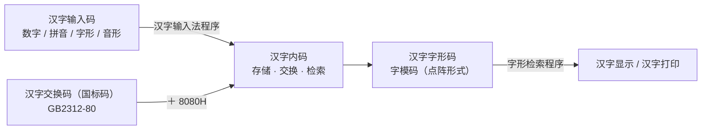

---
title: 计算机系统基础与组成原理-2 数据的机器级表示与运算
description: 从二进制编码与进位计数制讲起，经原码反码补码移码、整数加减乘除的电路实现、IEEE 754 浮点数的表示与运算，直到字节序与边界对齐。
category: 计算机科学
subject: 计算机科学
subfield: 计算机系统基础与组成原理
topic: 数据的机器级表示与运算
difficulty: 中等
date: "2026-11-17"
tags: [计算机系统, 计算机组成原理, 计算机系统基础, 机器级数据, 数值编码, 整数运算, 浮点数, 数据存储, "408"]
draft: false
featured: false
---

## 数制与编码

### 二进制编码概述

#### 采样与编码

现实世界中的信息（声音、图像、温度、文字）进入计算机要经过两步：

- **采样**——对连续信息采样，以使信息**离散化**
- **编码**——对离散样本用**二进制**，即用 **0 和 1 进行编码**

编码完成后的数据，按"打算怎么处理它"交由不同类别的指令处理：

| 数据类型 | 对应指令 |
| :--- | :--- |
| 定点数 | **定点运算指令** |
| 浮点数 | **浮点运算指令** |
| 逻辑值、位、字符 | **逻辑、位操作或字符处理指令** |

#### 二进制的优势

- **物理可实现性**：只有两种稳定状态（高/低电平、导通/截止、磁化正向/反向），造两态器件远比造十态器件简单可靠
- **编码、计数与运算规则最简单**，可用开关电路实现，算术运算能直接由逻辑门搭出来
- **与逻辑值天然对应**：0、1 正好对应假、真，逻辑运算与程序中的逻辑判断都顺手

既然机器内部只有二进制，为什么还要引入八进制与十六进制呢？因为**它们并不改变数值，只压缩书写**。一个八进制数码恰好对应 3 位二进制，一个十六进制数码恰好对应 4 位二进制——把冗长的二进制串 3 位或 4 位压成 1 个数码，人读写、查错都容易得多。

:::example 例 1 · 为什么用二进制
A. 物理器件特性所致　B. 节约元器件　C. 运算速度快　D. 信息处理方便

**答案：A**

**解析：** 二进制只有两种稳定状态，用有两个状态的物理器件即可表示，而制造两态器件远比制造多态器件容易可靠。B、C、D 都只是采用二进制之后的**结果**，不是**原因**。

:::


:::example 例 2 · 八/十六进制的目的

引入八进制和十六进制的目的是（　）
A. 用于等价地表示二进制，便于阅读和书写　
B. 可以表示更大范围的数　
C. 节约元件　
D. 实现方便

**答案：A**

**解析：** 八进制与十六进制**不改变数值的表示范围**（同样 32 位二进制无论写成八进制还是十六进制，能表示的数的个数一样），也不节省元件；它们的唯一作用是**把冗长的二进制串压缩成人类易读易写的形式**（3 位或 4 位压成 1 个数码）。
:::


#### 苏联的三进制计算机

二进制并不是唯一可行的方案，上世纪五六十年代，莫斯科国立大学研制了三进制计算机（Сетунь，Setun）

- 用**铁氧体磁芯和半导体二极管**组成可控电流变压器，具有**正电压（1）、零电压（0）、负电压（−1）** 三种状态；
- 相比二进制逻辑电路（真空管），它**速度更快、可靠性更高，需要的设备和电能也更少**；
- 但相比**集成电路**，它没有优势——因而最终没有成为主流。

> **说明：** 三进制在理论上"信息密度"更高（每一位携带 $\log_2 3 \approx 1.585$ bit，高于二进制的 1 bit），起点也领先。它输给二进制的原因不在理论，而在工程：二进制在**器件制造的可靠性、抗干扰容限**和**布尔代数这一成熟数学工具**上占优，而集成电路的成熟又进一步放大了这种优势。这提示一条通用的判断：**技术路线的胜负往往不取决于理论最优，而取决于工程实现的代价。**

### 进位计数制

#### 计数方法的演化

人类对"数"的记录方式，经历了从具体到抽象的演进：

- **远古时代**：结绳记事——用特定符号直接记数，一个绳结对应一个对象，**无权重概念**
- **中世纪**：罗马数字（I、V、X、…）——符号本身开始反映权重（V = 5、X = 10），但**位置不反映权重**
- **阿拉伯数字**（1、2、3、…）——符号反映权重，**所在位置也反映权重**。阿拉伯数字的关键突破在于发明了基于"乘法"思想的计数方法：每一位的数值 = 符号值 × 位置权重

正是这种"位权"思想，使得无论多大的数都能用少量符号紧凑地表示，也为后续二进制的发明奠定了基础

#### $R$ 进制通用定义

任何一个 $R$ 进制数，都由**基数**和**权**两个要素组成：

- **基数 $R$**：基数为 $R$ 的数制称为 **$R$ 进制数**。$R$ 进制数的主要特点就是**逢 $R$ 进 1**；基数也就是每个数位所用到的不同符号的个数
    - 例如：二进制的基数为 2（逢二进一），八进制为 8，十六进制为 16；古巴比伦发明的 60 进制计数法，其基数为 60
- **权 $W_i$**：权也称**位权**，指某一位 $i$ 上的数码的权重值，$W_i = R^i$。

例如：一个十进制数可表示为：

$$K_{n}K_{n-1}\dots K_{2}K_{1}K_{0}\cdot K_{-1}K_{-2}\dots K_{-m}$$

其值的大小为：

$$K_{n}\cdot 10^{n}+K_{n-1}\cdot 10^{n-1}+\cdots +K_{2}\cdot 10^{2}+K_{1}\cdot 10^{1}+K_{0}\cdot 10^{0}+K_{-1}\cdot 10^{-1}+K_{-2}\cdot 10^{-2}+\cdots +K_{-m}10^{-m}$$

称 $10^{i}\ (i=1,2,\dots ,n)$ 为**位权**。十进制计数法有 $0\sim 9$ 共 10 个符号，其核心思想为"逢十进一"。

把底数换成任意 $r$，就得到 $r$ 进制的通用展开式：

$$K_{n}K_{n-1}\dots K_{2}K_{1}K_{0}\cdot K_{-1}K_{-2}\dots K_{-m}=\sum_{i=-m}^{n}K_{i}\cdot r^{i}$$

:::example 例 1 · 同一数值的三种写法
- 二进制数 $101.1 \rightarrow 1\times 2^{2}+0\times 2^{1}+1\times 2^{0}+1\times 2^{-1}=5.5$
- 八进制数 $5.4 \rightarrow 5\times 8^{0}+4\times 8^{-1}=5.5$
- 十六进制数 $5.8 \rightarrow 5\times 16^{0}+8\times 16^{-1}=5.5$

**评注：** 同一个十进制值 $5.5$，在三种进制下的写法完全不同，这正是"数（抽象的值）"与"数的表示（具体的数码串）"的区别——**值不变，写法随基数变**。$\frac{1}{2}$ 在二进制里是干净的 $0.1$，在八进制里是 $0.4$，在十六进制里是 $0.8$，因为 $2^{-1}=8^{-1}\times 4=16^{-1}\times 8$。
:::


#### 常用数制的对应关系

| 十进制 | 二进制 | 八进制 | 十六进制 | 十进制 | 二进制 | 八进制 | 十六进制 |
| :---: | :---: | :---: | :---: | :---: | :---: | :---: | :---: |
| 0 | 0000 | 0 | 0 | 9 | 1001 | 11 | 9 |
| 1 | 0001 | 1 | 1 | 10 | 1010 | 12 | A |
| 2 | 0010 | 2 | 2 | 11 | 1011 | 13 | B |
| 3 | 0011 | 3 | 3 | 12 | 1100 | 14 | C |
| 4 | 0100 | 4 | 4 | 13 | 1101 | 15 | D |
| 5 | 0101 | 5 | 5 | 14 | 1110 | 16 | E |
| 6 | 0110 | 6 | 6 | 15 | 1111 | 17 | F |
| 7 | 0111 | 7 | 7 | 16 | 10000 | 20 | 10 |
| 8 | 1000 | 10 | 8 | | | | |

> **注意**：十六进制用 **A~F**（或 a~f）表示 10~15，计算前**先把字母换成数值**。八进制里没有"8"和"9"这两个数码——表中十进制 15 对应八进制 **17**，是因为 $15 = 1 \times 8 + 7$

#### 各种进制的常见书写方式

为避免混淆，不同进制各有书写约定，每种进制都有两种写法：**括号下标式**与**后缀字母式**

|  进制  |    括号下标式（格式一）    |      后缀式（格式二）       | 英文          | 说明                   |
| :--: | :--------------: | :-----------------: | :---------- | :------------------- |
| 二进制  | $(1010001000)_2$ |    $1010001000B$    | Binary      | 后缀 **B** 或 b         |
| 八进制  |    $(1652)_8$    |       $1652O$       | Octal       | 后缀 **O** 或 o         |
| 十进制  |  $(1652)_{10}$   |       $1652D$       | Decimal     | 后缀 **D** 或 d，**可省略** |
| 十六进制 |  $(1652)_{16}$   | $1652H$ 或 $0x 1652$ | Hexadecimal | 后缀 **H** 或 h         |

> **注意**：三种写法都可能出现，需能互相识别：括号下标式（$(1652)_{16}$）、后缀式（$1652H$）、**C 语言前缀式**（`0x1652`；八进制用前导 `0`，如 `01652`；十进制直接写 `1652`）。C 语言没有二进制字面量，需要二进制时只能写十六进制或用 `0b` 扩展（C23 起为标准）

---

#### 进制之间的转换

##### $R$ 进制转十进制

规则：把每一位的数码乘以其位权，再全部相加。

$$N = \sum_{i=-k}^{m-1} D_i \cdot R^i$$

:::example 例 1 · 按权展开

将 $(10101.01)_2$、$(307.6)_8$、$(3A.C)_{16}$ 分别转换成十进制；再将 $(10010010.110)_2$、$(251.5)_8$、$(AE86.1)_{16}$ 转换成十进制。
**思路：** 统一套用按权展开式，注意小数点右边从 $R^{-1}$ 起算；十六进制先把字母换成数值。

**解：**
- 第一组（小数位不多，重点在负数次幂）：
    - $(10101.01)_2 = 1 \times 2^4 + 0 \times 2^3 + 1 \times 2^2 + 0 \times 2^1 + 1 \times 2^0 + 0 \times 2^{-1} + 1 \times 2^{-2} = 16 + 4 + 1 + 0.25 = \mathbf{21.25}$
    - $(307.6)_8 = 3 \times 8^2 + 0 \times 8^1 + 7 \times 8^0 + 6 \times 8^{-1} = 192 + 7 + 0.75 = \mathbf{199.75}$
    - $(3A.C)_{16} = 3 \times 16^1 + 10 \times 16^0 + 12 \times 16^{-1} = 48 + 10 + 0.75 = \mathbf{58.75}$
- 第二组（整数位数多，重点在高次幂的展开）：
    - $10010010.110B = 1 \times 2^7 + 1 \times 2^4 + 1 \times 2^1 + 1 \times 2^{-1} + 1 \times 2^{-2} = \mathbf{146.25}$
    - $251.5O = 2 \times 8^2 + 5 \times 8^1 + 1 \times 8^0 + 5 \times 8^{-1} = \mathbf{168.625}$
    - $AE86.1H = 10 \times 16^3 + 14 \times 16^2 + 8 \times 16^1 + 6 \times 16^0 + 1 \times 16^{-1} = \mathbf{44678.0625}$

**评注：** 失分点集中在两处：① 十六进制里 $A = 10$、$C = 12$，**先把字母换成数值再算**；② 常用负次幂要记熟——$2^{-1} = 0.5$、$2^{-2} = 0.25$、$2^{-3} = 0.125$、$2^{-4} = 0.0625$、$8^{-1} = 0.125$、$16^{-1} = 0.0625$。另外 $(251.5)_8$ 的答案是 $168.625$ 而不是 $168.5$，就是因为 $5 \times 8^{-1} = 0.625$——**八进制的"半"是 0.4，不是 0.5**。
:::


##### 十进制转 $R$ 进制

| 部分 | 方法 | 关键 |
| :--- | :--- | :--- |
| **整数部分** | **除 $R$ 取余，求余倒序** | 直到**商为 0** |
| **小数部分** | **乘 $R$ 取整，不倒序** | 直到**积为 0** 或达到精度要求为止 |

设某十进制数的整数部分为

$$k_{n}r^{n}+k_{n-1}r^{n-1}+\cdots +k_{1}r^{1}+k_{0}r^{0}$$

把它除以 $r$：

$$\frac{k_{n}r^{n}+k_{n-1}r^{n-1}+\cdots +k_{1}r^{1}+k_{0}r^{0}}{r} = k_{n}r^{n-1}+k_{n-1}r^{n-2}+\cdots +k_{1}r^{0}\ \cdots\ k_{0}$$

即**商** $= k_{n}r^{n-1}+k_{n-1}r^{n-2}+\cdots +k_{1}$，**余数** $= k_{0}$。也就是说，**第一次除得的余数就是最低位** $k_0$，它被"挤"出来了；再对商除以 $r$，依次求得 $k_{1}, k_{2}, \dots$，直到商为 0。所以余数的读出顺序与求得顺序相反——这就是"倒序"的来历

:::example 例 2 · 除基取余

$75D = ?B$
**思路：** 不断除以 2，记下每次余数，直到商为 0，然后把余数**从下往上**读。

**解：**
$$\begin{aligned} 75 \div 2 &= 37 \cdots 1\ (k_0) \\ 37 \div 2 &= 18 \cdots 1\ (k_1) \\ 18 \div 2 &= 9 \cdots 0\ (k_2) \\ 9 \div 2 &= 4 \cdots 1\ (k_3) \\ 4 \div 2 &= 2 \cdots 0\ (k_4) \\ 2 \div 2 &= 1 \cdots 0\ (k_5) \\ 1 \div 2 &= 0 \cdots 1\ (k_6) \end{aligned}$$

从下往上读余数：$75D = 1001011B$。

**评注：** 也可以使用竖式（短除法）进行计算——注意右边那一列余数是**自下而上**拼成结果的：
```text
    2 | 75
      | 37 ... 1
      | 18 ... 1
      | 9  ... 0
      | 4  ... 1
      | 2  ... 0
      | 1  ... 0
      | 0  ... 1
```
随手验算：$1001011B = 64 + 8 + 2 + 1 = 75$ ✓。**会验算比会算更重要**
:::


##### 十进制转 $R$ 进制（小数部分）

设某十进制数的小数部分为

$$k_{-1}r^{-1}+k_{-2}r^{-2}+\cdots +k_{-m}r^{-m}$$

乘以 $r$：

$$(k_{-1}r^{-1}+k_{-2}r^{-2}+\cdots +k_{-m}r^{-m})\times r = k_{-1}r^{0}+k_{-2}r^{-1}+\cdots +k_{-m}r^{-(m-1)}$$

乘积的**整数部分即为 $k_{-1}$**——它是被"抬"到整数位的最高小数位。继续对新的小数部分乘以 $r$，依次求得 $k_{-2}, k_{-3}, \dots$。所以小数部分是**顺着读**的：求得顺序就是位的顺序。

> **为什么一个倒序、一个不倒序？** 因为整数部分是"除"出来的——第一次除得的余数是**最低位** $k_0$，所以要倒着读；小数部分是"乘"出来的——第一次乘得的整数部分是**最高位** $k_{-1}$，所以顺着读即可。这一条想通了就永远不会弄反。

:::example 例 3 · 乘基取整与无限循环

$0.3D = ?B$
**思路：** 不断乘 2，取整数部分作为下一位小数，用剩下的小数部分继续乘。

**解：**
$$\begin{aligned} 0.3 \times 2 &= 0.6,\ \text{取}0\ (k_{-1}) \\ 0.6 \times 2 &= 1.2,\ \text{取}1\ (k_{-2}) \\ 0.2 \times 2 &= 0.4,\ \text{取}0\ (k_{-3}) \\ 0.4 \times 2 &= 0.8,\ \text{取}0\ (k_{-4}) \\ 0.8 \times 2 &= 1.6,\ \text{取}1\ (k_{-5}) \end{aligned}$$

之后开始循环（$0.6 \to 1.2 \to 0.4 \to 0.8 \to 1.6 \to 1.2 \dots$），因此 $0.3$ 在二进制表示下为**无限循环小数**：$0.3D = 0.01001\dots B$。

**评注：** 这说明**十进制有限小数在二进制中可能变成无限小数**——这也是浮点数精度问题的根源之一，将在 §2.4 正面处理。判断"转几次能转完"有个简便法则：小数部分的分母约简后若只含基数的质因子，就能转完。$0.5 = 1/2$、$0.75 = 3/4$、$0.875 = 7/8$ 都能转完；$0.3 = 3/10$ 含因子 5，二进制（基 2）转不完；$0.2 = 1/5$ 同样转不完。
:::


前面说小数部分"乘 $R$ 取整直到积为 0"，但**积并不总会变成 0**。当积不会为 0，或转化后位数很长时，就只能由**精度要求**反过来决定保留几位小数。这是本节唯一一个"答案不唯一、需要按给定条件推"的知识点

**判据**：若要求转换误差小于给定的 $\varepsilon$，则只需保留 $k$ 位二进制小数，其中 $k$ 取满足下式的最小整数：

$$2^{-k} \le \varepsilon$$

直接截断（丢弃多余小数位）时，被丢掉的最高位权重是 $2^{-(k+1)}$，因此误差严格小于第 $k$ 位的权重 $2^{-k}$。所以只要 $2^{-k}$ 本身不大于要求的精度上限，保留 $k$ 位就一定达标。

| 精度要求 $\varepsilon$ | 需保留位数 $k$ | 核对截断误差上限 $2^{-k}$ |
| :--- | :---: | :--- |
| $0.1$ | 4 | $2^{-4} = 0.0625 < 0.1$ ✓（而 $2^{-3} = 0.125 > 0.1$ ✗）|
| $0.05$ | 5 | $2^{-5} = 0.03125 \le 0.05$ ✓（而 $2^{-4} = 0.0625 > 0.05$ ✗）|
| $0.01$ | 7 | $2^{-7} = 0.0078125 \le 0.01$ ✓（而 $2^{-6} = 0.015625 > 0.01$ ✗）|

:::example 例 4 · 精度定位数

将 $(114.35)_{10}$ 转换成二进制，要求转换误差小于 $0.1$。
**思路：** 整数部分照常除 2 取余；小数部分先按"乘 2 取整"算下去（会发现积永远不会变成 0），再由 $2^{-k} < 0.1$ 定出保留位数，最后截断。

**解：**
- 整数部分 114：$114 \div 2 = 57 \cdots 0$，$57 \div 2 = 28 \cdots 1$，$28 \div 2 = 14 \cdots 0$，$14 \div 2 = 7 \cdots 0$，$7 \div 2 = 3 \cdots 1$，$3 \div 2 = 1 \cdots 1$，$1 \div 2 = 0 \cdots 1$；余数倒序读得 $1110010$
- 小数部分 0.35：$0.35 \times 2 = 0.7$ 取 0，$0.7 \times 2 = 1.4$ 取 1，$0.4 \times 2 = 0.8$ 取 0，$0.8 \times 2 = 1.6$ 取 1，……此后进入循环，**积不会为 0**
- 定位数：$2^{-4} = 0.0625 < 0.1$，故保留 **4 位**小数即可满足要求
- 截断得 $(114.35)_{10} \approx (1110010.0101)_2$

**评注：** 验算截断误差——$(0.0101)_2 = 0.25 + 0.0625 = 0.3125$，而 $0.35 - 0.3125 = 0.0375 < 0.1$ ✓。注意"取 4 位"依据的是**第 4 位的权重 $2^{-4}$**，不是实际误差 $0.0375$——**判据给的是误差上限，实际误差可能更小**
:::


:::example 例 5 · 精度 + 反算 + 误差

将 $(0.3)_{10}$ 转换成二进制数 $X$，并使其误差不大于 $0.05$。请确定 $X$ 的保留位数，将 $X$ 再转换回十进制数 $Y$，并计算 $Y$ 与 $0.3$ 之间的误差。
**思路：** 三步——① 由 $2^{-k} \le 0.05$ 定保留位数；② 乘 2 取整得到 $X$（各位数码见例3）；③ 按权展开求出 $Y$，作差得误差。

**解：**
- 定位数：$2^{-4} = 0.0625 > 0.05$（不够），$2^{-5} = 0.03125 \le 0.05$（够）⇒ 保留 **5 位**小数
- 求 $X$：取例3 的前 5 位 ⇒ **$X = 0.01001$**
- 求 $Y$：$Y = (0.01001)_2 = 2^{-2} + 2^{-5} = 0.25 + 0.03125 = \mathbf{0.28125}$
- 求误差：$0.3 - 0.28125 = \mathbf{0.01875}$

**参考答案：** 保留 5 位；二进制数 $X = 0.01001$；十进制数 $Y = 0.28125$；转换误差 $= 0.01875$。

**评注：** $0.3$ 在二进制下是**无限循环小数**（例3 已验证），因此无论保留多少位都不可能精确表示——**这正是浮点数精度问题的总根源**，也是"$0.1 + 0.2 \ne 0.3$"这类反直觉结果在机器层面的原因，将在 §2.4 正面回答。考试中"确定保留位数"一定要先写 $2^{-k}$ 与 $\varepsilon$ 的比较，再写二进制结果——只写结果不得分。
:::


##### 二进制与八进制、十六进制的快捷互换

由于 $2^3 = 8$、$2^4 = 16$，二进制与八进制、十六进制之间存在**分组对应**关系，可以完全绕开十进制：

| 转换方向 | 规则 |
| :--- | :--- |
| 二进制 → 八进制 | **3 位一组**，每组转换成对应的八进制数码 |
| 二进制 → 十六进制 | **4 位一组**，每组转换成对应的十六进制数码 |
| 八进制 → 二进制 | 每位八进制数码展开为 **3 位**二进制 |
| 十六进制 → 二进制 | 每位十六进制数码展开为 **4 位**二进制 |

- 例如：$111100010B \rightarrow 111\ 100\ 010 \rightarrow 742O$
- 例如：$11110010B \rightarrow 1111\ 0010 \rightarrow F2H$
- 例如：$251.5O = 010\ 101\ 001\ .101B$
- 例如：$AE86.1H = 1010\ 1110\ 1000\ 0110\ .0001B$

> **注意**：分组一律**以小数点为中心分别向两边进行**。整数部分从**低位向高位**分组，小数部分从**高位向低位**分组；位数不足时在**最左侧（整数）或最右侧（小数）补 0**。

> **提示**：反过来（八/十六进制 → 二进制）展开时，**最高位和最低位的 0 可以略去**——如 $(13.724)_8$ 展开得 $001011.111010100$，首尾的 0 去掉即为 $1011.1110101$。这与"补 0"是同一件事的两面：补 0 不改变数值，去 0 也不改变数值。

举个完整的对照（以 $(1111000.111)_2$ 为例）：

```text
整数 1111000  →  001 111 000  →  1 7 0
小数 .111     →  .111          →       .7      ⇒ 170.7 O

整数 1111000  →  0111 1000     →  7 8
小数 .111     →  .1110         →     .E        ⇒ 78.E H
```

:::example 例 6 · 综合转换与互验

$(123.75)_{10} = (?)_{2} = (?)_{8}$
**思路：** 整数部分 123 用除基取余法；小数部分 0.75 用乘基取整法；两个结果拼起来。转八进制同理，只是基数为 8。

**解：** 先转二进制——
- 整数部分 123：$123 \div 2 = 61 \cdots 1$，$61 \div 2 = 30 \cdots 1$，$30 \div 2 = 15 \cdots 0$，$15 \div 2 = 7 \cdots 1$，$7 \div 2 = 3 \cdots 1$，$3 \div 2 = 1 \cdots 1$，$1 \div 2 = 0 \cdots 1$；余数倒序读得 $1111011$
- 小数部分 0.75：$0.75 \times 2 = 1.5$ 取 1，$0.5 \times 2 = 1.0$ 取 1（积已为 0，结束）；整数顺读得 $11$
- 合并：$(123.75)_{10} = (1111011.11)_2$

再转八进制（$R = 8$）——
- 整数部分 123：$123 \div 8 = 15 \cdots 3$，$15 \div 8 = 1 \cdots 7$，$1 \div 8 = 0 \cdots 1$；倒序读得 $173$
- 小数部分 0.75：$0.75 \times 8 = 6.0$ 取 6（积已为 0，结束）；顺读得 $6$
- 合并：$(123.75)_{10} = (173.6)_8$

**评注：** 两个结果可以互验：$(1111011.11)_2$ 每 3 位分组即 $001\ 111\ 011 \cdot 110 = 173.6_8$，与"除 8 取余"的结果一致。**会用两种方法互验，是这一节最实用的自查手段。**
:::


:::example 例 7 · 分组捷径

$(120.875)_{10} = (?)_{2} = (?)_{8} = (?)_{16}$
**思路：** 先转二进制（除 2 取余 + 乘 2 取整），再用分组法得到八进制与十六进制——比"除 8 取余""除 16 取余"各算一遍快得多。

**解：**
- 整数部分 120：$120 \div 2 = 60 \cdots 0$，$60 \div 2 = 30 \cdots 0$，$30 \div 2 = 15 \cdots 0$，$15 \div 2 = 7 \cdots 1$，$7 \div 2 = 3 \cdots 1$，$3 \div 2 = 1 \cdots 1$，$1 \div 2 = 0 \cdots 1$；倒序读得 $1111000$
- 小数部分 0.875：$0.875 \times 2 = 1.75$ 取 1，$0.75 \times 2 = 1.5$ 取 1，$0.5 \times 2 = 1.0$ 取 1；顺读得 $111$
- 故 $(120.875)_{10} = (1111000.111)_2$
- 转八进制（每 3 位一组）：$001\ 111\ 000 \cdot 111 \Rightarrow (170.7)_8$
- 转十六进制（每 4 位一组）：$0111\ 1000 \cdot 1110 \Rightarrow (78.E)_{16}$

**评注：** 验算——$(170.7)_8 = 64 + 56 + 0.875 = 120.875$ ✓；$(78.E)_{16} = 112 + 8 + 0.875 = 120.875$ ✓。注意小数部分分组时**从高位向低位、位数不足在最右侧补 0**（$0.111 \to 0.1110$ 补成 4 位）。
:::


---

### 十进制数的表示

十进制数处在"人机交界"上最尴尬的位置：人习惯十进制，机器只会二进制。要让机器"按十进制的方式"处理十进制数，有两条截然不同的路——**把它当字符串（ASCII 码字符表示）**，或者**给每一位十进制数字单独配一个二进制码（BCD 码表示）**。前者实现简单却几乎无法参与运算，后者专为运算而生却要多占空间

#### 用 ASCII 码字符表示

最直接的做法是**把十进制数看成字符串，直接用 ASCII 码表示**：

- `0` ~ `9` 分别对应 **30H ~ 39H**；
- 1 位十进制数对应 **8 位**二进制数；
- **高 4 位含有非数值信息，运算不方便**。

| 十进制数字 | ASCII 码（十六进制） | ASCII 码（8 位二进制） | 高 4 位 | 低 4 位 |
| :---: | :---: | :---: | :---: | :---: |
| 0 | 30H | 0011 0000 | 0011 | 0000 |
| 1 | 31H | 0011 0001 | 0011 | 0001 |
| 2 | 32H | 0011 0010 | 0011 | 0010 |
| 3 | 33H | 0011 0011 | 0011 | 0011 |
| 4 | 34H | 0011 0100 | 0011 | 0100 |
| 5 | 35H | 0011 0101 | 0011 | 0101 |
| 6 | 36H | 0011 0110 | 0011 | 0110 |
| 7 | 37H | 0011 0111 | 0011 | 0111 |
| 8 | 38H | 0011 1000 | 0011 | 1000 |
| 9 | 39H | 0011 1001 | 0011 | 1001 |

每位数字占满 1 字节（8 位），但**真正携带数值信息的只有低 4 位**，高 4 位恒为 `0011`（也就是十六进制的 3）。这直接导致了"运算不方便"的三重代价：

1. **空间浪费一半**：10 个数字只需 4 位就能区分，却占了 8 位；
2. **不能直接参与运算**：ASCII 码不遵守十进制进位规则——`'9' + 1` 得到 3AH（字符 `':'`），而不是 `'0'`，所以"12 + 34"必须先逐位剥离高 4 位、还原成数值、按权求和，算完再转回字符串；
3. **需要解析与格式化**：这正是 `printf` / `scanf` 中 `%s` 与 `%d` 的差别所在，也是字符串 `"123"`（占 3 字节）与整数 `123`（`int` 占 4 字节）在内存中完全不同的原因。

:::example 例 1 · ASCII 表示

十进制数 $123$ 用 ASCII 码字符表示时，在内存中是什么样子？
**思路：** 逐个数字字符查表，每个数字占 1 字节。

**解：** `1` → 31H，`2` → 32H，`3` → 33H，故内存中为
```text
31H  32H  33H
0011 0001  0011 0010  0011 0011
```
共占 3 字节。

**评注：** 对比一下：把 $123$ 当作整数存进 `int`，内存中是 `7BH 00H 00H 00H`（小端序，共 4 字节，字节序见 §2.6.1）——**同一个十进制数 $123$，两种表示的字节内容和长度都不一样**。这就是 CSO-1 开篇案例④"同名全局变量读错"那类问题的底层土壤：类型不同，内存布局就不同。
:::


#### 用 BCD 码表示

**BCD**（Binary Coded Decimal，二-十进制编码）的思路是：**用二进制表示数字 0~9，每 4 位二进制编码 1 位十进制数字**。因为它一次编码一位十进制数字，所以不存在"进制换算"的问题，十进制小数点位置与二进制分组边界天然对齐——这就是它"运算方便"的根源。

BCD 码**存在多种编码方案**，按"每一位编码是否都有固定权值"分成两大类：

| 类别 | 定义 | 代表编码 |
| :--- | :--- | :--- |
| **有权 BCD 码** | 编码的每一位都有固定的权值，**加权求和的值即是表示的十进制数字** | 8421 码、2421 码、5211 码、4311 码、84-2-1 码 |
| **无权 BCD 码** | 编码的每一位并没有固定的权 | 格雷码、余 3 码 |

##### 有权 BCD 码

各有权码的差别就在"四位各自的权是多少"：

| 编码名称 | 各位权值（从左到右） | 特点 |
| :--- | :--- | :--- |
| **8421 码** | 8　4　2　1 | 最常用，就是 0~9 的**自然二进制码** |
| **2421 码** | 2　4　2　1 | 对 9 自补（0↔9、1↔8…可按位取反互相得到）|
| **5211 码** | 5　2　1　1 | 对 9 自补 |
| **4311 码** | 4　3　1　1 | 部分十进制数字有**多种合法编码**（非唯一）|
| **84-2-1 码** | 8　4　−2　−1 | 含**负权值**，对 9 自补 |

最常用的 8421 码与两个自补码的完整编码表：

| 十进制 | 8421 码 | 2421 码 | 5211 码 |
| :---: | :---: | :---: | :---: |
| 0 | 0000 | 0000 | 0000 |
| 1 | 0001 | 0001 | 0001 |
| 2 | 0010 | 0010 | 0011 |
| 3 | 0011 | 0011 | 0101 |
| 4 | 0100 | 0100 | 0111 |
| 5 | 0101 | 1011 | 1000 |
| 6 | 0110 | 1100 | 1010 |
| 7 | 0111 | 1101 | 1100 |
| 8 | 1000 | 1110 | 1110 |
| 9 | 1001 | 1111 | 1111 |
| *（非法）* | 1010~1111 共 6 个 | 0000~1111 中另有 6 个未用 | 另有 6 个未用 |

**验证方法**：把编码的每一位乘上它对应的权再相加，结果应当等于该十进制数字。例如 2421 码中 5 → 1011：$1 \times 2 + 0 \times 4 + 1 \times 2 + 1 \times 1 = 5$ ✓；5211 码中 3 → 0101：$0 \times 5 + 1 \times 2 + 0 \times 1 + 1 \times 1 = 3$ ✓。

> **延伸**：所谓"**对 9 自补**"是指 $n$ 与 $9-n$ 的编码恰好逐位取反。以 2421 码为例，0(0000) 与 9(1111)、1(0001) 与 8(1110)、2(0010) 与 7(1101)、3(0011) 与 6(1100)、4(0100) 与 5(1011) 都满足"逐位取反"。这一性质的工程价值在于：**求十进制补数（做减法）只需按位取反，不需要借位电路**——这是早期计算器与商用机偏爱自补码的原因。

##### 无权 BCD 码

无权码的每一位**没有固定权值**，因此不能靠"加权求和"求值，只能查表。代表是**余 3 码**与**格雷码**。

**余 3 码**：在 8421 码的基础上**加 3（即加 0011）** 得到，故名"余 3"。

| 十进制 | 8421 码 | 余 3 码 |
| :---: | :---: | :---: |
| 0 | 0000 | 0011 |
| 1 | 0001 | 0100 |
| 2 | 0010 | 0101 |
| 3 | 0011 | 0110 |
| 4 | 0100 | 0111 |
| 5 | 0101 | 1000 |
| 6 | 0110 | 1001 |
| 7 | 0111 | 1010 |
| 8 | 1000 | 1011 |
| 9 | 1001 | 1100 |

余 3 码有三个值得一提的性质：**① 无权**（不能加权求值，只能查表）；**② 对 9 自补**（0 的 0011 与 9 的 1100 逐位取反即得）；**③ 不含全 0 码**——任何一个合法编码里至少有一个 1，因此"全 0"可以安全地用作"线路故障或数据缺失"的标志。

**格雷码**（Gray code，又称循环码、单位距离码）：任意两个**相邻**编码之间**只有一位不同**。它不用于算术运算，而是用于**消除计数与位置检测中的过渡噪声**：普通二进制计数在 3→4（0011→0100）时三位同时跳变，若各条信号线的延迟不同，瞬间可能读出 0111 之类的假值；格雷码每次只变一位，从根本上消除了这种"多位同时翻转"的风险，因此广泛用于旋转编码器、异步 FIFO 指针、卡诺图与状态机编码。

:::example 例 2 · BCD 编码与解码
**（一）** 用 8421 码和余 3 码表示十进制数 $59$。
**（二）** 已知某 8421 码为 $0110\ 1000$，求其表示的十进制数。

**思路：** BCD 码"一位十进制数字 = 一组 4 位二进制"，所以编码时逐位查表拼接，解码时每 4 位一切、逐组查表。

**解：**
- **（一）** 8421 码：$5 \to 0101$，$9 \to 1001$ ⇒ $0101\ 1001$；余 3 码：$5 \to 5+3=8 \to 1000$，$9 \to 9+3=12 \to 1100$ ⇒ $1000\ 1100$
- **（二）** 每 4 位一组：$0110 = 6$，$1000 = 8$ ⇒ $68$

**评注：** BCD 码的**分组边界是"从十进制位"而不是"从数值大小"**决定的，这正是它相对纯二进制的优势——十进制小数点落在什么位置，BCD 的分组边界就落在什么位置，不需要像纯二进制那样做进制换算。反过来也要警惕一个高频错误：**BCD 码不是二进制数**。十进制 $25$ 的 8421 码是 $0010\ 0101$，而 $25$ 的二进制是 $11001$，两者完全不同；如果误把 $0010\ 0101$ 当二进制算，得到的是 $37$。
:::


> **注意**：8421 码里 **1010~1111 这 6 种组合是非法（冗余）码**——4 位二进制虽有 16 种组合，但十进制数字只有 10 个。一旦在数据里读出 1010~1111，说明该组数据已经损坏，或上一次 BCD 运算没有做修正。这正是 BCD 加法必须"**加 6 修正**"的原因：$9 + 1 = 1010$（非法），加 0110 得 $1\ 0000$，即"本位 0、向高位进 1"

> **延伸**：BCD 码的典型应用场合是**需要精确十进制舍入**的地方——金融计息、商业票据、计算器，以及 x86 早期用于 BCD 调整的 `DAA` / `DAS` / `AAA` / `AAS` 指令。原因是二进制浮点无法精确表示 $0.1$，而 BCD 码可以精确表示任意十进制小数——**"要精确的十进制，就别用二进制浮点"**，这是 BCD 至今没有被淘汰的根本理由

#### 两种表示方式的对比与选择

| 对比维度 | ASCII 码字符表示 | BCD 码表示 |
| :--- | :--- | :--- |
| **编码单位** | 1 位十进制数字 = **1 字节（8 位）** | 1 位十进制数字 = **半字节（4 位）** |
| **空间效率** | 低（有效位只占一半） | 高（无浪费位） |
| **能否直接运算** | **不能**（不遵守十进制进位规则） | **能**（有专门的 BCD 调整运算） |
| **输出为文本** | 直接可用（本身就是字符） | 需要一次转换 |
| **非法码** | 无（任何一字节都是合法 ASCII） | 有（8421 码中 1010~1111 非法） |
| **典型用途** | 字符串输入输出、文本文件 | 精确十进制计算、金融与商业数据处理 |

---

### 非数值数据的编码表示

前面所有内容都围绕"数值"展开——它们的编码必须满足算术运算的规则。但机器里还存着大量**非数值数据**：逻辑值、字符、汉字、声音、图像。这类数据的编码不需要满足"加法"的约束，它们只需要保证一件事：**同一个符号在任何一台机器上都被解成同一个符号**

#### 逻辑值

逻辑值只有"真"和"假"两种状态，因此**用 1 位表示就够**（通常约定 1 表示真、0 表示假）。但机器的最小可寻址单位是字节，所以实际存储时往往用一个字节甚至一个字来表示一个逻辑值——C 语言里 `bool`、C 习惯用 `int` 存真假，就是这条规则的遗迹。

比"单个逻辑值"更有价值的是**位向量**（bit vector）：把 $n$ 位拼在一起，**每一位代表一个独立的是/否判断**。于是"$n$ 个布尔量"就被压缩进 $n$ 位，而"对集合求交、并、补"这些操作恰好对应"按位与、或、非"——**位向量与集合是同构的**。这就是位图（bitmap）、位集合（bitset）、权限掩码、以及算法竞赛中"状态压缩"的共同原理。

> **相关链接**：逻辑运算的具体门电路（与门/或门/非门/异或门、复合逻辑、多路选择器与三态门）见数电课程；C 语言里 `&` / `|` / `^` / `~` / `<<` / `>>` 的用法与优先级陷阱见 [C++程序设计基础-2 数据类型与运算符](/notes/cpp-2-data-types-and-operators/)；位运算在竞赛中的经典技巧（lowbit、mask 枚举子集、bitset）见 AC-6 位运算与机器数的竞赛应用

#### 西文字符的编码表示

西文字符之所以能用很少几位编码，源于它自身的语言特点：

- 是一种**拼音文字**，用有限几个字母可拼写出所有单词；
- 只对**有限个**字母和数学符号、标点符号等辅助字符编码；
- 所有字符总数不超过 256 个，使用 **7 或 8 个二进位**可表示。

**表示**（常用编码为 **7 位 ASCII 码**）分为四类：

| 类别 | 内容 |
| :--- | :--- |
| **十进制数字** | `0` / `1` / `2` … / `9` |
| **英文字母** | `A` / `B` / … / `Z`、`a` / `b` / … / `z` |
| **专用符号** | `+` / `−` / `%` / `*` / `&` …… |
| **控制字符**（不可打印或显示） | 换行、回车、退格、响铃、`ESC` 等 |

**操作**：字符数据的主要操作是**字符串操作**，如传送、比较等。

常用 ASCII 码值：

| 字符 | ASCII（十六进制） | ASCII（7 位二进制） | 说明 |
| :--- | :---: | :---: | :--- |
| `NUL` | 00H | 000 0000 | 空字符，C 语言字符串结束标志 `'\0'` |
| `LF` | 0AH | 000 1010 | 换行 `'\n'` |
| `CR` | 0DH | 000 1101 | 回车 `'\r'` |
| 空格 `' '` | 20H | 010 0000 | |
| `'0'` ~ `'9'` | 30H ~ 39H | 011 0000 ~ 011 1001 | 数字字符（10 个连续）|
| `'A'` ~ `'Z'` | 41H ~ 5AH | 100 0001 ~ 101 1010 | 大写字母（26 个连续）|
| `'a'` ~ `'z'` | 61H ~ 7AH | 110 0001 ~ 111 1010 | 小写字母（26 个连续）|

必须记牢的**规律**：

1. **数字字符的"溢出"性质**：`'0'`~`'9'` 的 ASCII 码低 4 位恰好等于该数字本身（30H + n），所以 `'5' - '0' = 5` 成立——这是 C 语言里"字符转数字"的标准写法
2. **大小写只差一位**：同一字母的大写与小写码值**相差 20H = 32**，也就是第 5 位（$2^5$ 权位）是"大小写位"。小写转大写只需把该位清零
3. **7 位与 8 位**：7 位 ASCII 共可表示 $2^7 = 128$ 个字符（编码 0~127）；实际存储时占 **1 字节（8 位）**，最高位通常补 0，也可用作奇偶校验位——这就是"使用 7 或 8 个二进位可表示"的原因：**128 个字符远少于 256，8 位绰绰有余**

:::example 例 1 · ASCII 码值推算

已知字符 `'a'` 的 ASCII 码为 61H。
**（一）** 求 `'f'` 的 ASCII 码（十六进制）。
**（二）** 求 `'A'` 与 `'a'` 的 ASCII 码之差（十进制）。
**（三）** 求字符串 `"Hello"` 在内存中占多少字节（不含结束符）。

**思路：** 不查表，直接用"连续性"规律推算：字母在编码表中是**连续排列**的，序号差就是码值差。

**解：**
- **（一）** `'a'` → `'f'` 相差 5 个序号 ⇒ `'f'` = 61H + 5 = **66H**
- **（二）** `'A'` = 41H，`'a'` = 61H ⇒ 61H − 41H = 20H = **32**
- **（三）** 5 个字符各占 1 字节 ⇒ **5 字节**（这是 C 字符串"长度"的概念；若按 C 字符串的实际存储量算，还要加上结束符 `'\0'`，共 6 字节）

**评注：** 第（一）问考的是"字母连续"，第（二）问考的是"大小写差 20H"——这两条规律配合 `'0'` 的低 4 位性质，就足以覆盖绝大多数 ASCII 码推算题，不必背全表。第（三）问是"字符数 vs 字节数"的区分点：**ASCII 编码下 1 字符 = 1 字节，但这个等式在汉字（1 汉字 = 2 字节）和 UTF-8（1 汉字 = 3 字节）下都不成立**，这是后面长度计算题的常见陷阱。
:::


#### 汉字编码

汉字与西文有一个本质差别：**字符数量太多**。西文用 128 个 ASCII 码就够了，汉字光国标基本集就有 6763 个——这决定了汉字不可能像 ASCII 那样"一个字符一个码"，而必须把"输入—交换—存储—输出"拆成几套彼此配合的编码



##### 汉字输入码

**定义**：汉字输入的编码，**由西文字符组合而成**

**类型**：数字编码、拼音编码、字形编码、音形编码

**本质**：输入码是"**给人用的**"编码。同一个汉字可以有多种输入码——"中"既可以是拼音 `zhong`，也可以是五笔的 `khk`，还可以是区位号。输入码由键盘上已有的西文字符拼成，所以它**不是机内存储用的编码**，只是"人→机"这一段的临时表示，经汉字输入法程序转换后即被丢弃

##### 汉字交换码（国标码）

**定义**：是指**不同的具有汉字处理功能的计算机系统之间在交换汉字信息时所使用的代码标准**

**标准来源**：目前国内计算机系统所采用的标准信息处理交换码，是基于 **1980 年制定的国家标准《信息交换用汉字编码字符集·基本集》（GB2312-80）** 修订的国标码。

**字符集规模**：该字符集共收录了 **6763 个汉字**和 **682 个图形符号**。6763 个汉字按其使用频率和用途，又可分为：

| 分类 | 数量 | 排列方式 |
| :--- | :---: | :--- |
| **一级常用汉字** | 3755 | 按**拼音字母顺序**排列 |
| **二级次常用汉字** | 3008 | 按**偏旁部首**排列 |
| 合计 | 6763 | |

**编码方式**：采用**两个字节**对每个汉字进行编码，**每个字节各取七位**，这样可对 $128 \times 128 = 16384$ 个字符进行编码

> **为什么"两个字节各取七位"能表示 16384 个字符**：每个字节用 7 位 ⇒ 单字节有 $2^7 = 128$ 种取值；两个字节组合 ⇒ $128 \times 128 = 16384$ 种。这既覆盖了 6763 个汉字 + 682 个符号（共 7445 个，约占 45%），又为扩展留了余量。注意 $3755 + 3008 = 6763$ ✓，这个加法常被用来验算记忆。

##### 汉字内码

**定义**：用于汉字信息的**存储、交换、检索**等操作的**机内代码**，一般采用**两个字节**表示。

**核心关系式**：

$$\text{汉字机内码} = \text{汉字国标码} + \text{8080H}$$

> **延伸：为什么要加 8080H**——国标码的每个字节只用了低 7 位，取值范围是 00H~7FH，**与 ASCII 码的取值范围完全重叠**。这意味着机器拿到一个字节时无法判断它是"一个 ASCII 字符"还是"某个汉字的一半"。给两个字节各加 80H（即把最高位置 1）之后，汉字内码的两个字节都 ≥ 80H，而 ASCII 码都 ≤ 7FH，两者被彻底分开。反过来说，**中文环境下"半个汉字乱码"的根源也在这里**：程序若按单字节处理，只截取了汉字内码的一半，剩下的那一半就会被当成非法字符或另一个 ASCII 字符显示出来。

> **延伸：完整的编码链条还包含区位码**——GB2312 把 7445 个字符安排在 $94 \times 94$ 的二维表中：行号叫"**区**"（1~94 区），列号叫"**位**"（1~94 位），（区号，位号）即区位码。换算关系为：
> $$\text{国标码} = \text{区位码} + 2020\text{H}, \qquad \text{内码} = \text{国标码} + 8080\text{H} = \text{区位码} + \text{A0A0H}$$
> 两步各加 20H 与 80H，都是"把字节推出 ASCII 区间"的同一手法：加 20H 是为了避开 ASCII 的**控制字符区**（00H~1FH），加 80H 是为了避开**全部 ASCII 区**（00H~7FH）。

> **延伸：GB2312 之后**——GB2312 只收 6763 个汉字，人名、古籍、方言用字大量缺字；GBK 扩到 21886 个字符，向下兼容 GB2312；GB18030 再扩到七万余字并覆盖全部 Unicode 码位。而 Unicode 的思路更进一步：**只给每个字符分配一个抽象编号（码点）**，具体怎么存进字节由 UTF-8 / UTF-16 等 **实现方式**决定——这正是下面那条设计原则的现代版本。

##### 汉字字形码

**定义**：**最基本、应用最广泛的是字模码**，用**点阵形式**表示和存储汉字字形代码

**本质**：字形码是"**画**"出来的——把一个汉字看成一个 $m \times n$ 的点阵，有笔画的位置记 1、无笔画记 0，于是整个字变成一串位图

| 点阵规格 | 位数 | 占用字节 | 说明 |
| :---: | :---: | :---: | :--- |
| 16 × 16 | 256 | **32 字节** | 最常见的显示用点阵 |
| 24 × 24 | 576 | **72 字节** | 打印常用，字形更清晰 |
| 32 × 32 | 1024 | **128 字节** | 高质量打印 |

**点阵越密，字形越清晰，占用的存储空间也越大**——这是"清晰度换空间"的又一例权衡。输出时，系统经**字形检索程序**按汉字内码取出对应的字形码点阵，分别送往显示或打印

:::example 例 2 · 点阵字库容量

一个 16 × 16 点阵的汉字字库，收 6763 个汉字，共需多少 KB 存储空间？
**思路：** 先算单字点阵占多少字节，再乘字数。

**解：** 单字 $16 \times 16 = 256$ 位，$256 \div 8 = 32$ 字节；$6763 \times 32 = 216416$ 字节 $\approx 211$ KB。

**评注：** 换到 24 × 24 点阵就是 $6763 \times 72 = 486936$ 字节 $\approx 476$ KB——**点阵规格每提高一档，字库体积成倍增长**，所以手机与嵌入式设备常只带一套小点阵字库，其余字形按需下载或用矢量字体（轮廓描述）现算。
:::


> **通用设计原则：** 汉字的四套编码（输入码 / 交换码 / 内码 / 字形码）各自优化各自的目标：输入码优化"人打得快"，交换码优化"不同系统间不出错"，内码优化"机器存得省、查得快"，字形码优化"输出好看"。**把不同用途的表示分离，让每一套各司其职**，这是编码设计里反复出现的思想——现代 Unicode 的"码点（给人用的编号）与 UTF-8（给机器存的字节流）分离"就是同一思路的新版

#### 声音与图像的编码

字符之外，声音与图像同样要被拆成 0/1。它们的编码不追求"可运算"，追求的是**在给定的存储容量与传输带宽下尽可能不失真**——于是"有损"与"无损"成为这一领域的核心权衡。

**声音**的编码要先**采样**再**量化**：按固定时间间隔（采样率，如 CD 的 44.1 kHz）取波形幅度，再把每个幅度值用固定位数的二进制表示（量化位数，如 16 位）。**采样率越高、量化位数越多，还原越逼真，数据量也越大**——CD 立体声每秒约 $44100 \times 16 \times 2 = 1.41$ Mbit，这就是为什么必须压缩。**图像**的编码则是把画面切成像素网格，每个像素记下亮度与色度分量；**分辨率越高、颜色位数越多，图像越清晰、体积越大**。分辨率与位深这两个参数，与上面字模点阵的"16 × 16 / 32 × 32"是同一个思路：**离散化的粒度决定精度，精度决定体积**

| 媒体类型   | 格式   | 压缩性质 | 特点                |
| :----- | :--- | :--- | :---------------- |
| **声音** | WAV  | 无损   | CD 音质，保存原始采样数据    |
| **声音** | MP3  | 有损压缩 | 丢弃人耳不敏感的成分，体积小    |
| **声音** | APE  | 无损压缩 | 完整保留波形，体积明显大于 MP3 |
| **图像** | RAW  | 无损压缩 | 保存传感器原始数据，便于后期处理  |
| **图像** | BMP  | 不压缩  | 逐像素存储，体积最大        |
| **图像** | JPEG | 有损压缩 | 基于变换编码，适合照片       |
| **图像** | GIF  | 无损压缩 | 适合图形与简单动画         |

> **延伸**：**JPEG 是有损压缩**（基于离散余弦变换 DCT，丢弃高频细节），**GIF 是无损压缩**（LZW 字典压缩）但受"调色板不超过 256 色"的限制，**PNG 也是无损压缩**（GIF 的现代替代）。判断"有损/无损"最实用的办法是看**反复另存后画质是否持续劣化**：JPEG 会（每次都有损失），GIF/PNG/RAW 不会。

---

## 定点数与整数的表示

### 定点数与浮点数

#### 定点数

**定义**：**小数点位置约定在固定位置的数**

按小数点隐含的位置不同，定点数分两种：

| 类型 | 小数点位置 | 说明 |
| :--- | :--- | :--- |
| **定点小数** | 隐含固定在**最高数据位的左边**，整数位则用于表示符号位 | **纯小数** |
| **定点整数** | 隐含固定在**最低位的右边**，最高位为符号位 | **纯整数** |

小数点**本身不占位、不存储**，在哪里完全由**解释规则**决定，机器里真正存的只有**符号位**和**数值位**两段

举例：$996.007$ 是定点数（小数点固定在个位之后），实现简单，但**表示范围受限**

#### 浮点数

**定义**：**小数点位置约定为可浮动的数**。例如 $9.96007\times 10^{2}$（科学计数法）——表示范围更大，但实现复杂

**浮点数的表示方法不唯一**，同一个数可以写成多种形式：
$$0.00123 = 0.0123 \times 10^{-1} = 0.123 \times 10^{-2} = 1.23 \times 10^{-3}$$

因此浮点数必须先经过**规格化**（约定尾数的第一位为非零有效数字）才能得到唯一表示

#### 定点数与浮点数的对比

| 对比维度 | 定点数 | 浮点数 |
| :--- | :--- | :--- |
| **小数点位置** | 固定（隐含约定） | 可浮动 |
| **表示的唯一性** | **唯一** | **不唯一**（需规格化） |
| **表示范围** | 小 | 大 |
| **精度分布** | 绝对精度**均匀**（每格间隔相同） | 相对精度均匀，**绝对精度随数值增大而变粗** |
| **硬件复杂度** | 简单（一套定点运算器即可） | 复杂（需对阶、规格化、舍入、溢出判断） |
| **典型用途** | 整数运算、DSP、嵌入式与 AI 定点加速 | 科学计算、AI 训练 |

---

### 真值与机器数

定点数要进机器，第一道关口是**符号问题**。人写 $-19$ 时用一个减号表示"负"，机器里只有 0 和 1，减号必须被"数字化"。做完这一步，同一个真值就有了**原码、反码、补码、移码**四种机器数写法

#### 机器数与真值

- **符号数字化**：将数的**符号**用 0 和 1 表示的处理方式，一般规定 **0 表示正号，1 表示负号**
- **机器数**：将数值数据在**计算机内部编码表示后的数**；编码方法包括**原码、补码、反码、移码**
- **真值**：**机器数真正的值**；数值用二进制表示，对于 `+`、`−` 符号**直接用符号表示，不用二进制表示**（例如 $+0.0110$、$-0.0110$）

| 对比维度 | 真值 | 机器数 |
| :--- | :--- | :--- |
| **符号的表示** | 直接用 `+` / `−`（人类符号） | 用 **0 / 1** 数字化 |
| **数值部分** | 二进制 | 二进制编码（原/反/补/移） |
| **书写形式** | 不唯一（$+0.011$、$+0.0110$ 都对） | 由**字长唯一确定** |
| **面向对象** | **人** | **机器** |

> **约定记号**：若真值为 $x$，则用 $[x]_{\text{原}}$、$[x]_{\text{反}}$、$[x]_{\text{补}}$、$[x]_{\text{移}}$ 分别表示真值所对应的原码、反码、补码、移码。

:::example 例 1 · 1+4 位真值

求 $x = -0.375$、$y = 0.75$ 的 **1+4 位**真值（4 位数据位，不够右边用 0 补齐）。
**思路：** 真值是"人看的写法"，保留 `+`/`−` 符号，只把绝对值化成二进制小数，再按要求的位数补齐。

**解：**
- $|x| = 0.375 = 0.25 + 0.125 = 0.011_2$，补足 4 位小数得 $0.0110$ ⇒ $x_{\text{真值}} = \mathbf{-0.0110}$
- $y = 0.75 = 0.5 + 0.25 = 0.11_2$，补足 4 位小数得 $0.1100$ ⇒ $y_{\text{真值}} = \mathbf{0.1100}$

**评注：** 两个容易忽略的约定：① **"1+4 位"= 1 位符号位 + 4 位数值位**（不是 5 位数值位）；② 定点小数"不够就补 0"补在**最右边**（小数末尾），因为在小数末尾补 0 不改变真值（$0.11 = 0.1100$）。**补 0 的方向由"是整数还是小数"决定**——这一点在 §2.2.3 的原码/补码题里还会再考一次。
:::


#### 无符号数的表示

无符号数是整个机器字长的**全部二进制位均为数值位**，没有符号位，相当于数的绝对值。讨论无符号数时通常只有无符号整数，而没有无符号小数（如 C 语言中 `unsigned` 修饰符只能修饰整型变量）

例如：$1001100B = 136D$

无符号数的表示范围：

- 8 位二进制数 → $2^8$ 种不同状态：$0000\ 0000 \sim 1111\ 1111$（$0\sim 255$）
- $n$ 位无符号数表示范围：$0 \sim 2^{n}-1$

| 概念 | 定义 |
| :--- | :--- |
| **无符号整数** | 编码的**所有二进制位都用来表示数值**而没有符号位；**默认符号为正** |
| **带符号整数** | 用**一个二进位表示符号**；**现代计算机中均用补码表示** |

#### 有符号数的定点表示

有符号数又称带符号数，需要额外分配一个符号位。根据小数点位置的不同，分为两种格式：

- **定点整数**：符号位 + 数值部分 + 小数点位置（隐含在数值部分之后）
- **定点小数**：符号位 + 小数点位置（隐含在符号位之后）+ 数值部分（也称尾数）

可用**原码、反码、补码**三种方式表示定点整数和定点小数，还可用**移码**表示定点整数（移码不能表示小数）

#### 无符号与有符号的对照

**相同位数下，无符号整数的最大数比带符号整数大**

| 对比维度 | 无符号整数 | 带符号整数 |
| :--- | :--- | :--- |
| **符号位** | 无（全部位表示数值） | 1 位（最高位） |
| **编码方式** | 自然二进制 | **补码** |
| **n 位表示范围** | $0 \sim 2^n - 1$ | $-2^{n-1} \sim 2^{n-1} - 1$ |
| **8 位范围** | $0 \sim 255$ | $-128 \sim 127$ |
| **32 位范围** | $0 \sim 4294967295$ | $-2147483648 \sim 2147483647$ |
| **最大数比较** | **更大**（8 位：$255 > 127$） | 更小 |
| **典型用途** | 位运算、地址、模运算、哈希、位图 | 一般数值计算 |

> **注意**：两者的**总状态数完全相同**（都是 $2^n$ 个），区别只在于"怎么分配正负"。这是"表示范围"这件事的本质——**位数决定总数，编码规则决定怎么分**。无符号换来更大的正数范围，代价是**彻底不能表示负数**

---

### 原码、反码、补码、移码

#### 四种编码的分工

符号数字化之后，同一个真值就有了四种机器数写法。它们**不是四个等价的可选项**，而是四种针对不同目的的设计：**原码**最贴近人的直觉，**补码**让减法变成加法，因而成为现代计算机的唯一选择，**反码**只是原码通往补码的中间产物，**移码**则专门为"比较大小"而生。

| 编码 | 定位 | 关键性质 |
| :--- | :--- | :--- |
| **原码** | 最符合人类直觉：符号位单独标，数值位即绝对值 | 0 有 $+0/-0$ 两种形式；符号位不能直接参与运算 |
| **反码** | 原码到补码的**中间步骤**，无独立应用场景 | 继承原码的两条毛病；补码 = 反码末位 + 1 |
| **补码** | **现代计算机带符号整数的唯一表示** | 0 唯一；加减统一；范围不对称，负数多一个 |
| **移码** | 专为**比较大小**而生，用于浮点数阶码 | 只能表示整数；真值序与无符号数序一致 |

下图给出两种小数点位置下的机器数格式（$X_s$ 为符号位，$n$ 为数值位数）：

```text
  定点整数 [x]码 = Xs , X₁X₂ … Xn      小数点隐含在最低位之后
  定点小数 [x]码 = Xs . X₁X₂ … Xn      小数点隐含在符号位之后
```

#### 原码

**原码表示规则**：
- 最高位表示数的**符号**，其他位表示**数值位**
- 符号位：**0－正数，1－负数**
- 数值位：**与绝对值相同**。原码不需要任何变换，正负号单独标记，数值部分就是绝对值

**定义式**（1+n 位 = 1 位符号位 + n 位数值位）：

| 位数 | 真值 | 机器数（原码） |
| :--- | :--- | :--- |
| 1+n 位定点整数 | $X = +X_1X_2\cdots X_n$ | $[X]_{\text{原}} = \mathbf{0}\,X_1X_2\cdots X_n$ |
| 1+n 位定点整数 | $X = -X_1X_2\cdots X_n$ | $[X]_{\text{原}} = \mathbf{1}\,X_1X_2\cdots X_n$ |
| 1+n 位定点小数 | $X = +0.X_1X_2\cdots X_n$ | $[X]_{\text{原}} = \mathbf{0.}X_1X_2\cdots X_n$ |
| 1+n 位定点小数 | $X = -0.X_1X_2\cdots X_n$ | $[X]_{\text{原}} = \mathbf{1.}X_1X_2\cdots X_n$ |

:::example 例 1 · 求原码

求下列各数的原码。
**（一）** $X = 1011$，$Y = -1011$，求 1+4 位原码。
**（二）** $X = 0.1101$，$Y = -0.1101$，求 1+4 位原码。
**（三）** $X = 1011$，$Y = -0.1101$，求 **1+7 位**原码机器数。

**思路：** 原码的做法是"符号位照抄，数值位照抄绝对值"——不需要任何变换。难点全在**第（三）问：同一题里同时出现定点整数和定点小数**，两者的"7 位"含义不同。

**解：**
- **（一）** $[X]_{\text{原}} = 0\,1011 = \mathbf{01011}$；$[Y]_{\text{原}} = 1\,1011 = \mathbf{11011}$
- **（二）** $[X]_{\text{原}} = \mathbf{0.1101}$；$[Y]_{\text{原}} = \mathbf{1.1101}$
- **（三）** $X$ 是**定点整数**，1+7 位 = 1 位符号 + 7 位整数位，$1011$ 补足 7 位应补在**最左边**：$0001011$ ⇒ $[X]_{\text{原}} = \mathbf{00001011}$；$Y$ 是**定点小数**，1+7 位 = 1 位符号 + 7 位小数位，$0.1101$ 补足 7 位应补在**最右边**：$0.1101000$ ⇒ $[Y]_{\text{原}} = \mathbf{1.1101000}$

**评注：** 第（三）问是本节**头号失分点**。判据只有一条：**补 0 要补在"没有数字的那一侧"**——定点整数没有小数位，凑够整数位要往左端补；定点小数没有整数位，要往小数的末尾补。做题前先在心里给每个数标上"整数/小数"，再动手。
:::


**真值 0 的表示**：原码的 0 有**两种形式**——$[+0]_{\text{原}} = 00\cdots 0$，$[-0]_{\text{原}} = 10\cdots 0$。

**原码的正负数范围是对称的**，表示范围为（1+n 位）：

| 类型   | 范围                                   |
| :--- | :----------------------------------- |
| 定点整数 | $-(2^n - 1) \le X \le 2^n - 1$       |
| 定点小数 | $-(1 - 2^{-n}) \le X \le 1 - 2^{-n}$ |

> **注意：原码表示的缺陷**：
> -  **0 有两种表示**（$+0$ 与 $-0$），硬件必须额外判断"两个 0 是否相等"，而且 $2^{n+1}$ 个编码里有 2 个都表示 0，白白浪费一个
> - **符号位不能直接参与运算**——原码做加法时符号位会错误地参与数值运算。这两条正是**补码被引入的直接动因**。

#### 反码

**反码表示规则**：
- 最高位为**符号位**（0 正 1 负），其他位为**数值位**
- 数值位**正数时与绝对值相同，负数时为其绝对值全部取反**

**定义式**：

| 位数 | 真值 | 机器数（反码） |
| :--- | :--- | :--- |
| 1+n 位定点整数 | $X = +X_1X_2\cdots X_n$ | $[X]_{\text{反}} = \mathbf{0}\,X_1X_2\cdots X_n$ |
| 1+n 位定点整数 | $X = -X_1X_2\cdots X_n$ | $[X]_{\text{反}} = \mathbf{1}\,X_1X_2\cdots X_n$（数值位为绝对值**取反**）|
| 1+n 位定点小数 | $X = +0.X_1X_2\cdots X_n$ | $[X]_{\text{反}} = \mathbf{0.}X_1X_2\cdots X_n$ |
| 1+n 位定点小数 | $X = -0.X_1X_2\cdots X_n$ | $[X]_{\text{反}} = \mathbf{1.}X_1X_2\cdots X_n$（同上）|

**真值 0 的表示**：反码的 0 也有**两种形式**——$[+0]_{\text{反}} = 00\cdots0$，$[-0]_{\text{反}} = 11\cdots1$。

**表示范围**：与原码相同（定点整数 $\pm(2^n-1)$，定点小数 $\pm(1-2^{-n})$），**正负对称**。

> **反码的应用场景**：反码一般只承担**原码到补码的中间步骤**（负数补码 = 反码末位 + 1），基本没有任何独立的应用场景：0 有两种表示、符号位不能直接参与运算这两条毛病它全都继承自原码。

#### 补码

##### 补码的产生背景

原码直接做加法时，**符号位会错误地参与数值运算**：两个正负号相加本该抵消，硬件却把符号位当成数值最高位参与了进位，例如：

- **加法正确**：$[14]_{\text{原}}=0,0001110$，$[8]_{\text{原}}=0,0001000$，相加得 $0,0010110=[22]_{\text{原}}$ ✓
- **减法失败**：$[14]_{\text{原}}=0,0001110$，$[-14]_{\text{原}}=1,0001110$，相加得 $1,0011100=[-28]_{\text{原}}\neq[0]_{\text{原}}$ ✗

若减法必须有一套独立电路，CPU 就要同时养一个加法器和一个减法器，而如果减法能改写成加法，硬件成本立刻减半。那么如何实现“加法表示减法”这一需求呢？首先需要引入模运算的概念：

设 $x,m\in \mathbb{Z}, m>0$，则存在唯一决定的整数 $q$ 和 $r$ 使得 $x=qm+r$，$0\le r < m$。其中 $r$ 称为余数，$q$ 称为商，$m$ 称为**模**（modulus）。若两个数做取模运算所得余数相同，且二者绝对值之和等于模，则称二者互为**补数**（complement）。（模运算的相关理论可见离散数学DM-1 基础集合论、数论与矩阵和初等数论相关课程）

- 例如：$-3 \bmod 12 = 9$，$9 \bmod 12 = 9$，$|-3|+|9|=12$，故 $-3$ 和 $9$ 互为补数。

在现实世界中，时钟是一种典型的模 12 系统。假定时针指向 **10 点**，要拨到 **6 点**，有两种拨法：
- **倒拨 4 格**：$10 - 4 = 6$
- **顺拨 8 格**：$10 + 8 = 18 \equiv 6 \pmod{12}$
在模 12 系统中：$10 - 4 \equiv 10 + 8 \pmod{12}$，即 $-4 \equiv 8 \pmod{12}$。于是称 **8 是 $-4$ 对模 12 的补码**。同样有 $-3 \equiv 9 \pmod{12}$、$-5 \equiv 7 \pmod{12}$。因此，在一个模运算系统中，**一个数与它除以"模"后的余数等价**。

除了时钟系统，现实中还有如角度（模 360）、水表与汽车里程表（模 $10^k$）、以及**计算机中的 $n$ 位寄存器（模 $2^n$）** 等诸多模运算系统。

后来随着对模运算的研究，发现**将减数替换为其补数的原码**，便能正确计算。例如：计算 $14 - 14$（模 $2^8$）
- $[14]_{\text{原}}=0,0001110$
- $-14 \bmod 2^8 = 242$，即 $-14$ 的补数为 $256-|-14| = 242$（$[242]_{\text{原}}=1,1110010$）
- 于是 $[-14]_{\text{补}} = 1,1110010 = [242]_{\text{原}}$
- 相加：$[14]_{\text{原}} + [-14]_{\text{补}} = 0,0001110 + 1,1110010 = 0,0000000 = [0]_{\text{原}}$ ✓

:::example 例 1 · 用补码算 88−66

利用补码计算 $88-66$。
**思路：** 把 $-66$ 换成它的补数（模 $2^8$ 下 $-66 \equiv 190$），然后用加法。

**解：**
- $[88]_{\text{原}}=0,1011000$，$[-66]_{\text{原}}=1,1000100$
- $[-66]_{\text{补}} = 1,0111110$（也可算 $256-66=190$，$[190]_{\text{原}}=1,0111110$ ✓）
- $[88]_{\text{原}} + [-66]_{\text{补}} = 0,1011000 + 1,0111110 = 1,0010110$，丢弃最高位进位后为 $0,0010110 = [22]_{\text{原}}$ ✓

**评注：** 这道题里出现了一个必须习惯的现象——**最高位的进位被丢掉了**。它不是"错误"，而是模 $2^8$ 的定义：$88 + 190 = 278 = 256 + 22 \equiv 22 \pmod{256}$。**加减法结果"超出字长就丢位"这条规则，就是补码算术的全部硬件语义**
:::


因此，**补数的原码即为补码。** 补码的作用是让减法操作转变为加法操作、节省硬件成本——CPU 只需要一套加法器电路，无需单独的减法器。由此得到两条重要的结论：
- 一个负数的补码等于模减该负数的绝对值
- 对于某一确定的模，**某数减去小于模的另一数，总可以用该数加上另一数负数的补码来代替**

> **结论**：补码 = **把"负号"编码成"模 $2^n$ 下的偏移"**。$[X]_{\text{补}} = 2^n + X \pmod {2^n}$ 里的 $2^n$ 就是"模"，加 $X$（$X<0$）再取模，效果等于 $2^n - |X|$。**减法因此变成加法，符号位因此可以参与运算，0 因此唯一。**

> **说明**：计算机里的"模"就是**字长的 2 的幂**：8 位寄存器的模是 $2^8 = 256$，32 位寄存器的模是 $2^{32}$。寄存器只能存 $n$ 位，**超过 $n$ 位的进位被自然丢弃**——这就是模运算的物理实现，不需要任何额外电路。所以"补码"不是一条人为规定，而是"**有限位宽 + 自然丢弃进位**"这一硬件事实的数学表述。

##### 补码的标准定义

假定补码有 $n$ 位（1 位符号位 + $n-1$ 位数值位），则
$$[X]_{\text{补}} = 2^n + X \qquad \left(-2^{n-1} \le X < 2^{n-1},\ \bmod 2^n\right)$$
其中 $X$ 是**真值**，$[X]_{\text{补}}$ 是**机器数**。这个式子把"符号"变成了"模运算下的偏移"：**负号不需要单独存储，它被"模 $2^n$ 下的补数"吸收了**。由此可以得到不同定点数的补码表示的定义式：

| 位数 | 真值 | 机器数（补码） |
| :--- | :--- | :--- |
| 1+n 位定点整数 | $X = +X_1X_2\cdots X_n$ | $[X]_{\text{补}} = \mathbf{0}\,X_1X_2\cdots X_n$ |
| 1+n 位定点整数 | $X = -X_1X_2\cdots X_n$ | $[X]_{\text{补}} = \mathbf{1}\,X_1X_2\cdots X_n + 1$ |
| 1+n 位定点小数 | $X = +0.X_1X_2\cdots X_n$ | $[X]_{\text{补}} = \mathbf{0.}X_1X_2\cdots X_n$ |
| 1+n 位定点小数 | $X = -0.X_1X_2\cdots X_n$ | $[X]_{\text{补}} = \mathbf{1.}X_1X_2\cdots X_n + 0.0\cdots01$ |
##### 补码表示规则

- 最高位为**符号位**（0 正 1 负）
- 数值位：**正数**与绝对值相同
- 负数**有两种等价算法：
1. **绝对值取反后，末位加 1**（要考虑进位）；
2. **找最右的 1，右边（含该位）不变，左边按位取反**

> **两种算法等价的原因**：对负数绝对值取反时，**最右边那个 1** 会变成 0；随后的"+1"会从这个位置开始连续进位，一路把它再变回 1，直到遇到第一个 0 才停下。所以净效果就是：**从最右的 1 开始，右边（含这个 1 本身）保持不变，左边全部取反**。熟练之后用它比"取反加一"更快，也不容易在连续进位上出错。

:::example 例 2 · 求补码

求下列各数的补码。
**（一）** $X = 1011$，$Y = -1011$，求 1+4 位补码。
**（二）** $X = 0.1101$，$Y = -0.1101$，求 1+4 位补码。
**（三）** $X = 1011$，$Y = -0.1101$，求 1+7 位补码机器数。

**思路：** 正数照抄；负数用"绝对值取反、末位加 1"。**先补足位数、再做取反加一**，顺序不能反——否则末位加 1 会加错位置。

**解：**
- **（一）** $[X]_{\text{补}} = 0\,1011 = \mathbf{01011}$；$Y$：绝对值 $1011$ 取反得 $0100$，末位加 1 得 $0101$ ⇒ $[Y]_{\text{补}} = \mathbf{10101}$
    用算法 ② 验算：$1011$ 最右的 1 在最低位，右边（无）不变、该位起往左取反 ⇒ $0101$ ✓
- **（二）** $[X]_{\text{补}} = \mathbf{0.1101}$；$Y$：$0.1101$ 取反得 $1.0010$，末位加 1 得 $1.0011$ ⇒ $[Y]_{\text{补}} = \mathbf{1.0011}$
- **（三）** $[X]_{\text{补}} = \mathbf{00001011}$；$Y$（定点小数，先补到 7 位小数）：$0.1101000$ 取反得 $1.0010111$，末位加 1 得 $1.0011000$ ⇒ $[Y]_{\text{补}} = \mathbf{1.0011000}$

:::


:::example 例 3 · 三码对照

求 $x=-0.375$（1+4 位）与 $-19$（8 位）的原码、反码、补码。
**思路：** 反码比补码少一步——**只取反、不加 1**。补足位数后再取反。

**解：**
- $x_{\text{真值}} = -0.0110$ ⇒ $[x]_{\text{原}} = 1.0110$，$[x]_{\text{反}} = \mathbf{1.1001}$，$[x]_{\text{补}} = \mathbf{1.1010}$
- $x = -19D = -0010011_2$（7 位数值位）⇒ $[x]_{\text{原}} = 1,0010011$，$[x]_{\text{反}} = \mathbf{1,1101100}$，$[x]_{\text{补}} = \mathbf{1,1101101}$

:::


##### 补码表示的优越性

用补码表示的**真值 0 的表示是唯一的**，按正数、负数两种表示法得到的结果一致，**都是全零**：$[+0]_{\text{补}} = [-0]_{\text{补}} = 00\cdots0$。注意 $-0$ 的补码是"反码 $1,1111111$ 末位加 1、进位溢出后归零"得到的

**表示范围**：定点整数 $-2^{n} \le X \le 2^{n}-1$，定点小数 $-1 \le X \le 1-2^{-n}$。**补码负数范围比正数多一个最小单位**（四码的完整对照与边界编码见第 8 小节）。此外有两条规定：

- 定点整数补码 $[x]_{\text{补}}=1,0000000$（8 位）表示 $x=-2^{7}=-128$；
- 定点小数补码 $[x]_{\text{补}}=1.0000000$（8 位）表示 $x=-1$。

> **注意**：将负数补码转回原码的方法相同——**尾数取反，末位 + 1**。补码的对称性使得编码和解码使用同一套逻辑。**计算机中带符号的整型数据均用补码表示。**

> **延伸：与"反码 = 补码 − 1"的对应**——补数 $2^n - |X|$ 与"取反"（即 $2^n-1-|X|$，全 1 减去绝对值）恰好差 1。这就是"补码 = 反码末位 + 1"的来历，也解释了 $\pm 0$ 的两种反码（$00\cdots0$ 与 $11\cdots1$）正是 $0$ 与 $2^n-1$ 的关系。**反码不是独立设计，它只是"用全 1 当模"的中间产物**，因而注定只当过渡

---

#### 移码

**移码的表示方法**：**数值 + 偏移值**，其中偏移量一般取$2^{n-1}$。当偏移量取$2^{n-1}$时，可以等价地使用“补码的符号位取反”的方式求解移码

注意：**移码只能用于表示整数**

:::example 例 4 · 求移码

偏移值取 $2^7=80\text{H}$，求 $X = 10\text{H}$ 的移码。
**思路：** 本题的偏移值为$2^{n-1}$，因此可以先求补码，再把**符号位取反**

**解：**
$X = 10\text{H}$，偏移值 $80\text{H}$：$X$ 的移码 $= 10\text{H} + 80\text{H} = \mathbf{90\text{H}}$（数值 + 偏移值，与符号位取反等价）

**评注：**注意偏移值是一个**约定参数**，题目一定会给；不给就无法确定移码。
:::


**核心价值**：将补码转化为移码时，移码表示的真值依次增大，因此移码表示的整数**很方便比较大小**

8 位移码的完整序（偏移值 $2^7=128$）：
$$\begin{aligned} [-128]_{\text{移}}&=0,0000000 \\ [-127]_{\text{移}}&=0,0000001 \\ [-126]_{\text{移}}&=0,0000010 \\ &\ \vdots \\ [127]_{\text{移}}&=1,1111111 \end{aligned}$$

> **延伸：移码为什么便于比较**——对同一个 $n$ 位数，**移码 = 补码的符号位取反**。因此移码完整保留了补码的"大小顺序"性质，同时把**最小的负数映射成全 0、最大的正数映射成全 1**。于是硬件做移码比较时，直接按**无符号数**比大小，得到的结果就等于有符号真值的大小比较结果，**再也不需要单独抽出符号位做判断**——这也是为什么移码没有真正意义上的"符号位"。

#### 四种编码的对照与转换链

**同一批数的四码对照**：

| 真值 | $[x]_{\text{原}}$ | $[x]_{\text{反}}$ | $[x]_{\text{补}}$ | $[x]_{\text{移}}$ |
| :--- | :--- | :--- | :--- | :--- |
| $+50$ | $0,0110010$ | $0,0110010$ | $0,0110010$ | $1,0110010$ |
| $-100$ | $1,1100100$ | $1,0011011$ | $1,0011100$ | $0,0011100$ |
| $+19$ | $0,0010011$ | $0,0010011$ | $0,0010011$ | $1,0010011$ |
| $-19$ | $1,0010011$ | $1,1101100$ | $1,1101101$ | $0,1101101$ |
| $+0$ | $0,0000000$ | $0,0000000$ | $0,0000000$ | $1,0000000$ |
| $-0$ | $1,0000000$ | $1,1111111$ | $0,0000000$ | $1,0000000$ |

> 正数在原、反、补三码中**完全相同**（差异只出现在移码的符号位上）

**转换链**：

| 转换方向 | 直接做法（不求真值的捷径） |
| :--- | :--- |
| 原码 ↔ 补码 | 正数两者相同；负数：数值位**取反末位加 1**（可逆）|
| 原码 ↔ 反码 | 正数两者相同；负数：数值位**取反**（可逆）|
| 反码 ↔ 补码 | 负数：**末位加 1**（反向则末位减 1）|
| **补码 ↔ 移码** | **符号位取反**（最快，不必求补）|
| 任意 ↔ 任意 | **先求真值，再按定义编出目标码**（最保险）|

:::example 解题技巧 · 由 [x]补 求 [−x]补
**方法**：符号位、数值位**全部取反**，末位 +1（也就是"对整串机器数求补"）。
**例**：$[115]_{\text{补}}=0,1110011 \rightarrow [-115]_{\text{补}}= \mathbf{1,0001101}$。
**验算**：$1,0001101$ 再整体求补得 $0,1110011$，回到原值 ✓——**这个操作是对合的（做两次回到自身）**，因此"求相反数的补码"与"由补码还原真值"是同一条运算，这正是"减法 = 加上减数的补数"的算法基础。
:::


#### 已知码求真值

**方法要点**：先根据**符号位**确定真值的正负，然后**对照该码的定义反方向求出绝对值**。

| 机器数    | 符号判断          | 反求绝对值的方法               |
| :----- | :------------ | :--------------------- |
| **原码** | 最高位 0 正 / 1 负 | 数值位**就是**绝对值，直接读       |
| **补码** | 最高位 0 正 / 1 负 | 数值位**取反末位加 1**（即再求一次补） |
| **反码** | 最高位 0 正 / 1 负 | 数值位**取反**              |
| **移码** | **不能直接判符号**   | 真值 = 机器数 **− 偏移值**     |

:::example 例 5 · 已知各码求真值

已知各种码，求对应的真值。
**（1）** $[x]_{\text{原}}=1,0001101$；（2）$[x]_{\text{反}}=1,0001101$；（3）$[x]_{\text{补}}=1,0001101$；（4）$[x]_{\text{移}}=1,0001101$。

**思路：** 四问的机器数**完全一样**，变的只是解释规则。逐条按上表反求即可。

**解：**
- （1）符号位为 1（负数），数值位 $0001101=13$ ⇒ $x=\mathbf{-13}$
- （2）符号位为 1，数值位取反得 $1110010=114$，即 $[x]_{\text{原}}=1,1110010$ ⇒ $x=\mathbf{-114}$
- （3）符号位为 1，尾数取反末位 +1 得 $1110011=115$，即 $[x]_{\text{原}}=1,1110011$ ⇒ $x=\mathbf{-115}$
- （4）符号位取反得 $[x]_{\text{补}}=0,0001101=[x]_{\text{原}}$ ⇒ $x=\mathbf{+13}$

:::


:::example 例 6 · 同一个机器数，四种解释

移码偏移值为 80H，某机器数 $X = 80\text{H}$，求该数分别为**原码、补码、反码、移码**时对应的十进制值。
**思路：** $X = 80\text{H} = 1000\ 0000$，是一个 8 位机器数。同一个比特串在四种"解释规则"下会得到四个不同的真值——逐一按各自定义反求。

**解：**
- **原码**：符号位 $1$ → 负；数值位 $0000000 = 0$ ⇒ 真值 $= \mathbf{-0}$
- **补码**：符号位 $1$ → 负；数值位 $0000000$ 取反末位加 1 得 $10000000 = 128$ ⇒ 真值 $= \mathbf{-128}$
- **反码**：符号位 $1$ → 负；数值位 $0000000$ 取反得 $1111111 = 127$ ⇒ 真值 $= \mathbf{-127}$
- **移码**：真值 = 移码 − 偏移值 $= 80\text{H} - 80\text{H}$ ⇒ 真值 $= \mathbf{0}$

:::


#### 四种编码的表示范围总结

##### 原码的表示范围

**纯小数**

| 数值类别 | 编码 | 真值 |
| :--- | :--- | :--- |
| 零 | $0.00\cdots0$（$+0$）与 $1.00\cdots0$（$-0$） | **都是 0** |
| **最大正数** | $0.11\cdots1$ | $1 - 2^{-n}$ |
| **最小正数** | $0.00\cdots01$ | $2^{-n}$ |
| **最大负数**（绝对值最小） | $1.00\cdots01$ | $-2^{-n}$ |
| **最小负数**（绝对值最大） | $1.11\cdots1$ | $-(1 - 2^{-n})$ |

原码纯小数的范围是 $[-(1-2^{-n}),\ 1-2^{-n}]$，**关于原点对称**。

**整数**

| 数值类别 | 编码 | 真值 |
| :--- | :--- | :--- |
| **最大正数** | 符号位为 0，尾数全为 1 | $2^{n} - 1$ |
| **最小负数** | 符号位为 1，尾数全为 1 | $-(2^{n} - 1)$ |

> **原码特点：最大正数与最小负数是对称的，即绝对值相同。**

> **注意**：原码的"对称"是**用表示效率换来的**——$+0$ 与 $-0$ 占用两个编码却表示同一个数，白白浪费一个，因此 1+n 位原码只能表示 $2^{n+1}-1$ 个数，范围是 $\pm(2^n-1)$ 而非 $\pm 2^n$。

##### 补码的表示范围

**纯小数**

| 数值类别 | 编码 | 真值 |
| :--- | :--- | :--- |
| 零 | $0.00\cdots0$ | **正 0 和负 0 表示唯一**（都是 0） |
| **最大正数** | $0.11\cdots1$ | $1 - 2^{-n}$ |
| **最小正数** | $0.00\cdots01$ | $2^{-n}$ |
| **最大负数**（绝对值最小） | $1.11\cdots11$ | $-2^{-n}$ |
| **最小负数**（绝对值最大） | $1.00\cdots0$ | $-1$ |

补码纯小数的范围是 $[-1,\ 1-2^{-n}]$。

**整数**

| 数值类别 | 编码 | 真值 |
| :--- | :--- | :--- |
| **最大正数** | 符号位为 0，尾数全为 1 | $2^{n} - 1$ |
| **最小负数** | 符号位为 1，尾数全为 0 | $-2^{n}$ |

补码整数的范围是 $[-2^{n},\ 2^{n}-1]$。

> **补码由于 0 的表示是唯一的，造成正数范围与负数范围不对称，负数比正数多一个最小单位。**

##### 反码与移码的表示范围

- **反码**：范围与原码**完全相同**——定点整数 $\pm(2^{n}-1)$、定点小数 $\pm(1-2^{-n})$，同样**正负对称**、同样浪费一格。差别只在"$-0$"的那串编码：原码是 $1.00\cdots0$，反码是 $1.11\cdots1$（全 1）。所以 1+n 位反码同样只能表示 $2^{n+1}-1$ 个数。
- **移码**：只能表示整数，范围与补码**相同**（$-2^{n} \sim 2^{n}-1$），但它把整个编码序**平移到非负区间**：真值加偏移值 $2^{n}$ 得编码，于是真值 $-2^{n}$ 对应编码 $00\cdots0$、真值 $2^{n}-1$ 对应编码 $11\cdots1$。（偏移值按"1+n 位"口径记作 $2^{n}$，即总位数为 $m=n+1$ 时的 $2^{m-1}$，与第 5 小节的口径是同一个数。）

> **一句话记**：**范围看补码**（整数 $-2^{n}\sim 2^{n}-1$、小数 $-1\sim 1-2^{-n}$），**对称看原码与反码**（$\pm(2^{n}-1)$、$\pm(1-2^{-n})$），**移码范围同补码、只是编码整体平移**——这正是移码能把"比大小"变成"按无符号数比大小"的原因（见第 5 小节）。

##### 四码范围总表

| 编码 | 定点整数（1+n 位） | 定点纯小数 | 0 的表示 | 可表示个数 |
| :--- | :--- | :--- | :--- | :--- |
| **原码** | $\pm(2^{n}-1)$，**对称** | $\pm(1-2^{-n})$，**对称** | 不唯一（$+0$ 与 $-0$） | $2^{n+1}-1$ |
| **反码** | $\pm(2^{n}-1)$，**对称** | $\pm(1-2^{-n})$，**对称** | 不唯一（$+0$ 与 $-0$） | $2^{n+1}-1$ |
| **补码** | $-2^{n} \sim 2^{n}-1$，**不对称** | $-1 \sim 1-2^{-n}$，**不对称** | **唯一**（全 0） | $2^{n+1}$ |
| **移码** | $-2^{n} \sim 2^{n}-1$ | ——（只能表示整数） | **唯一** | $2^{n+1}$ |

> **说明**：补码"多出来的那一个数"**就是从 $-0$ 的编码里挪出来的。** 原码中 $1.00\cdots0$ 表示 $-0$；补码规定 0 唯一为全 0 之后，$1.00\cdots0$ 这个编码被"**挪用**"去表示 $-1$（纯小数）或 $-2^n$（整数）

:::example 例 7 · 补码的最小值

一个 8 位的二进制整数，采用补码表示，且由 3 个"1"和 5 个"0"组成，则最小值为：
A. `11100000b`　B. `00000111b`　C. `10000011b`　D. `01110000b`

**参考答案：C。** 分两步定：
- **符号位必须为 1**，否则结果为正数（$0\sim127$），不可能最小 ⇒ 排除 B（$7$）、D（$112$）；
- 剩下两个"1"要放在**权值最小**的位置上，才能使 $-128$ 尽量不被正数补偿。A 把两个 1 放在 $2^6, 2^5$ 位，得 $-128 + 64 + 32 = -32$；C 把它放在 $2^1, 2^0$ 位，得 $-128 + 2 + 1 = \mathbf{-125}$。
- 故 **C（`10000011b` $= -125$）最小**。

:::


---

### C 语言定点数类型及其转换

#### 类型与宽度

| 类别      | 类型                                                                                                   | 宽度                                 | 说明                                  |
| :------ | :--------------------------------------------------------------------------------------------------- | :--------------------------------- | :---------------------------------- |
| **带符号** | `char`                                                                                               | 8 位                                | 符号性由编译器实现决定                         |
| **带符号** | `short`                                                                                              | 16 位                               |                                     |
| **带符号** | `int`                                                                                                | 32 位                               |                                     |
| **带符号** | `long`                                                                                               | **32 位**（32 位机器）/ **64 位**（64 位机器） | 宽度随平台变化，**移植性陷阱**                   |
| **带符号** | `long long`                                                                                          | 64 位                               |                                     |
| **无符号** | `unsigned char`、`unsigned short`、`unsigned int`（可省作 `unsigned`）、`unsigned long`、`unsigned long long` | 与对应带符号版本相同                         | 通常在常数后加 `'u'` 或 `'U'` 表示，如 `12345U` |

**宽度的三种关系**：`char` ≤ `short` ≤ `int` ≤ `long` ≤ `long long`，且 `short` 至少 16 位、`int` 至少 16 位（现代平台实际是 32 位）、`long` 至少 32 位。**只有"相对宽度"受标准约束，"绝对位数"并不受约束。**

> **延伸**：
> - C 标准并**没有**规定 `char` 的符号性——它由编译器实现决定（x86 上的 GCC/Clang 默认 `signed char`，ARM 上则常为 `unsigned char`）。把 `char` 列在带符号一类，是按 x86 平台的口径。写可移植代码时，涉及字符符号性的判断应显式写 `signed char` 或 `unsigned char`
> - `long` 的宽度随平台变化：`long` 在 Windows 64 位下仍是 **32 位**（LLP64 模型），而 `long long` 才是 64 位。**需要确定宽度时应使用 `<stdint.h>` 的 `int32_t` / `uint64_t`**，不要依赖 `int` / `long`

**各类型的取值范围**：

| 类型 | 位宽 | 最小值 | 最大值 | 无符号版范围 |
| :--- | :---: | :--- | :--- | :--- |
| `char` | 8 | $-128$（$[x]_{\text{补}}=\texttt{80H}$） | $127$ | $0 \sim 255$ |
| `short` | 16 | $-32768$（$-2^{15}$） | $32767$ | $0 \sim 65535$ |
| `int` | 32 | $-2147483648$（$-2^{31}$，`80000000H`） | $2147483647$ | $0 \sim 4294967295$ |

#### 编译器处理常量时默认的类型

整数字面量的类型由**值的大小**和**编译标准**共同决定

**C90 标准下**：

| 范围 | 类型 |
| :--- | :--- |
| $0 \sim 2^{31}-1$ | `int` |
| $2^{31} \sim 2^{32}-1$ | **`unsigned int`** |
| $2^{32} \sim 2^{63}-1$ | `long long` |
| $2^{63} \sim 2^{64}-1$ | `unsigned long long` |

**C99 标准下**：

| 范围 | 类型 |
| :--- | :--- |
| $0 \sim 2^{31}-1$ | `int` |
| $2^{31} \sim 2^{63}-1$ | **`long long`** |
| $2^{63} \sim 2^{64}-1$ | `unsigned long long` |

注：$2^{31} = 2147483648$，其机器数为 `100…0`（1 个 1 后跟 31 个 0）

> **注意**：两张表的差别**只有一处**——$2^{31} \sim 2^{32}-1$ 这个区间：C90 判给 `unsigned int`，C99 判给 `long long`。而 $2147483648$ 恰好落在这个区间里，**这就是下面三个问题的全部根源**

**问题 1**：在有些 32 位系统上，C 表达式 `-2147483648 < 2147483647` 的执行结果为 **false**。为什么？

**解答**：在 ISO C90 标准下，编译器将 `-2147483648` **分两部分处理**：首先将 `2147483648` 看成 `unsigned int` 型，其机器数为 `0x80000000`；然后对其取负，结果**仍为** `0x80000000`；还是将其看成一个无符号整型，其值仍为 `2147483648`。因此 `-2147483648 < 2147483647` 执行结果为 false。具体过程如下：

| 步骤  | 操作                                                              | 结果                                        |
| :-: | :-------------------------------------------------------------- | :---------------------------------------- |
|  1  | 字面量 `2147483648` = $2^{31}$，按 C90 表落在 $2^{31} \sim 2^{32}-1$ 区间 | 类型是 **`unsigned int`**                    |
|  2  | 一元负号 `-` 对它取负：按模 $2^{32}$ 运算，$-2^{31} \bmod 2^{32} = 2^{31}$    | 比特串仍 `0x80000000`，类型仍是 **`unsigned int`** |
|  3  | 比较时 `2147483647`（`int`）被转成 `unsigned int`                       | 变成 `2147483647`                           |
|  4  | 实际比较的是 $2147483648 < 2147483647$                                | **false**                                 |

**问题 2**：若定义变量 `int i = -2147483648;`，则 `i < 2147483647` 的执行结果为 **true**。为什么？

**解答**：这里 `-2147483648` 先按 C90 规则得到 `unsigned int` 值 $2147483648$，但赋值给 `int i` 时发生了**类型转换**（机器数不变），`i` 的机器数是 `0x80000000`，按补码解释正好就是 $-2147483648$。所以 `i` 确实等于 $-2147483648$，与 `2147483647` 按 **`int` 型**比较，结果为 **true**。

**问题 3**：如果将表达式写成 `-2147483647-1 < 2147483647`，结果会怎样为什么？

**解答**：`2147483647` 落在 C90 表的**第一区间**，是 `int`；取负后仍是 `int`，再减 1 得 `int` 型的 $-2147483648$。两边都是 `int`，按 `int` 型比较，结果为 **true**。

> **延伸：C99 下的结果**——在 ISO C99 标准下，`2147483648` 落在 `long long` 区间，因此 `-2147483648` 是 `long long` 型的 $-2147483648$；与 `int` 型的 `2147483647` 比较时，`int` 被提升为 `long long`，结果为 **true**

> **结论**：**不要把 $-2147483648$ 直接写成字面量**。要表示 `int` 的最小值，应使用`<limits.h>` 中的 `INT_MIN` 或 `-2147483647-1`

:::example 例 1 · unsigned char 的循环

``for (unsigned char i = 0; i < 1000; i++) printf("%d\n", i);`` 中 `i` 被打印了几次？
A. 999　B. 1000　C. 1001　D. 以上都不是

**参考答案：D**
`unsigned char` 的取值范围是 $0 \sim 255$。循环从 $i = 0$ 打印到 $i = 255$（共 256 次），第 256 次执行 `i++` 时**发生回绕**：$255 + 1 = 256$，而 8 位无符号数无法表示 256，按**模 $2^8$** 运算得 $256 \bmod 256 = 0$。于是 `i` 又变回 0，条件 `0 < 1000` 依然成立，循环**永远不会结束**。

:::


#### 强制类型转换规则

C/C++ 中不同类型的整数在底层都是**补码存储**的，但位宽不同。当不同类型之间相互赋值时，底层的位串不变只换解释方式、**位截断**、**位扩展**

| 转换方向                         | 做法                       | 数值是否改变                       |
| :--------------------------- | :----------------------- | :--------------------------- |
| **等宽，符号性不同**（有符号 ↔ 无符号）      | **不改变数据内容，只改变解释方式**      | **值会变**（同一个位串换一种读法）          |
| **长 → 短**（如 `int` → `short`） | **高位截断，保留低位**            | **可能出现结果未定义而不报错**            |
| **短 → 长**（如 `short` → `int`） | 无符号用**零扩展**，带符号用**符号扩展** | 零扩展不改变无符号数的值；**符号扩展不改变补码真值** |
##### 位扩展

由于 ALU 的位数固定，运算前可能需要把短数据扩展为长数据；通用寄存器位数固定，把数据存入寄存器时也可能需要长度扩展。**C 语言中没有明确的位扩展运算符，但在进行数据类型转换时会用到。** 有两种方式：

| 源类型 | 扩展方式 | 规则 |
| :--- | :--- | :--- |
| **无符号数** | **零扩展**（Zero Extension）| 高位补 **0** |
| **带符号整数** | **符号扩展**（Sign Extension）| 高位补**符号位**（正数补 0，负数补 1）|
> **带符号数高位补符号位的原因**：补码的数值大小由"符号位加权"决定（$x = -b_{n}2^{n} + \sum b_i 2^{i}$），若把负数高位补 0，符号位就丢了，值会被误读成大正数。补符号位等价于把 $\pm$ 号延续下去，数值不变。

例如：

- **零扩展**（适用于无符号整数）：$[90]_{\text{补}}=01011010 \rightarrow 0000000001011010$；$[166]_{\text{补}}=10100110 \rightarrow 0000000010100110$
- **符号扩展**（适用于带符号整数）：$[90]_{\text{补}}=0,1011010 \rightarrow 0,000000001011010$；$[-90]_{\text{补}}=1,1011010 \rightarrow 1,1111111111011010$

> **注意**：对于补码，**符号扩展不会改变真值**——因为高位用符号位填充，相当于在数学上保持 $x = -b_n\cdot 2^n + \sum b_i\cdot 2^i$ 恒等

##### 位截断

- 当一个长数**足够大到短数无法表示**时，截断会**发生溢出**
- **截断结果是未定义的，没有规定编译器必须报错，因此隐秘性很强**

> **注意**："未定义 + 不报错"是位截断最危险的地方。把一个超出范围的 `int` 强转成 `short`，程序不会崩、不会报警，只会**悄悄给出一个错误的数**

:::example 例 2 · 分析程序的输出
```c
int x = -1;
unsigned u = 2147483648;      // 机器数为 80000000h
printf("x=%u=%d\n", x, x);
printf("u=%u=%d\n", u, u);
```

**思路：** 先写出每个变量**真实的机器数（补码比特串）**，再看 `%u`（按无符号解释）和 `%d`（按补码有符号解释）分别把它读成什么数。**比特串一个都不变，变的只是"怎么读"。**

**解：**
- `x = -1`：补码机器数 = `0xFFFFFFFF`。
    - `%u` 按无符号读 ⇒ $2^{32} - 1 = \mathbf{4294967295}$
    - `%d` 按有符号读 ⇒ $\mathbf{-1}$
- `u = 2147483648` = $2^{31}$：机器数 = `0x80000000`。
    - `%u` 按无符号读 ⇒ $\mathbf{2147483648}$
    - `%d` 按补码有符号读 ⇒ $-2^{31} = \mathbf{-2147483648}$

**程序输出：**
```
x=4294967295=-1
u=2147483648=-2147483648
```

:::


:::example 例 3 · 分析程序的输出
```c
int a = 165537, b = -34991;  // int 型占用 4 个字节
short c = (short)a, d = (short)b;
printf("%d %d\n", c, d);
```

**思路：** 32 位 → 16 位，直接**截取低 16 位**，再按 16 位补码解释。

**解：**
- $[a]_{\text{补}}=0\text{x}000286\text{A}1$，$[c]_{\text{补}}=0\text{x}86\text{A}1$（截取低 16 位），真值为 $\mathbf{-31071}$
- $[b]_{\text{补}}=0\text{xFFFF}7751$，$[d]_{\text{补}}=0\text{x}7751$（截取低 16 位），真值为 $\mathbf{30545}$

**程序输出：** `-31071 30545`
:::


:::example 例 4 · 分析程序的输出
```c
short x = -4321;
int m = x;
printf("%d", m);
```

**解：** 转换前 $[x]_{\text{补}}=1,110111100011111 = 0\text{xEF1F}$；转换后 $[m]_{\text{补}}=0\text{xFFFFEF1F}$（高位用符号位 1 填满），真值仍为 $\mathbf{-4321}$。
**程序输出：** `-4321`
:::


---

## 定点数的运算及其硬件实现

### 位运算与逻辑运算

位运算与逻辑运算是"机器级运算"的入口：它们直接作用于位串，不涉及数制与符号，是后续一切算术运算的素材

#### 位运算

位运算（bitwise operation）把操作数当成**一串彼此独立的二进制位**，逐位平行地施加同一规则，位与位之间**不发生任何进位或借位**

**用途**：对位串实现**掩码操作**，即"置 1""清 0""是否为 1 测试""是否为 0 测试"。例如计算机网络领域中的子网掩码（见CN-5 网络层）。此外，由于位运算非常容易通过数字电路实现，通过位运算的组合，可以组成加减乘除等算术运算

以 `unsigned char x`（8 位）为例，四个按位运算符及其典型效果：

| 运算符 | 名称 | 典型效果 | 与集合运算的类比 |
| :---: | :--- | :--- | :--- |
| **\|** | 按位或 | 把 `x` 的**最高位置 1** | 并集 |
| **&** | 按位与 | 把 `x` 的**最高位清 0** | 交集 |
| **~** | 按位取反 | 逐位翻转（**单目运算**），如取反 `0x7F` 得 `0x80` | 补集 |
| **^** | 按位异或 | 把**最高位翻转** | 对称差 |

例如：

```c
x |= 0x80;    /* 按位或  ：把最高位置 1 */
x &= 0x7F;    /* 按位与  ：把最高位清 0 */
y  = ~0x7F;   /* 按位取反：结果为 0x80 */
x ^= 0x80;    /* 按位异或：把最高位翻转 */
```

:::example 例 1 · 掩码四式的组合使用

对于一个 16 位变量 `x`，使第 15-12 位全为 1、第 11-8 位全为 0、第 7-0 位按位取反，则对应的 C 语言语句为：
A. `x = ((x | 0xF000) & 0x0F00) ^ 0xFF`
B. `x = ((x | 0xF000) & 0xF0FF) ^ 0xFF`
C. `x = ((x | 0xF000) & 0xF0FF) ^ 0xFF00`
D. `x = ((x | 0x0FFF) & 0xF0FF) ^ 0xFF`

**思路：** 分三步套用"掩码四式"——**先用 `|` 把该置 1 的位置 1，再用 `&` 把该清 0 的位清 0，最后用 `^` 把该翻转的位翻转**。三个掩码分别由三段位域确定：
- 第 15-12 位（高 4 位）置 1 ⇒ 掩码 `0xF000`，用 `|`；
- 第 11-8 位（次高 4 位）清 0 ⇒ 掩码必须**第 11-8 位为 0、其余位为 1**，即 `0xF0FF`，用 `&`；
- 第 7-0 位（低 8 位）取反 ⇒ 掩码 `0x00FF`（写成 `0xFF` 即可），用 `^`。

**解：** $x = ((x \mid \text{0xF000})\ \&\ \text{0xF0FF})\ \hat{}\ \text{0xFF}$，选 **B**
:::


#### 异或的特殊性质

对 n bit 位数按位异或（C 语言中为 `^`，数电中常记为$\oplus$）：若有**奇数个 1**，则异或结果为 **1**；若有**偶数个 1**，则异或结果为 **0**

- 例如：$1\oplus 0\oplus 0\oplus 1\oplus 1\oplus 0\oplus 1 = 0$（偶数个 1）
- $1\oplus 0\oplus 0\oplus 1\oplus 1\oplus 1\oplus 1 = 1$（奇数个 1）

基于这个特性，异或运算常用于实现**奇偶校验**和**二进制加法**：

- **奇偶校验**：一串数据再加一位校验位，使全体"1 的个数"为奇数（奇校验）或偶数（偶校验），接收端把所有位异或一遍即可判断是否出错——只要一位翻转，奇偶性就变了（奇偶校验码的完整理论可见计算机网络计算机网络-3 数据链路层）
- **二进制加法**：两个数相加时，本位的和恰好是"两个操作数加低位进位共三个输入中 1 的个数是否为奇数"，即 $S_i = A_i \oplus B_i \oplus C_{i-1}$

#### 逻辑运算

运算大体可以分为两类：
- **算术运算**：对数字进行的运算，如加、减、乘、除、幂次方运算。其中加减乘除称为**基本算术运算**，幂次方等可以由基本算术运算复合而成的运算称为**复合算术运算**
- **逻辑运算**：对逻辑值（真/假）进行的运算，如与、或、非、异或等。其中与、或、非称为**基本逻辑运算**，异或等可以由基本逻辑运算复合而成的运算称为**复合逻辑运算**，常用于**关系表达式**的运算，是**非数值计算**，操作数只有 `True` 和 `False` 两个逻辑值。

以 `unsigned char x` 为例：**`||` 表示逻辑或运算，`&&` 表示逻辑与运算，`!` 表示逻辑非运算。**

逻辑运算的求值规则与按位运算完全不同，例如：
1. **非零即真**：任何标量（整数、指针、字符）都可作为逻辑操作数，`0` 为假，**一切非 0 值都为真**
2. **结果归一化**：逻辑运算的结果**只能是 `0` 或 `1`**，与操作数的"具体数值"无关
3. **短路求值（short-circuit evaluation）**：`&&` 左侧为假时右侧不再求值，`||` 左侧为真时右侧不再求值

具体的差别见下表：

| 对比维度       | 按位运算                     | 逻辑运算                   |
| :--------- | :----------------------- | :--------------------- |
| **符号表示**   | **&**、**\|**、**~**、**^** | **&&**、**\|\|**、**!**  |
| **运算过程**   | **按位**逐位运算               | **对整体**当作一个逻辑值运算       |
| **结果类型**   | **位串**（与操作数同宽）           | **逻辑值**（`0` 或 `1`）     |
| **用途**     | 掩码、置位、清 0、测试             | 关系表达式的真假判断             |
| **求值方式**   | 严格求值，两侧都算                | 短路求值，右侧可能不算            |
| **副作用安全性** | 两侧副作用**一定**发生            | `&&`/`\|\|` 可"保护"右侧副作用 |

> **注意**：`&&` 与 `&` 在 C 语言里都是合法运算符，**混用不会报错但语义完全不同**。例如 `x & 0x0F` 取出低 4 位，而 `x && 0x0F` 只是判断"`x` 非 0 且 `0x0F` 非 0"，结果恒为 `x != 0`。更危险的是逻辑运算的**短路求值**（`&&` 左侧为假时右侧不求值，`||` 左侧为真时右侧不求值），把 `&&` 误写成 `&` 会**丢掉短路语义**，可能执行本不该执行的副作用。因此，在实际编程中，需要区分自己想要的是“数值”还是“真值”：“数值”使用位运算，而“真值”使用逻辑运算

---

### 数字电路基础

无论是算术运算还是逻辑运算，都要有输入和输出——这就是数字电路的"函数"观点：**电路 = 输入到输出的映射**。于是逻辑代数里的每一个表达式，都对应一片门电路；反之每一片组合逻辑电路，都能写成一个布尔表达式

#### 基本逻辑运算及其门电路

**(1) 与运算**：条件同时具备，结果发生。

$$Y = A \text{ AND } B = A \mathbin{\&} B = A \cdot B = AB$$
其门电路标识为（**左：国标／IEC 符号　右：ANSI/IEEE 特征形状**，下同）：


**(2) 或运算**：条件之一具备，结果发生。

$$Y = A \text{ OR } B = A + B$$
其门电路标识为：


**(3) 非运算**：条件不具备，结果发生。

$$Y = \text{NOT } A = A' = \overline{A}$$
其门电路标识为：


基本逻辑运算的优先级：**非 > 与 > 或**。这与乘方 > 乘 > 加的算术优先级是同一套"先紧后松"的思路

#### 复合逻辑运算及其门电路

**(1) 与非 (NAND)**：$Y = \overline{A \cdot B} = \overline{AB}$

其门电路标识为：


**(2) 或非 (NOR)**：$Y = \overline{A + B}$

其门电路标识为：


**(3) 异或 (XOR)**：$Y = A \oplus B = A\overline{B} + \overline{A}B$——**相异为 1，相同为 0**

其门电路标识为：


**(4) 同或 (XNOR)**：$Y = A \odot B = \overline{A \oplus B}$——**相同为 1，相异为 0**

其门电路标识为：


> **封装思想**：屏蔽电路部件的内部实现细节，仅对外暴露输入/输出引脚。使用者仅需关心该部件的功能即可。封装思想不仅适用于程序（软件），也适用于电路（硬件）——这就是硬件设计中的"黑盒抽象"。上面六个符号之所以能作为独立符号使用，正是因为它们的内部结构已被封装掉

#### 多输入门电路

多输入门可以将输入端画成多个分支，功能完全不变：

- 多输入"或门"：$Y = A+B+C+D$
- 多输入"与门"：$Y = A\cdot B\cdot C\cdot D$
- 多输入"或非门"：$Y = \overline{A+B+C+D}$
- 多输入"与非门"：$Y = \overline{A\cdot B\cdot C\cdot D}$

门电路标识分别为（**注意这张图只画了 ANSI/IEEE 特征形状那一套**，没有并排画矩形符号；多输入的矩形写法是在框内标 `≥3`／`&` 并把输入引脚数画够，下面 `m ≥ ⌈log₂k⌉` 的位宽道理与之同理）：


#### 芯片制程

门电路由晶体管实现，**芯片制程**指该芯片内部的**晶体管栅极宽度**。晶体管栅极宽度决定了晶体管的大小。晶体管越小，功耗越低，单位面积内晶体管数量更多，可以实现更复杂的硬件功能。

这也是"制程数字越小越先进"的物理依据：同样面积塞进更多门，才可能铺开更宽的数据通路（32 位、64 位）和更多的并行单元

#### 多路选择器 MUX

**多路选择器（Multiplexer，简称 MUX）** 是电路的"守门员"——在多个输入数据中，只允许其中一个数据通过

图形通常用"梯形"表示，有多个输入、一个输出、一个控制信号（梯形的**更长的一边为输入端，更短的一边为输出端**）


若有 $k$ 个输入，则控制信号的位数 $m \ge \lceil \log_2 k \rceil$ bit。

> **注意**：在电路图中，控制信号常用英文缩写"XXXop"表示，图形常用"**虚线箭头**"表示。有的多路选择器可能会预留一个控制信号，用于拦截所有输入。

:::example 例 2 · MUX 的控制信号位数

某数据通路需要从 32 个来源中选一个送入 ALU，问选择信号至少几位？若再增加一个"全部拦截"功能呢？
**思路：** 直接用 $m \ge \lceil \log_2 k \rceil$。

**解：**
- 32 路输入：$m \ge \lceil \log_2 32 \rceil = 5$ 位；
- 若要求能"全部拦截"（输出高阻或 0），则第 6 种状态需要一个额外区分，实际做法是**或用 6 位控制、或另设一个使能端**，因此控制端总数至少 6 位（或用 5 位选择 + 1 位使能）。

:::


#### 三态门

**三态门**同样扮演"守门员"的角色——根据控制信号决定是否让输入的数据通过。


> 三态门与非门的区别：非门没有控制信号，只有输入和输出。三态门增加了一个独立的控制端，当控制信号禁止时输出呈现**高阻态**（第三种状态，因此得名"三态"）。

三态门的价值在于**总线共享**：多个部件把输出挂到同一根总线上，任一时刻只允许一个部件输出有效电平，其余全部置为高阻，从而避免"两个驱动器对打"

---

### 加法器与算术逻辑单元

有了门电路与 MUX，就能开始搭"会算数"的电路了。加法器是运算器的第一块砖——加减乘除都最终归约为加法，所以加法器的速度几乎决定了整机的运算速度。加法器的基本功能就是实现加法运算。但看似简单的"加法"，从门电路到完整的 ALU 加法器，经历了多层次的工程创新


#### 一位全加器FA

一位加法由以下五个要素构成：

- $A_i$：被加数的本位
- $B_i$：加数的本位
- $C_{i-1}$：来自低位的进位
- $S_i$：本位和（输出）
- $C_i$：向高位的进位（输出）

因此一位加法的输入为 $A_i$，$B_i$，$C_{i-1}$，输出为 $S_i$，$C_i$。三个输入做"二进制加法"的完整情况如下：

| $A_i$ | $B_i$ | $C_{i-1}$ | $S_i$ | $C_i$ | 说明 |
| :---: | :---: | :---: | :---: | :---: | :--- |
| 0 | 0 | 0 | 0 | 0 | 无输入 |
| 0 | 0 | 1 | 1 | 0 | 单个 1，直接落到本位 |
| 0 | 1 | 0 | 1 | 0 | 单个 1，直接落到本位 |
| 0 | 1 | 1 | 0 | 1 | 两个 1，进位 |
| 1 | 0 | 0 | 1 | 0 | 单个 1，直接落到本位 |
| 1 | 0 | 1 | 0 | 1 | 两个 1，进位 |
| 1 | 1 | 0 | 0 | 1 | 两个 1，进位 |
| 1 | 1 | 1 | 1 | 1 | 三个 1，和 1 且进位 |

观察真值表可知：

- 当输入中有**奇数个 1** 时 $S_i=1$，反之 $S_i=0$：$S_i = A_i \oplus B_i \oplus C_{i-1}$
- 当输入中**至少 2 个 1** 时 $C_i=1$：$C_i = A_i B_i + (A_i \oplus B_i) C_{i-1}$——本位的两个 1 一定进位，或者其中一个 1 遇上低位进位。

将二者电路合并，得到**一位全加器（Full Adder，简称 FA）**，可以实现 1 bit 位的加法


#### 串行进位的并行加法器

把 n 个一位全加器串联起来，就可进行两个 n bit 数的相加。


**设计特点与不足**：

- 进位信息是**串行**产生的，计算速度取决于进位产生和传递的速度。由于电信号到达稳定需要一定时间，进位产生会有延迟。串行进位又称**行波进位**（ripple carry），每一级进位直接依赖于前一级的进位，进位信号逐级形成。
- 但由于两个输入端允许**并行**输入 n bit，因此这种加法器属于**并行加法器**。

综上，这种设计称为**串行进位的并行加法器**

**延迟的量级**：设一位全加器从 $C_{i-1}$ 到 $C_i$ 的进位延迟为 $t$，则第 n 位的进位要等前面 n−1 级逐级传递，总进位延迟约为 $n \cdot t$——**与字长成正比**（$O(n)$）。64 位加法器就要等 64 级门，这是它最致命的缺点。

> **注意**："并行加法器"指的是**操作数并行输入**（n 位一起进），不是"进位并行产生"

#### 超前进位加法器 CLA

为解决串行进位延迟的问题，设计了**并行进位的并行加法器**——所有进位信息同时产生，几乎没有延迟。因此也称为**超前进位加法器（Carry-lookahead Adder，简称 CLA）**


**基本原理**：由 $C_i = A_i B_i + (A_i \oplus B_i) C_{i-1}$，利用其递归特性展开：

$$\begin{aligned} C_i &= A_i B_i + (A_i \oplus B_i)(A_{i-1}B_{i-1} + (A_{i-1}\oplus B_{i-1})C_{i-2}) \\ C_i &= A_i B_i + (A_i \oplus B_i)(A_{i-1}B_{i-1} + (A_{i-1}\oplus B_{i-1})(A_{i-2}B_{i-2} + (A_{i-2}\oplus B_{i-2})C_{i-3})) \\ &\ \cdots\cdots \end{aligned}$$

最终 $C_i$ 可以展成 $A_i$、$B_i$ 与 $C_0$ 的关系式，因此第 $i$ 位向更高位的进位 $C_i$ 可根据被加数、加数第 $1\sim i$ 位以及最开始便确定的 $C_0$ 来**直接计算**，无需等待低位进位。

为让表达式更简洁，记 $G_i = A_i \cdot B_i$（**进位生成**，generate），$P_i = A_i \oplus B_i$（**进位传递**，propagate），则有：

$$C_i = G_i + P_i C_{i-1}$$

由此展开：

$$\begin{aligned} C_1 &= G_1 + P_1 C_0 \\ C_2 &= G_2 + P_2 G_1 + P_2 P_1 C_0 \\ C_3 &= G_3 + P_3 G_2 + P_3 P_2 G_1 + P_3 P_2 P_1 C_0 \\ C_4 &= G_4 + P_4 G_3 + P_4 P_3 G_2 + P_4 P_3 P_2 G_1 + P_4 P_3 P_2 P_1 C_0 \\ &\ \cdots\cdots \end{aligned}$$

$C_i$ 为 1，当且仅当某一级**生成**了进位，并且此后每一级都**传递**得过去。$C_4$ 的式子从左到右，正是"第 4 级生成 / 第 3 级生成且第 4 级传递 / …… / 第 1 级生成且 2~4 级全传递 / 全靠 $C_0$ 一路传上去"这五种情形

> **注意**：随着 $i$ 增大，$C_i$ 的逻辑表达式会越来越复杂，电路规模也会急剧膨胀。因此实际工程中一般采用**4 位 CLA 加法器**，即由 4 个 FA 和一些新的线路、运算逻辑组成，在速度与复杂度之间取得平衡

| 方案 | 进位延迟 | 电路规模 | 结论 |
| :--- | :--- | :--- | :--- |
| 串行进位（行波） | $O(n)$，随字长线性增长 | 最小 | 简单但慢 |
| 全展开 CLA | 常数级（理想） | 随位数爆炸（扇入也受限） | 位数一多无法实现 |
| **4 位 CLA（实际采用）** | 组内常数级 | 可接受 | **组内并行、组间再级联** |

超出 4 位的部分，把多个 4 位 CLA 按同样思路继续往上组织（组间再串、或用更高一层的先行逻辑），既保住"不等所有低位进位"的收益，又避免单块电路的扇入爆炸

#### 带标志位的加法器

实际计算机运算时，还需要考虑溢出判断等问题，于是引入了以下四个标志位：

| 标志位 | 含义 | 判断规则 |
| :---: | :--- | :--- |
| **OF** (Overflow Flag) | 溢出标志 | 判断**带符号数**加减运算是否溢出。OF=1 溢出；OF=0 未溢出 |
| **SF** (Sign Flag) | 符号标志 | 判断带符号数运算结果的**正负性**。SF=1 结果为负；SF=0 结果为正 |
| **ZF** (Zero Flag) | 零标志 | 判断运算结果是否为 0。ZF=1 结果为 0；ZF=0 结果不为 0 |
| **CF** (Carry Flag) | 进位/借位标志 | 判断**无符号数**加减运算是否溢出。CF=1 溢出；CF=0 未溢出 |

标志位的硬件实现（$n$ 位加法器）：

- $OF = C_n \oplus C_{n-1}$：最高位的进位 $\oplus$ 次高位的进位——**进进相同、出出不同则溢出**
- $SF = S_n$：运算结果的最高位（符号位），直接取出来
- $ZF = \overline{S_n + \cdots + S_2 + S_1}$：仅当运算结果所有 bit 全为 0 时，ZF 才为 1（用一个 n 输入或非门实现）
- $CF = C_{out} \oplus C_{in} = C_n \oplus C_0$：反映无符号数加减运算是否溢出


#### 算术逻辑单元 ALU

**ALU 是运算器的核心**。CPU 由控制器与运算器组成——控制器负责解析指令并发出相应控制信号，运算器负责对数据进行处理。ALU 通过组合逻辑电路，实现了加、减、乘、除、与、或、非等功能。而加减乘除运算都要基于加法来实现，因此**加法器是 ALU 的核心**

**(1) ALU 的功能**：

- 算术运算：加、减、乘、除等
- 逻辑运算：与、或、非、异或、移位等
- 相关其他功能：如求补码、直送等

如果 ALU 支持 $K$ 种功能，则控制信号位数 $m \ge \lceil \log_2 K \rceil$（与多路选择器同理）

**(2) ALU 的实现原理**：


从ALU 的结构其实就时**一堆并行挂着的功能部件**和**一个多路选择器**

ALU 的运算数、运算结果位数与计算机的**机器字长**相同。ALU 中也可以引入标志位（OF、SF、ZF、CF），表示运算结果的特征，这些标志信息通常会被送入 **PSW（程序状态字寄存器，Program Status Word）**，有的计算机系统也称**标志寄存器（Flag Register，FR）**。同时，ALU 中也可以引入 $C_{in}$ 进位输入信号与 $C_{out}$ 进位输出信号。

---

### 移位运算

#### 移位运算的原理

移位运算通过改变各个数码位与小数点的相对位置，从而**改变各数码位的位权**。小数点位置固定时，数值位整体挪动一位，每个 1 代表的权重就整体升降一档，因此可以用移位快速实现特殊值的乘除法

- 对于十进制数：小数点固定，数值位左移 $n$ 位相当于 $\times 10^{n}$；右移 $n$ 位相当于 $\div 10^{n}$
- 对于二进制数：小数点固定，数值位左移 $n$ 位相当于 $\times 2^{n}$；右移 $n$ 位相当于 $\div 2^{n}$

> 由于移位运算这种特殊的性质，工程上"乘 2 的幂"在硬件里**不需要任何运算部件**——把 $n$ 条输出线接到错开 $n$ 位的输入线上即可，延迟几乎为零、面积几乎为零；而通用乘法器要做 n 轮移位加、除法器要做 n 轮试减。编译器也正因此把常量乘除尽量改写成"移位 + 加减"

#### 移位运算的种类

同样的位串，按不同规则移动，得到的数值结果完全不同。计算机中的移位分三类：

| 类型 | 把数据视为 | 规则 | 使用场合 |
| :--- | :--- | :--- | :--- |
| **逻辑移位** | **无符号数据** | 各数据位在位置上发生变化，导致无符号数据的数值（无正负）放大或缩小 | 许多机器和编译器对**无符号整数**采用逻辑移位 |
| **算术移位** | **带符号数据（机器数）** | 结果在数值的**绝对值**上放大或缩小，同时**符号位必须保持不变** | 许多机器和编译器对**带符号整数**采用算术移位 |
| **循环移位** | 位串 | 所有数据位在**自身范围内**左移或右移，左移时最高位移入最低位，右移时最低位移入最高位 | 加密、校验、位串旋转 |

##### 逻辑移位

逻辑移位常用于处理**无符号整数**：

- **逻辑左移**：高位移出丢弃，低位补 0。
    - 每左移一位相当于 $\times 2$。若移出丢弃的位 = 1，则发生**溢出**（超出 $n$ bit 无符号整数的表示范围 $0\sim 2^{n}-1$）。
- **逻辑右移**：低位移出丢弃，高位补 0。
    - 每右移一位相当于 $\div 2$。若移出丢弃的位 = 1，则会**丢失精度**。

##### 算术移位

算术移位常用于处理**带符号整数**（补码表示）：

- **算术左移**：高位移出丢弃，低位补 0。
    - 每左移一位相当于 $\times 2$。若移出前后**符号位不同**，则发生溢出。
- **算术右移**：低位移出丢弃，高位补**符号位**。
    - 每右移一位相当于 $\div 2$。若移出丢弃的位 = 1，则会丢失精度。

**为保证补码算术左移时不发生溢出，移位的数据最高有效位必须与符号位相同。**

> 算术左移等价于乘 2：补码溢出判断的一般规则是"结果的两个符号位是否一致"；在单符号位表示下，等价的说法就是"**移出位（原最高有效位）必须与符号位相同**"。若二者相异，说明这次左移跨过了可表示范围的一半，结果必然溢出。以补码整数范围 $[-2^{n-1},\,2^{n-1}-1]$来看：正数左移后若 $2x > 2^{n-1}-1$，或负数左移后若 $2x < -2^{n-1}$，就溢出了

> **注意**：算术右移**不是**精确的除法——对负数它是**向下取整**。例如 $-1$（`1111 1111`）算术右移一位得 `1111 1111`，仍是 $-1$，而精确的 $-1 \div 2 = -0.5$。这与"浮点转整数向 0 截断"的语义（见 §2.4.5）**并不一致**，写数值代码时要特别小心：`-7 >> 1` 得 $-4$，而 `-7 / 2` 得 $-3$

| 移位类型     | 补位         | 算术意义                 | 溢出 / 丢精度判据                             |
| :------- | :--------- | :------------------- | :------------------------------------- |
| **逻辑左移** | 低位补 0      | $\times 2^{n}$       | 移出的最高位 = 1 ⇒ **溢出**（超出 $0\sim2^{n}-1$） |
| **逻辑右移** | 高位补 0      | $\div 2^{n}$（向下取整）   | 移出的最低位 = 1 ⇒ **丢精度**                   |
| **算术左移** | 低位补 0      | $\times 2^{n}$       | 移出位（原最高数值位）≠ 符号位，即**符号位发生变化** ⇒ **溢出** |
| **算术右移** | 高位补**符号位** | $\div 2^{n}$（负数向下取整） | 移出的最低位 = 1 ⇒ **丢精度**                   |
| **循环移位** | 移出的位回填到另一端 | 无（不是乘除）              | 不丢位，只是循环回绕                             |

:::example 例 1 · 逻辑右移与算术右移

整数 $x$ 的机器数为 `1101 1000`，分别对 $x$ 进行逻辑右移 1 位和算术右移 1 位操作，得到的机器码分别是（　）
A. `1110 1100`, `1110 1100`　B. `0110 1100`, `1110 1100`　C. `1110 1100`, `0110 1100`　D. `0110 1100`, `0110 1100`

**思路：** 两种右移的唯一差别是高位补什么：逻辑右移补 0，算术右移补符号位。

**解：**
- 逻辑右移：高位补 0 → `0110 1100`
- 算术右移：高位补符号位（最高位 = 1）→ `1110 1100`
- 故选 **B**

**参考答案：B**

**评注：** 逻辑移位与算术移位的唯一区别就在于右移时高位补什么——**逻辑补 0，算术补符号位**。左移时两者规则相同（都补 0），区别体现在"是否允许改变符号位"。
:::


:::example 例 2 · 同一个机器数，两种类型

已知 32 位寄存器 R1 中存放的变量 `x` 的机器数为 `80000004H`，请回答下列问题。
（1）当 `x` 是 `unsigned int` 类型时，`x` 的值是多少？`x/2` 的值是多少？`x/2` 的机器数是多少？`2x` 的机器数是多少？
（2）当 `x` 是 `int` 类型时，`x` 的值是多少？`x/2` 的值是多少？`x/2` 的机器数是多少？`2x` 的机器数是多少？

**思路：** 无符号整数直接按全 32 位数值读；除 2 与乘 2 分别对应**逻辑右移一位**与**逻辑左移一位**。带符号整数按补码解释；除 2 与乘 2 分别对应**算术右移一位**与**算术左移一位**。

**解：**
（1）
- `x` 的值：$\text{80000004H} = 2^{31} + 2^{2}$
- `x/2` 的值：$2^{30} + 2^{1}$
- `x/2` 的机器数：逻辑右移一位 ⇒ $\text{80000004H} \gg 1 = \mathbf{40000002H}$
- `2x` 的机器数：逻辑左移一位 ⇒ $\text{80000004H} \ll 1 = 1\ \text{00000008H}$，截为 32 位得 $\mathbf{00000008H}$

（2）
- `x` 的值：$\text{80000004H} = 1000\ 0000\ \cdots\ 0100\text{b}$，最高位为 1 ⇒ 负数。按补码还原：$x = -(2^{31} - 2^{2})$
- `x/2` 的值：$-(2^{30} - 2^{1})$
- `x/2` 的机器数：算术右移一位（符号位不变、高位补 1）⇒ $\mathbf{C0000002H}$
- `2x`：算术左移时，**移出位与符号位相异，发生溢出**

:::


:::example 例 3 · 移位与类型转换的顺序

分析下面两段程序，写出参数 `word` 分别为 127、128、255、256 时两个函数的返回值
```c
int func1(unsigned word) {
    return (int) ((word << 24) >> 24);   /* 先移位（无符号），最后才转 int */
}
int func2(unsigned word) {
    return ((int) word << 24) >> 24;     /* 先转 int，再移位（有符号） */
}
```

**思路：** 两段位运算完全相同（先 `<< 24`、再 `>> 24`），差别只在**移位之前还是之后转成 `int`**，这决定了 `>>` 是逻辑右移还是算术右移。

**解：**

| 参数 `word` | `func1` 返回值 | `func2` 返回值 |
| :---: | :--- | :--- |
| 127 | `0000007FH`（$+127$） | `0000007FH`（$+127$） |
| 128 | `00000080H`（$+128$） | `FFFFFF80H`（$-128$） |
| 255 | `000000FFH`（$+255$） | `FFFFFFFFH`（$-1$） |
| 256 | `00000000H`（$0$） | `00000000H`（$0$） |

- **`func1`**：`word` 是 `unsigned`，两次移位都是**逻辑移位**。`<< 24` 把低 8 位移到最高字节，`>> 24` 再把它移回来、**高位一律补 0**——净效果是"取出低 8 位，当作无符号数"，故 128 → 128、255 → 255。
- **`func2`**：先 `(int) word` 变成带符号，`<< 24` 之后符号位等于原低 8 位的最高位；再 `>> 24` 是**算术右移、高位补符号位**——净效果是"取出低 8 位，当作**带符号**数"，故 128 → $-128$、255 → $-1$。
:::


---

### 整数的加减运算与溢出判断

#### 原码的加减运算

原码做加减的规则与人类手算一致：

- **（1）加法运算**：
    - 正 + 正 → 绝对值做加法，结果为正，可能溢出。
    - 负 + 负 → 绝对值做加法，结果为负，可能溢出。
    - 正 + 负 / 负 + 正 → 绝对值大的减绝对值小的，符号同绝对值大的数。
- **（2）减法运算**：减数符号取反，转变为加法

规则虽直观，但要在电路里实现它需要比较两个操作数**绝对值的大小**（一位一位从高位比下来）、按比较结果**选择做加法还是减法**、单独**决定结果符号**，还要处理"绝对值相等时结果为 0、符号位该置 0 还是 1"这类边界情形。也就是说，除了加法器之外还要搭比较器、选择器和符号逻辑，这就会导致电路十分复杂

#### 补码的加减运算

对于补码来说，**无论加法还是减法，最后都转变为加法**，由加法器统一实现运算，**符号位也参与运算**，最高位产生的进位直接丢弃：

$$[A+B]_{\text{补}} = [A]_{\text{补}} + [B]_{\text{补}} \pmod{2^{n}}, \qquad [A-B]_{\text{补}} = [A]_{\text{补}} + [-B]_{\text{补}} \pmod{2^{n}}$$

实现减法的主要工作在于**求 $[-B]_{\text{补}}$**，而 $[-B]_{\text{补}}$ 等于 $[B]_{\text{补}}$ **各位取反、末位加 1**。由于"末位加 1"可以并入加法器的最低进位 $C_{in}$，**减法就变成了"$B$ 取反后连同 $C_{in}=1$ 一起送进加法器"**。

| 对比项 | 原码加减 | 补码加减 |
| :--- | :--- | :--- |
| 符号位 | 不参与运算，单独处理 | **参与运算**，与数值位一起加 |
| 加减统一 | 减法需按绝对值大小分支 | **减法 = 加 $[-B]_{\text{补}}$**，一套加法器 |
| 需要的部件 | 加法器 + 比较器 + 选择逻辑 | **一个加法器**（外加取反与 $C_{in}$） |
| 结果符号 | 由规则另行决定 | 结果的最高位即符号 |

**补码加减的分段表述**：

$$x + y = \begin{cases} x + y - 2^{n}, & 2^{n-1} \le x + y \\ x + y, & -2^{n-1} \le x + y < 2^{n-1} \\ x + y + 2^{n}, & x + y < -2^{n-1} \end{cases}$$

$$x - y = \begin{cases} x - y - 2^{n}, & 2^{n-1} \le x - y \\ x - y, & -2^{n-1} \le x - y < 2^{n-1} \\ x - y + 2^{n}, & x - y < -2^{n-1} \end{cases}$$


:::example 例 1 · 8 位补码的加减

设机器字长为 8 位（含 1 位符号位），$A=15$，$B=-24$，求 $[A+B]_{\text{补}}$ 和 $[A-B]_{\text{补}}$
**思路：** 先写出两个数的补码，加法直接加；减法先求 $[-B]_{\text{补}}$（取反加一）再加，最高位进位丢弃。

**解：**
$[A]_{\text{补}}=0,0001111$，$[B]_{\text{补}}=1,1101000$
$[A+B]_{\text{补}} = [A]_{\text{补}} + [B]_{\text{补}} = 0,0001111 + 1,1101000 = 1,1110111 = [-9]_{\text{补}}$
$[A-B]_{\text{补}} = [A]_{\text{补}} + [-B]_{\text{补}} = 0,0001111 + 0,0011000 = 0,0100111 = [39]_{\text{补}}$

**评注：** 注意 $[-B]_{\text{补}}$ 的求法——是对 $[B]_{\text{补}}$ **整体取反加一**，不是对真值取反：$[B]_{\text{补}}=1,1101000$ 取反得 $0,0010111$，末位加 1 得 $0,0011000$（$=24$），正是 $[-(-24)]_{\text{补}}$。两题结果 $-9$ 与 $39$ 都在 $[-128,\,127]$ 内，故无溢出。
:::


#### 溢出

溢出（Overflow）指运算结果超出了机器数能表示的范围。**只有两种情况会溢出**：

- 正数 + 正数 → 可能**上溢**（超出最大正数）为负数
- 负数 + 负数 → 可能**下溢**（超出最小负数）为正数

例如（8 位补码）：

- $[15+124]_{\text{补}} = 0,0001111 + 0,1111100 = 1,0001011 = [-117]_{\text{补}}$（**上溢**，两正相加得负数）
- $[(-24)-124]_{\text{补}} = 1,1101000 + 1,0000100 = 0,1101100 = [+108]_{\text{补}}$（**下溢**，两负相加得正数）

> **注意**：一正一负相加**永远不会溢出**（结果的绝对值只会变小或不变），这也是三种判据都成立的根本原因。所谓"**看到负负得正、正正得负，就要立刻警觉溢出**"，说的就是这两条。

##### 溢出的判断方法

**方法一：采用一位符号位（逻辑表达式）**

设 $A$ 的符号为 $A_s$，$B$ 的符号为 $B_s$，运算结果的符号为 $S_s$，则
$$V = A_s B_s \overline{S_s} + \overline{A_s}\,\overline{B_s} S_s$$
若 $V=0$，无溢出；$V=1$，有溢出。

**方法二：根据进位情况判断**

设 $C_0$ 为最高有效数据位的进位，$C_f$ 为符号位的进位。当 $C_f$ 与 $C_0$ 不同时有溢出：
$$V = C_f \oplus C_0$$
若 $V=0$，无溢出；$V=1$，有溢出

**方法三：采用双符号位（模 4 补码）**

正数符号用 `00`，负数符号用 `11`，运算后看两个符号位：
 - $[15+124]_{\text{补}} = 00,0001111 + 00,1111100 = 01,0001011$（**上溢**，双符号位为 `01`）
 - $[(-24)-124]_{\text{补}} = 11,1101000 + 11,0000100 = 10,1101100$（**下溢**，双符号位为 `10`）

记两个符号位为 $S_1S_2$，则 $V = S_1 \oplus S_2$。若 $V=0$，无溢出；$V=1$，有溢出。

> **注意**：双符号位补码又称**模 4 补码**；单符号位补码又称**模 2 补码**。对于模 4 补码，**实际存储时只保留 1 个符号位**，运算时才会复制出 1 个符号位参与运算

三种方法的对照：

| 方法    | 判据                                                           |   直观性   |     硬件代价      |
| :---- | :----------------------------------------------------------- | :-----: | :-----------: |
| 一位符号位 | $V = A_sB_s\overline{S_s} + \overline{A_s}\overline{B_s}S_s$ |    中    |     需要几个门     |
| 进位法   | $V = C_s \oplus C_1$                                         |   较抽象   | **最低**（一个异或门） |
| 双符号位  | $V = S_1 \oplus S_2$                                         | **最直观** |  需要多 1 位寄存器   |

> **提示**：三种判据**完全等价**，任选其一即可；双符号位法适合手算与检查，进位法适合写硬件，一位符号位法适合填空与证明。

#### 无符号数的加减运算与溢出

- **无符号整数的加法**：从最低位开始，按位相加，并向更高位进位。
- **无符号整数的减法**：被减数不变，减数全部按位取反，末位 +1，减变加。
- **手算判断溢出**：$n$ bit 无符号整数表示范围 $0\sim 2^{n}-1$，超出此范围则溢出。
- **计算机判断溢出**：
    - 无符号数加法：最高位产生的进位 = 1 时溢出，否则未溢出。
    - 无符号数减法（已变加法）：最高位产生的进位 = 0 时溢出，否则未溢出。

对应的数学表述（$n$ 位）：

$$x + y = \begin{cases} x + y, & x + y < 2^{n} \\ x + y - 2^{n}, & 2^{n} \le x + y < 2^{n+1} \end{cases} \qquad x - y = \begin{cases} x - y, & x \ge y \\ x - y + 2^{n}, & x < y \end{cases}$$

#### 加减运算的电路实现

$n$ bit 补码 $X+Y$：$Y$ 直接送加法器，按位相加，$C_{in}=0$，最高位进位丢弃。
$n$ bit 补码 $X-Y$：将减数 $Y$ 全部按位取反（非门），末位 +1（$C_{in}=1$），得到 $[-Y]_{\text{补}}$，减法变为加法。
 两种情形由一位控制信号 `Sub` 统一选择：$\text{Sub}=0$ 送 $Y$、$C_{in}=0$；$\text{Sub}=1$ 送 $\overline{Y}$、$C_{in}=1$


|    标志    | 名称      | 含义                                              | 反映       |
| :------: | :------ | :---------------------------------------------- | :------- |
|  `Cout`  | 高位进位    | 加法器最高位的进位输出                                     | —        |
| **`ZF`** | 零标志     | 结果为 0 时置 1                                      | 结果是否为 0  |
| **`OF`** | 溢出标志    | **反映带符号数运算结果是否超过范围**                            | 带符号数是否溢出 |
| **`CF`** | 借位/进位标志 | **反映无符号数加减后的进/借位情况，$CF = \text{Sub} \oplus C$** | 无符号数是否越界 |
| **`SF`** | 符号标志    | 结果最高位（符号位）                                      | 结果的符号    |

:::example 例 2 · 四个标志位的计算
**题目：**$X$ 和 $Y$ 为 8 位机器数。若 $X = \text{A6H}$，$Y = \text{3FH}$，则 $x+y$、$x-y$ 运算后 $ZF$、$SF$、$OF$、$CF$ 各为多少？若 $X = \text{A6H}$，$Y = \text{FFH}$，则又如何？

**思路：** 逐项按定义求——$ZF$ 看结果是否为 0；$SF$ 看结果最高位；$OF$ 看**带符号**运算是否越界；$CF = \text{Sub} \oplus C$，其中 $C$ 是加法器最高位进位（**做减法时要把 $Y$ 取反加 1 再算进位**）。

**解：**

| 运算 | 加法器实际算式 | 结果 | $ZF$ | $SF$ | $OF$ | $CF$ |
| :--- | :--- | :--- | :---: | :---: | :---: | :---: |
| $x + y$ | $\text{A6H} + \text{3FH} = (0)\text{E5H}$ | $-27$ | 0 | 1 | 0 | $0 \oplus 0 = 0$ |
| $x - y$ | $\text{A6H} + \text{C1H} = (1)\text{67H}$ | $103$ | 0 | 0 | **1** | $1 \oplus 1 = 0$ |
| $x + y$ | $\text{A6H} + \text{FFH} = (1)\text{A5H}$ | $-91$ | 0 | 1 | 0 | $0 \oplus 1 = 1$ |
| $x - y$ | $\text{A6H} + \text{01H} = (0)\text{A7H}$ | $-89$ | 0 | 1 | 0 | $1 \oplus 0 = 1$ |

**说明：**
- 做减法时 $Y$ 取反加 1：$Y = \text{3FH} \to \text{C1H}$（`3FH` 取反得 `C0H`，加 1 得 `C1H`）；$Y = \text{FFH} \to \text{01H}$（取反得 `00H`，加 1 得 `01H`）。
- $CF = \text{Sub} \oplus C$：四行依次为"加法、减法、加法、减法"，$\text{Sub}$ 相应为 $0, 1, 0, 1$。

:::


:::example 例 3 · 带符号减法的结果与 CF
**题目：** 某 8 位计算机中，假定带符号整数变量 $x$ 和 $y$ 的机器数用补码表示，$[x]_{\text{补}} = \text{F5H}$，$[y]_{\text{补}} = \text{7EH}$，则 $x - y$ 的值及其相应的溢出标志 $CF$ 分别是（　）
A. $115$、$0$　B. $119$、$0$　C. $115$、$1$　D. $119$、$1$

**思路：** $x - y$ 用 $[x]_{\text{补}} + [-y]_{\text{补}}$ 算，再按 $CF = \text{Sub} \oplus C$ 定标志。

**解：**
- 求真值：$[x]_{\text{补}} = \text{F5H} = 1111\ 0101\text{b}$ ⇒ $x = -128+64+32+16+4+1 = -11$；
  $[y]_{\text{补}} = \text{7EH} = 0111\ 1110\text{b}$ ⇒ $y = 126$
- $[-y]_{\text{补}}$：$[y]_{\text{补}} = \text{7EH}$ 各位取反得 `81H`，末位加 1 得 $\text{82H} = 1000\ 0010\text{b}$
- $x - y = \text{F5H} + \text{82H} = (1)\text{77H}$，取低 8 位得 $\text{77H} = \mathbf{119}$
- $CF = \text{Sub} \oplus C = 1 \oplus 1 = \mathbf{0}$

**参考答案：D（119、0）**

**评注：** 本题有三个考点：① **减法要转成加 $[-y]_{\text{补}}$**，而 $[-y]_{\text{补}}$ 是对 $[y]_{\text{补}}$ **整体取反加一**（注意：不是对真值 $y$ 取反）；② **结果要按 8 位截断**（$(1)\text{77H}$ 丢弃最高进位）；③ **$CF$ 由 $\text{Sub} \oplus C$ 算出，其中 $C$ 是加法器最高位的进位**——本题 $\text{F5H} + \text{82H}$ 产生了进位，$C = 1$，故 $CF = 0$。顺带一提：$x - y = -11 - 126 = -137$ **已超出 8 位带符号范围**，所以 $OF$ 应为 1——虽然本题问的是 $CF$，但两个标志的差别值得对照。
:::


### 整数的乘法运算

加法解决了"两个数相加"，但程序里出现频率更高的往往是乘法。乘法在硬件上并不神秘：它只是"加法＋移位"循环若干轮；可这条循环里藏着三件值得单独讲的事——**乘法的溢出为什么是静默的**、**补码乘法为什么要让符号位也参与运算**（Booth 算法），以及**编译器为什么敢把乘法换成移位**

#### 二进制乘法的手算方法

二进制乘法的手算方法与十进制一致——列竖式，逐位相乘，错位相加

:::example 例 1 · 手算二进制乘法

手算 $1101 \times 1011$
```text
          1101        被乘数
        × 1011        乘数
        ──────
              1101    最低位 = 1，+被乘数
             1101     第 2 位 = 1，左移一位
            0000      第 3 位 = 0，+全 0
           1101       最高位 = 1，左移三位
        ────────
           10001111   乘积
```
结果：$1101 \times 1011 = 10001111_2 = 143$。
:::


从这个竖式可以读出三条观察，它们正是硬件乘法器的设计依据：

1. 两个 $n$ bit 无符号数相乘，可拆解为 **$n$ 轮加法运算**；
2. 根据**乘数的各个 bit**，决定每一轮是"＋被乘数"还是"＋全 0"；
3. 每一轮加法都要与上一轮的结果**错位相加**——而"错位"在硬件里就是**右移一位**。

把"错位"改成"右移"，竖式就从一张静态的表变成了一台会转的机器：每轮只看乘数当前的最低位、决定加不加，然后把整体右移一次，$n$ 轮之后结果自然落在寄存器里。

#### 二进制乘法递推公式

设 $X$ 为被乘数、$Y = y_{n-1}\cdots y_1y_0$ 为乘数，按权展开：

$$X \times Y = X \times (y_{n-1}\cdots y_1 y_0) = X y_{n-1}2^{n-1} + \cdots + X y_1 2^1 + X y_0 2^0$$

整体提出 $2^n$，就得到"每一步都先除以 2"的形式：

$$X \times Y = 2^n \times \left(X y_{n-1}2^{-1} + \cdots + X y_1 2^{1-n} + X y_0 2^{-n}\right) = 2^n \times 2^{-1}\left(\cdots 2^{-1}\left(2^{-1}\left(P_{-1} + X y_0\right) + X y_1\right)\cdots + X y_{n-1}\right)$$

上式具有明显的**递归性质**。令 $P_{-1} = 0$，每步的部分积为

$$P_0 = 2^{-1}(P_{-1} + X y_0), \quad P_1 = 2^{-1}(P_0 + X y_1), \quad \cdots, \quad P_{n-1} = 2^{-1}(P_{n-2} + X y_{n-1})$$

其**递推公式**为

$$P_i = 2^{-1}\left(P_{i-1} + X \times y_i\right) \qquad (i = 0, 1, 2, \cdots, n-1), \quad P_{-1} = 0$$

迭代从乘数**最低位** $y_0$ 与 $P_{-1}=0$ 开始，经 **$n$ 次"判断—加法—右移"循环**求出 $P_{n-1} = X \times Y$

示例 1：$X = 0110$，$Y = 1010$，即 $6 \times 10 = 60$。

| 轮次 | 乘数当前位 | 判断操作 | 加后 P | 右移一位后 |
| :---: | :---: | :--- | :--- | :--- |
| 初始 | — | — | `0000` | $P=0000,\ Y=1010$ |
| 1 | $y_0=0$ | 加 `0000` | `0000` | $P=0000,\ Y=0101$ |
| 2 | $y_1=1$ | 加 `0110` | `0110` | $P=0011,\ Y=0010$ |
| 3 | $y_2=0$ | 加 `0000` | `0011` | $P=0001,\ Y=1001$ |
| 4 | $y_3=1$ | 加 `0110` | `0111` | $P=0011,\ Y=1100$ |

最终 $P = 0011$、$Y = 1100$，拼接即 $X \times Y = 0011\ 1100_2 = 60$ ✓，与竖式逐位对应。

示例 2：$X = 1101$，$Y = 1110$，即 $13 \times 14 = 182$。

| 轮次 | 乘数当前位 | 判断操作 | 加后 P | 右移一位后 |
| :---: | :---: | :--- | :--- | :--- |
| 初始 | — | — | `0000` | $P=0000,\ Y=1110$ |
| 1 | $y_0=0$ | 加 `0000` | `0000` | $P=0000,\ Y=0111$ |
| 2 | $y_1=1$ | 加 `1101` | `1101` | $P=0110,\ Y=1011$ |
| 3 | $y_2=1$ | 加 `1101` | `1 0011`（$C=1$） | $P=1001,\ Y=1101$ |
| 4 | $y_3=1$ | 加 `1101` | `1 0110`（$C=1$） | $P=1011,\ Y=0110$ |

结果 $X \times Y = 1011\ 0110_2 = 182$ ✓。

:::example 例 1 · 无符号乘法的递推

$X = 1010$，$Y = 1011$，则 $X \times Y =$ ？用 8 位二进制数表示（不带 `b` 或 `B`）。
**思路：** 直接套用 $P_i = 2^{-1}(P_{i-1} + X y_i)$ 的"判断—加法—右移"循环，4 位乘 4 位共 4 轮。

**解：**

| 轮次 | 乘数当前位 | 判断操作 | 加后 P | 右移一位后 |
| :---: | :---: | :--- | :--- | :--- |
| 初始 | — | — | `0000` | $P=0000,\ Y=1011$ |
| 1 | $y_0=1$ | 加 `1010` | `1010` | $P=0101,\ Y=0101$ |
| 2 | $y_1=1$ | 加 `1010` | `1111` | $P=0111,\ Y=1010$ |
| 3 | $y_2=0$ | 加 `0000` | `0111` | $P=0011,\ Y=1101$ |
| 4 | $y_3=1$ | 加 `1010` | `1101` | $P=0110,\ Y=1110$ |

**参考答案：** $P = 0110$、$Y = 1110$，故 $X \times Y = 0110\ 1110_2 = 110$ ✓（$10 \times 11 = 110$）

**评注：** 三个易错点：① **加法只看乘数的"当前最低位"**，而乘数每轮右移一位，所以第 2 轮看的是原来的 $y_1$ 而不是 $y_0$；② **"判断—加法—右移"的顺序不能颠倒**，右移时要把 P、Y（及进位触发器 C）**连成一体整体右移**；③ **低位不要丢**——右移时 P 的最低位会挤进 Y 的最高位，最终 $2n$ 位的积正是"P 拼 Y"，所以最后一轮之后的 Y 不是垃圾。
:::


#### 无符号数乘法的原理与电路

根据得到的二进制乘法的递归思路，可以设计下面的电路进行无符号数的乘法运算


| 寄存器/信号 | 位宽 | 作用 |
| :--- | :---: | :--- |
| 被乘数寄存器 **X** | $n$ | 全程不变，每轮被整体加进 P |
| 乘数寄存器 **Y** | $n$ | 每轮**逻辑右移**；低位逐轮让出来，最终存放积的低 $n$ 位 |
| 部分积寄存器 **P** | $n$ | 存放部分积的高 $n$ 位 |
| 进位触发器 **C** | 1 | 保存本轮加法的进位；右移时并入 P 的最高位，随后清零 |
| 计数器 **$C_n$** | — | 初值 $n$，每轮减 1，减到 0 即结束 |

**开始**：被乘数、乘数分别放入 X、Y；乘积寄存器 P 置 0；计数器 $C_n$ 初值置 $n$。

> **特殊情况**：当被乘数、乘数中有一个为全 0 时，结果直接得 0，不必执行后续步骤。

**重复 $n$ 轮"判断—加法—移位"，直到 $C_n=0$**：

1. 将乘数寄存器 Y 的最低位送入控制逻辑判断；
2. ① 若最低位为 1，执行加法，结果写回 P（加法产生的进位保存至进位触发器 C）；② 若最低位为 0，什么也不做；
3. 将 **C、P、Y 视为一个整体**，**逻辑右移**一位；
4. 计数器 $C_n$ 减 1。

**结束（$C_n=0$）**：结果用 $2n$ 位暂存（P 拼 Y）；很多架构只保留低 $n$ 位作为乘积结果

:::example 例 2 · 无符号乘法的电路过程

$1101 \times 1011$ 的电路计算过程
X = 1101，Y = 1011，P = 0000，$C_n = 4$。

| 轮次 | Y 最低位 | 操作 | 加法结果（C·P） | 右移后的 P | 右移后的 Y | $C_n$ |
| :---: | :---: | :--- | :--- | :---: | :---: | :---: |
| 初始 | — | — | — | 0000 | 1011 | 4 |
| 1 | 1 | P＋X | 0·1101 | 0110 | 1101 | 3 |
| 2 | 1 | P＋X | 1·0011 | 1001 | 1110 | 2 |
| 3 | 0 | 不加 | 0·1001 | 0100 | 1111 | 1 |
| 4 | 1 | P＋X | 1·0001 | 1000 | 1111 | 0 |


结果：P = 1000，Y = 1111，拼接为 $10001111_2 = 143$ ✓，与手算一致。
:::


#### 乘法溢出的静默性

硬件计算时会算出 $2n$ 位，而高级语言却只取出其低 $n$ 位，以 C 语言为例

```c
int mul(int x, int y) { int z = x * y; return z; }
```

`x * y` 被转换为乘法指令，乘法电路给出的乘积是 **64 位**（两个 32 位 `int`），但**只取低 32 位赋给 `z`**。这意味着**乘法的溢出是完全静默的**——既不报错也不抛异常，只是高 32 位被直接丢掉

#### 乘法溢出的判据与处理

| 运算 | 真值 $x$ | 机器数 $X$ | 真值 $y$ | 机器数 $Y$ | $x \times y$ | $X \times Y$（8 位） | 低 4 位 $p$ | 溢出否 |
| :--- | :---: | :---: | :---: | :---: | :---: | :---: | :---: | :---: |
| 无符号乘 | 6 | `0110` | 10 | `1010` | 60 | `0011 1100` | `1100`（12） | 溢出 |
| 带符号乘 | 6 | `0110` | $-6$ | `1010` | $-36$ | `0011 1100` ✗ | `1100`（$-4$） | 溢出 |
| 无符号乘 | 8 | `1000` | 2 | `0010` | 16 | `0001 0000` | `0000` | 溢出 |
| 带符号乘 | $-8$ | `1000` | 2 | `0010` | $-16$ | `0001 0000` ✗ | `0000` | 溢出 |
| 无符号乘 | 13 | `1101` | 14 | `1110` | 182 | `1011 0110` | `0110`（6） | 溢出 |
| 带符号乘 | $-3$ | `1101` | $-2$ | `1110` | 6 | `1011 0110` ✗ | `0110`（6） | 不溢出 |
| 无符号乘 | 2 | `0010` | 12 | `1100` | 24 | `0001 1000` | `1000`（8） | 溢出 |
| 带符号乘 | 2 | `0010` | $-4$ | `1100` | $-8$ | `0001 1000` ✗ | `1000`（$-8$） | 不溢出 |

观察上表可知，**无符号乘法可以用高 $n$ 位是否全 0 判断溢出**；**带符号乘法却不能**——`1011 0110` 对无符号乘是溢出的（$182>15$），对带符号乘却恰好给出正确的低 4 位。所以**带符号乘法必须另有算法**，也必须另有溢出判据

**溢出处理**：① 程序员可以选择**忽略**溢出（尽管会得到错误结果）；② 想处理溢出，可在乘法指令后执行一条**溢出陷阱指令**——如 x86 的 `INTO`，它检查 OF 标志位，OF=1 就转入操作系统的"异常处理程序"

#### 带符号整数的乘法

带符号整数用补码表示，**符号位会参与运算**，计算补码乘法的算法称为 **Booth 乘法**（Booth's Algorithm）

##### 数学推导

假定 $[X]_{\text{补}} = x_{n-1}x_{n-2}\cdots x_1x_0$，$[Y]_{\text{补}} = y_{n-1}y_{n-2}\cdots y_1y_0$，求 $[X \times Y]_{\text{补}}$。基于补码性质（$-2^{n-1} \le Y < 2^{n-1}$，$\bmod\ 2^n$）：

$$[Y]_{\text{补}} = 2^n + Y \quad \Longrightarrow \quad Y = \left([Y]_{\text{补}} - 2^n\right) \bmod 2^n = [Y]_{\text{补}} - y_{n-1}2^n$$

把 $[Y]_{\text{补}}$ 按权展开后代入：

$$Y = y_{n-1}2^{n-1} + y_{n-2}2^{n-2} + \cdots + y_1 2^1 + y_0 2^0 - y_{n-1}2^n = -y_{n-1}2^{n-1} + y_{n-2}2^{n-2} + \cdots + y_1 2^1 + y_0 2^0$$

于是

$$[X\times Y]_{\text{补}} = X \times \left(-y_{n-1}2^{n-1} + y_{n-2}2^{n-2} + \cdots + y_1 2^1 + y_0 2^0\right)$$

把"逐项相加"改写成"**相邻两位相减**"的形式：

$$= X \times \left((y_{n-2}-y_{n-1})2^{n-1} + (y_{n-3}-y_{n-2})2^{n-2} + \cdots + (y_0-y_1)2^1 + (y_{-1}-y_0)2^0\right), \quad y_{-1} = 0$$

提出 $2^n$ 后同样具有递归性质，于是得到**部分积公式**：

$$P_i = 2^{-1}\left(P_{i-1} + (y_{i-1} - y_i)X\right), \qquad y_{-1} = P_{-1} = 0$$

**物理含义**：乘法器不再"看乘数某一位是 0 还是 1"，而是**看相邻两位的差**；$(y_{i-1}-y_i)$ 只能取 $+1$、$0$、$-1$，对应三种操作。

##### 电路实现


**开始**：被乘数、乘数分别放入 X、Y；P 置 0，**辅助位**（$y_{-1}$）置 0；计数器 $C_n$ 初值置 $n$。（特殊情况同上：有一个为全 0 时结果直接得 0。）

**重复 $n$ 轮"加减—移位"，直到 $C_n=0$**：① 将 Y 的最低位与辅助位（共 2 bit）送入控制逻辑；② 按下表决定本轮操作：

| $y_i$（乘数当前位） | $y_{i-1}$（辅助位） | $y_{i-1} - y_i$ | 本轮操作 |
| :---: | :---: | :---: | :--- |
| 0 | 0 | 0 | $+0$ |
| 0 | 1 | $+1$ | $+[X]_{\text{补}}$ |
| 1 | 0 | $-1$ | $-[X]_{\text{补}}$ |
| 1 | 1 | 0 | $+0$ |

③ 将 P、Y、辅助位视为整体**算术右移**一位；④ 计数器 $C_n$ 减 1。

**结束（$C_n=0$）**：结果用 $2n$ 位暂存（P 拼 Y），通常只保留低 $n$ 位。

例1：$1101 \times 0110$，即 $-3 \times 6 = -18$

X = 1101（$-3$），Y = 0110（$6$），P = 0000，辅助位 = 0，$C_n = 4$。

| 轮次 | Y 最低位 | 辅助位 | 操作 | P | Y | 辅助位 | $C_n$ |
| :---: | :---: | :---: | :--- | :--- | :--- | :---: | :---: |
| 初始 | — | 0 | — | 0000 | 0110 | 0 | 4 |
| 1 | 0 | 0 | $+0$ | 0000 | 0011 | 0 | 3 |
| 2 | 1 | 0 | $-[X]_{\text{补}} = +0011$ | 0001 | 1001 | 1 | 2 |
| 3 | 1 | 1 | $+0$ | 0000 | 1100 | 1 | 1 |
| 4 | 0 | 1 | $+[X]_{\text{补}} = +1101$ | 1110 | 1110 | 0 | 0 |


结果：P = 1110，Y = 1110，拼接为 $11101110_2 = -18$ ✓。

例2： $X = 1101$（$-3$），$Y = 1110$（$-2$）

| 轮次 | 当前位 $y_i$ | 辅助位 $y_{i-1}$ | 差值 | 本轮操作 | 加后 P | 算术右移一位后 |
| :---: | :---: | :---: | :---: | :--- | :--- | :--- |
| 初始 | — | 0 | — | — | `0000` | $P=0000,\ Y=1110$ |
| 1 | 0 | 0 | 0 | $+0$ | `0000` | $P=0000,\ Y=0111$，辅助位 0 |
| 2 | 1 | 0 | $-1$ | $+0011$ | `0011` | $P=0001,\ Y=1011$，辅助位 1 |
| 3 | 1 | 1 | 0 | $+0$ | `0001` | $P=0000,\ Y=1101$，辅助位 1 |
| 4 | 1 | 1 | 0 | $+0$ | `0000` | $P=0000,\ Y=0110$，辅助位 1 |

结果 $P = 0000$、$Y = 0110$，即 $0000\ 0110_2 = 6$ ✓（$-3\times(-2) = 6$）。

##### Booth 乘法的手算方法

把 Booth 部分积公式 $P_i = 2^{-1}\left(P_{i-1} + (y_{i-1}-y_i)X\right)$ 反向展开，$X \times Y$ 就化成了一次带权求和：

$$X \times Y = X \times \left[(y_{-1}-y_0)2^0 + (y_0-y_1)2^1 + (y_1-y_2)2^2 + \cdots + (y_{n-2}-y_{n-1})2^{n-1}\right], \quad y_{-1}=0$$

括号里的 $(y_{i-1}-y_i)$ 就是**相邻两位的差值**，只会是 $+1$、$0$、$-1$ 三种，于是就可以得到手算的步骤：

1. **求各位差值**：在 $Y$ 的最低位的右边补一个 $0$（即 $y_{-1}=0$），从左到右每次取"**左边一位 − 当前位**"，得出一串由 $+1$、$0$、$-1$ 组成的"新乘数"；
2. **定每一行的值**：差值 $+1$ 写 $[X]_{\text{补}}$，$-1$ 写 $-[X]_{\text{补}}$（即 $[X]_{\text{补}}$ 取反加一），$0$ 写全 $0$；
3. **错位相加**：新乘数**最低位的差值对应权 $2^0$**（不必左移），每往左一位左移一位；每行都要**高位符号扩展**到 $2n$ 位，最后丢掉最高的进位。

:::example 例 1 · Booth 竖式差位法

$X = 1010$（$-6$），$Y = 1011$（$-5$），则 $X \times Y =$ ？用 8 位二进制数表示（不用 `b` 或 `B`）。
**思路：** 先按"$y_{i-1}-y_i$"求出 $Y$ 的各位差值，得到新的 4 位乘数；再按差值逐行取 $[X]_{\text{补}}$、$-[X]_{\text{补}}$ 或全 $0$，高位符号扩展到 8 位后错位相加，丢进位得 $2n$ 位积。注意 $[X]_{\text{补}} = 1010$，而 $-[X]_{\text{补}} = 0110$（取反加一）。

**解：** 先求 $Y = 1011$ 的各位差值（在最低位右边补 $y_{-1}=0$）：

```text
         1    0    1    1  (0)
差值:     ↓    ↓    ↓    ↓
        -1   +1    0   -1
```

逐对验算（**左减右**）：$y_{-1}-y_0 = 0-1 = -1$、$y_0-y_1 = 1-0 = +1$、$y_1-y_2 = 0-1 = -1$、$y_2-y_3 = 1-1 = 0$，故新乘数自低位到高位为 $-1,\ +1,\ 0,\ -1$——正是图中 $1\,0\,1\,1\,(0)$ 下方那一排 $\mathbf{-1\ 1\ 0\ -1}$。验算它的值：

$$(-1)2^0 + (+1)2^1 + 0 \cdot 2^2 + (-1)2^3 = -1 + 2 - 8 = -11 = Y \checkmark$$

差位编码不改变乘数的值，只是把"每轮翻一次 $Y$"改成了"一次翻完 $Y$"。

于是竖式为（每行都**高位符号扩展**到 8 位；差值最低位对应权 $2^0$，行号为 $2$ 的那行才是 $+[X]_{\text{补}}$）：

```text
                 1  0  1  0          (被乘数 X = 1010)
       ×        -1 +1  0 -1          (Y 的各位差值，新乘数)
       ───────────────────────
       0  0  0  0  0  1  1  0       (差值 -1 → -[X]补 = 0110)
       0  0  0  0  0  0  0          (差值 +1 → +[X]补 = 1010)
       1  1  1  1  0  1             (差值  0 → 全 0)
       0  0  1  1  0                (差值 -1 → -[X]补 = 0110)
       ───────────────────────
   (1) 0  0  0  1  1  1  1  0
   ↑
   └─ 丢弃（模 2^8）
```

**参考答案：** 丢弃最高进位，$X \times Y = (0001\ 1110)_2 = (30)_{10}$ ✓（$-6 \times (-5) = 30$）
:::


##### Booth 乘的溢出判据

**若 $2n$ 位结果中"高 $n$ 位"的每一位都与"低 $n$ 位的最高位"相同，则不溢出；否则溢出。**

以 4 位乘 4 位为例，P（高 4 位）的每一位都要等于 Y 的最高位（$y_3$，也就是乘积的符号位）：

- $-3 \times -2$ 得 `0000 0110`，高 4 位 `0000` 全等于低 4 位最高位 `0` ⇒ **不溢出**；
- $-6 \times -5$ 得 `0001 1110`，高 4 位 `0001` 并不全等于低 4 位最高位 `1` ⇒ **溢出**；
- $-3 \times 6$ 得 `1110 1110`，高 4 位 `1110` 并不全等于低 4 位最高位 `0` ⇒ **溢出**。

> **注意**：这个判据与第 5 条的"高 $n+1$ 位不完全相同即溢出"是同一句话——"高 $n$ 位 ＋ 低 $n$ 位的最高位"正好就是高 $n+1$ 位。**判据看着不同，问的是同一件事：乘积的符号位有没有被"填满"。**

:::example 例 2 · 哪个乘法会溢出

4 个整数用 8 位补码分别表示 $r_1 = \text{FEH}$、$r_2 = \text{F2H}$、$r_3 = \text{90H}$、$r_4 = \text{F8H}$。若将运算结果存放在一个 8 位寄存器中，则下列运算中会发生溢出的是（　）
A. $r_1 \times r_2$　B. $r_2 \times r_3$　C. $r_1 \times r_4$　D. $r_2 \times r_4$

**思路：** 先由补码求真值，再估算乘积绝对值是否超出 8 位补码范围（$-128 \sim 127$）。

**解：**
- $r_1 = \text{FEH} = -2$，$r_2 = \text{F2H} = -14$，$r_3 = \text{90H} = -112$，$r_4 = \text{F8H} = -8$；
- A：$(-2)\times(-14) = 28$，未溢出；C：$(-2)\times(-8) = 16$，未溢出；
- B：$(-14)\times(-112) = 1568$，远超 127，**必定溢出**；D：$(-14)\times(-8) = 112 \le 127$，未溢出。

**答案：B**
:::


#### 整数乘法的溢出漏洞（`xdr_array`）

在 C 语言里，整数乘法经常被用来**计算内存分配的大小**，一旦这个大小回绕成一个小数，后续按原数量写入就会直接冲出缓冲区。2002 年 Sun Microsystems 公司的 RPC XDR 库中 `xdr_array` 函数的整数溢出漏洞（CVE-2002-0391）就是最典型的案例——攻击者可从远程或本地利用它获取 root 权限

漏洞的简化代码形如下面这段 `copy_array`：

```c
int copy_array(int *array, int count) {
    int *myarray = (int *)malloc(count*sizeof(int));
    if (myarray == NULL) return -1;
    for (int i = 0; i < count; i++) myarray[i] = array[i];
    return count;
}
```

`count*sizeof(int)` 是一次 **32 位乘法**，而 `sizeof(int) = 4`。只要乘积超过 `int` 的可表示范围，它就按模 $2^{32}$ **回绕成一个小正数**，`malloc` 于是只分配一小块内存；可紧接着的循环仍按 `count` 次写入，**堆缓冲区溢出**就此发生

取极端值 `count = 2^{30}+1 = 1073741825`：

1. 乘积 $= 4 \times (2^{30}+1) = 2^{32}+4$，对 $2^{32}$ 取模恰为 $4$，作为 32 位 `int` 读出来就是 **4 字节**；
2. 于是 `malloc(4)` 只给出 4 字节，而循环要写入 $2^{30}+1$ 个 `int`；
3. 越界写入的部分会顺着堆向后覆盖其他数据，甚至可以覆盖到函数指针，从而被劫持执行流

防御手段：**在乘法之前先做范围检查**，例如 `if (count > INT_MAX / sizeof(int)) return -1;`（用除法代替乘法永远不会溢出）；或者把运算提升到宽位宽，写成 `(size_t)count * sizeof(int)`。这也是 CWE-190（Integer Overflow）长期位居危险漏洞榜前列的原因——**它本身不是内存错误，却会引发内存错误**；编译器不会替你把关，检查必须由程序员写

#### 乘法运算的实现方式

**（1）ALU ＋ 移位器 ＋ 寄存器 ＋ 控制逻辑**：实现 $n$ bit 无符号数相乘**至少需要 $n$ 个时钟**。改进方案是**两位乘法**——每轮处理乘数寄存器 Y 的末尾 2 bit，仅需 $n/2$ 个时钟；代价是控制逻辑要判断 4 种组合，电路更复杂

**（2）阵列乘法器**：可以在**一个时钟**内完成乘法运算，属于快速乘法器的一种。它把 $n\times n$ 个"与门＋全加器"排成阵列，所有部分积同时产生并一次累加完


> **注意**：阵列乘法器是"用面积换时间"的典型——门数随 $n^2$ 增长，所以早期 CPU 靠它做单周期乘法，现代 CPU 则多用流水化的 Booth 乘法器。

**（3）软件实现**：在没有乘法指令的机器上，乘法完全可以用逻辑运算与加减运算等效实现

```c
unsigned int multiply(unsigned int x, unsigned int y) {
    unsigned int result = 0;
    for (int i = 0; i < 32; i++) {
        if (y & 1) result += x;   /* 当前位为 1 就加上被乘数 */
        x <<= 1;                   /* 被乘数左移：错位 */
        y >>= 1;                   /* 乘数右移：看下一位 */
    }
    return result;
}
```

- **优点**：在没有乘法指令的计算机中也能实现乘法（嵌入式、教学用指令集都可能没有乘法指令）；
- **缺点**：运算速度很慢（非流水线计算机中每条指令至少需要 1 个时钟，此处固定循环 32 轮）。

**（4）三种方式对照**：

| 实现方式 | 所需时钟 | 硬件代价 | 典型场合 |
| :--- | :---: | :--- | :--- |
| ALU ＋ 移位器（逐位） | $n$ | 小（一个加法器＋移位器） | 早期 CPU、教学模型 |
| 两位乘法 | $n/2$ | 中 | 折中方案 |
| 阵列乘法器 | $1$ | 大（门数 $\sim n^2$） | 高性能乘法单元 |
| 软件循环 | $\ge n$ 条指令 | 无额外硬件 | 无乘法指令的机器 |

---

### 整数的除法运算

#### 二进制除法的手算方法

商 × 除数的值要尽可能接近"中间余数"，但又不能大于中间余数。换句话说，**如果中间余数 ≥ 除数，则上商 1，否则上商 0**

:::example 例 1 · 手算二进制除法

手算 $00001111 \div 0010$，即 $15 \div 2 = 7$ 余 $1$

```text
         0111
    ┌─────────
0010│00001111
      -0010
      ─────
      0000111
        -0010
        ─────
        00111
         -0010
         ─────
         0011
          -0010
          ─────
          001   ← 余数
```

商为 0111，余数为 0001。
:::


1. 被除数与除数相减，**够减则上商为 1**，不够减则上商为 0；
2. 每次得到的差为**中间余数**，将除数右移后与上次的中间余数比较，用中间余数减除数，够减则上商 1，不够减则上商 0；
3. 重复第 2 步，直到求得的商的位数足够为止。

#### 无符号数的除法运算原理

该除法器支持 $2n$ bit ÷ $n$ bit，最终得到 $n$ bit 商、$n$ bit 余数。


| 寄存器 | 位宽 | 作用 |
| :--- | :---: | :--- |
| **R** | $2n$ | 初值放被除数（零扩展后），过程中放"中间余数"，结束时放余数 |
| **Q** | $n$ | 存放商，每轮左移后空出的最低位用于上商 |
| **Y** | $n$ | 除数，全程不变 |
| **$C_n$** | — | 计数器，初值 $n$ |

**开始**：除数放入 Y；被除数放入 R 并完成**零扩展**（$2n$ bit）；计数器 $C_n$ 初值置 $n$。

**特殊情况检查**：① 如果除数为 0，发生"**除数为 0**"异常，调出操作系统的异常处理程序；② 如果 $|被除数| < |除数|$，则商 = 0、余数 = 被除数，除法器不必再执行。

**进行 $1+n$ 轮处理**：

1. 上商规则：如果 $R - Y \ge 0$，则上商 1，否则上商 0；
2. **第 1 轮特殊处理（商溢出判断）**：直接上商——若第一位商 = 1，发生"**商溢出**"异常；若第一位商 = 0，说明不会溢出，**不保存这位商**，$C_n$ 不自减，继续；
3. **其余 $n$ 轮**：先左移（R、Q 左移，空出的位用于上商）→ 上商（试商 $R = R - Y$，若结果为负则**恢复余数**）→ $C_n$ 自减。

**结束**：$C_n = 0$ 时除法结束，**R 保存余数、Q 保存商**。

:::example 例 2 · 无符号除法的电路过程

$00001111 \div 0010$ 的电路计算过程
被除数 R = 00001111，除数 Y = 0010，Q = 0000，$C_n = 4$。

**第 1 轮（商溢出判断）**：这一轮问的是"商会不会超过 $n$ 位"。判据是**被除数的高 $n$ 位是否 ≥ 除数**：本例高 4 位为 `0000` < `0010`，首商必为 0 ⇒ 未溢出，不保存这位商，$C_n$ 不自减。

**然后进行 4 轮**：每轮"左移 R、Q → 试减 $R - Y$ → 结果 $\ge 0$ 则 Q 末位置 1，否则置 0 并把余数恢复回来"。左移把 R 的最低位挤进 Q 的最高位，而 **Q 左移空出的最低位正是"上商"的位置**。


最终 Q = 0111，R = 0001，即 $15 \div 2 = 7$ 余 $1$ ✓。
:::


#### 商溢出

若除法器支持 $2n$ bit ÷ $n$ bit（**双精度除法**）和 $n$ bit ÷ $n$ bit（**单精度除法**），最终都只保留 $n$ bit 商、$n$ bit 余数：

- $2n$ bit ÷ $n$ bit：商的实际位数可能超过 $n$ bit → **可能发生"商溢出"**；
- $n$ bit ÷ $n$ bit：商的实际位数不可能超过 $n$ bit → **不可能发生"商溢出"**。

| 情形 | 例子 | 商 | 判断 |
| :--- | :--- | :--- | :--- |
| 双精度除法**商溢出** | $255 / 15 = 17$ | $10001_2$（5 位） | 被除数高 4 位 `1111` ≥ 除数 ⇒ 溢出 |
| 双精度除法**未溢出** | $200 / 15 = 13$ | $1101_2$ | 被除数高 4 位 `1100` < 除数 ⇒ 未溢出 |
| 单精度除法 | $15 / 1 = 15$ | $1111_2$（4 位） | 不可能溢出 |

> **注意**：在 x86 中，**商为 0、商溢出都属于"除法错异常（Divide Error Exception）"**，也称除法异常。Linux 上这个异常历史上被打印为 `Floating point exception`——名字里虽然有浮点，但究其原因是整数除 0 或除法溢出

:::example 例 1 · 同一句除法，为什么一个报错
**题目：** 下面两段代码，`a` 都等于 `0x80000000`，`a / -1` 的结果却不同。为什么？
```c
int a = 0x80000000;
int b = a / -1;            /* 代码段一：输出 -2147483648 */
int c;  int d = -1;
c = a / d;                 /* 代码段二：输出 Floating point exception */
```

**思路：** 区别不在"除以 $-1$"这个数学操作，而在**除数是常量还是变量**——这决定了编译器生成什么指令。

**解：**
- **代码段一**：除数是**编译期常量** `-1`。用 `objdump` 看反汇编可知，**除以 $-1$ 被优化成一条取负指令 `neg`**，根本没有进入除法器，故未发生除法溢出；`neg` 把 `0x80000000` 依旧变回 `0x80000000`（即 $-2147483648$）。
- **代码段二**：除数是**变量** `d`，编译器只能生成真正的除法指令。当 `d = -1` 时执行 $-2^{31} \div -1$，商 $2^{31}$ 超出 32 位补码的可表示范围 ⇒ **发生除法溢出异常**，CPU 检测到后转去执行操作系统的异常处理程序。
- 屏幕上显示的 **`Floating point exception`** 是 Linux 对**除法错异常（Divide Error）**沿用的历史叫法，**与浮点运算毫无关系**。
:::


#### 带符号整数的除法原理


带符号除法与无符号除法的骨架相同，差别集中在**初始化时的符号扩展**与**上商判据**上。

**运算前初始化**：① 被除数（$n$ bit）需**符号扩展**为 $2n$ bit，放入寄存器 R、Q；② 除数（$n$ bit）放入寄存器 Y；③ 计数器 $C_n$ 初值置为 $n$。

**特殊情况检查**：① 除数为 0 → 触发"除数为 0"异常；② $|被除数| < |除数|$ → 商 = 0，余数 = 被除数；③ 对于补码的单精度除法，仅**绝对值最大的负数 ÷ $-1$** 才可能发生商溢出异常（$-2^{n-1}/-1 = 2^{n-1}$，超出 $n$ 位补码范围）。

**$n$ 轮处理**：

1. 先左移（R、Q 左移），空出的位用于上商；
2. **上商**：由控制逻辑根据中间余数与除数的符号组合决定本轮做减法还是加法（**同号减，异号加**）；再根据 ALU 运算结果（新余数）的符号位决定上商为 1 还是 0——**新余数与老余数符号不变 → 上商 1；符号变 → 上商 0**；
3. 计数器 $C_n$ 自减。

**结束**：$C_n = 0$ 时，寄存器 R 保存余数，寄存器 Q 保存商

#### 带符号整数除法的性质

**（1）带符号整数除法几乎不会溢出**。 $n$ 位除以 $n$ 位，**除 $-2^{n-1} / -1 = 2^{n-1}$ 会发生溢出外**，其余情况（除数为 0 外）都不会溢出。**为什么？** 因为**商的绝对值不可能比被除数的绝对值更大**，因而不会溢出，也就不会像乘法那样产生溢出漏洞。

**（2）不能整除时按"朝 0 方向"舍入**。整数除法的商也是整数，需要舍入，**通常按朝 0 方向舍入**：正数商取比自身小的最接近整数（Floor，地板），负数商取比自身大的最接近整数（Ceiling，天板）。例如

$$7 / 2 = 3, \qquad -7 / 2 = -3$$

这就是 C 语言里 `-7 / 2 == -3` 的原因，也是"浮点转整数向 0 截断"的同一条规则。C 语言的 `/` 与 `%` 由此确定（自 C99 起规定为**截断除法**，余数与被除数同号）：

```c
int a = -7 / 2;  /* -3 */   int b = -7 % 2;  /* -1 */
int c =  7 / -2; /* -3 */   int d =  7 % -2; /*  1 */
```

**（3）乘法与除法的结构性差别**：

| 对比项 | 乘法 | 除法 |
| :--- | :--- | :--- |
| 硬件轮数 | $n$ 轮加法＋右移 | $1+n$ 轮（首轮判溢出） |
| 能否流水线 | 可以 | **不能**（后一轮依赖前一轮余数） |
| 时钟数 | 几个～几十个 | 几十个或更多（比乘法还长） |
| 溢出是否常见 | **常见**（乘积只取低 $n$ 位） | 几乎不溢出（仅与除 0、$-2^{n-1}/-1$ 有关） |

#### 常量乘除运算

##### 常数乘法运算

整数乘法运算比移位和加法等运算所用时间长，通常一次乘法需要多个时钟周期，而一次移位、加法、减法只要一个或更少的时钟周期，因此**编译器在处理变量与常数相乘时，往往以移位、加法和减法的组合运算来代替乘法运算**，这种用移位加减运算替换乘除运算的方法叫做**强度削弱**（Strength Reduction）

- `x * 20`：$20 = 16 + 4 = 2^4 + 2^2$ ⇒ `(x<<4) + (x<<2)`，**两次移位＋一次加法**；
- `x * 14`：$14 = 8 + 4 + 2$ ⇒ `(x<<3) + (x<<2) + (x<<1)`；也可写成 $14 = 16 - 2$ ⇒ `(x<<4) - (x<<1)`，**只需一次移位＋一次减法**，编译器通常选这种"项数更少"的分解；
- `x * 15`：$15 = 16 - 1$ ⇒ `(x<<4) - x`。

```c
/* 编译器可能为 x * 14 生成的形态 */
int m14(int x) { return (x << 4) - (x << 1); }   /* 等价于 x*14，指令更少 */
```

> **结论**：对于汇编代码（第 3 章介绍）中看到连续的 `shl`/`add`/`sub` 组合，很可能是常量乘法；看到 `shr`/`sar` 前后配一条 `add`，很可能是常量除法

##### 常数除法运算

**计算机中除法运算比较复杂，而且不能用流水线方式实现**，所以一次除法大致需要**几十个或更多个时钟周期，比乘法指令还要长**。为了缩短时间，编译器在处理"一个变量 ÷ 一个 $2$ 的幂次形式的整数"时，**常采用右移运算来实现**：**无符号用逻辑右移，带符号用算术右移**
- **能整除时**直接右移即得结果，移出的全为 0。例如 $12/4 = 3$：`0000 1100 >> 2 = 0000 0011`；$-12/4 = -3$：`1111 0100 >> 2 = 1111 1101`
- **不能整除时**，右移移出的位中有非 0，需要相应处理：**采用朝零舍入，即截断方式**
  - **无符号数、带符号正整数（地板）**：移出的低位直接丢弃
  - **带符号负整数（天板）**：**加偏移量 $(2^k-1)$，然后再右移 $k$ 位，低位截断**

例如：
- 无符号数 $14/4 = 3$：`0000 1110 >> 2 = 0000 0011` ✓
- 带符号负整数 $-14/4 = -3$：
  - 若直接截断，`1111 0010 >> 2 = 1111 1100 = -4`，**$\neq -3$**；
  - 应先纠偏再右移：$k = 2$，故 $(-14 + 2^2 - 1)/4 = -3$，即

**原理**：**算术右移的语义是"向下取整"，而整数除法要求"朝 0 舍入"**，两者对负数会差出 1。这个差值正好用 $(2^k-1)$（即 $k$ 位全 1）去补偿——**加一个 $(2^k-1)$ 就等价于把"向下取整"抬回"朝零截断"**。下面给出纠偏值为 $(2^k-1)$ 的证明：

设负数 $x=-m$，$m = q\cdot 2^k + r$（$0 \le r < 2^k$）。算术右移给出 $\lfloor x/2^k \rfloor = -q - 1$（$r>0$ 时），而朝零截断要的是 $-q$，两者差 1。而

$$\left\lfloor \frac{x + 2^k - 1}{2^k} \right\rfloor = -q + \left\lfloor \frac{2^k - 1 - r}{2^k} \right\rfloor = -q$$

因为 $0 \le 2^k-1-r \le 2^k-1 < 2^k$，后一项恒为 0。所以**加 $2^k-1$ 后再右移，结果恰好等于朝零截断**（$r = 0$ 时也成立，此时 $2^k-1-r = 2^k-1$ 仍使那一项为 0）

:::example 例 1 · 十进制转 IEEE 754 单精度
假设 `x` 为一个 `int` 型变量，请给出一个计算 `x/32` 的函数 `div32`。要求**不能使用除法、乘法、模运算、比较运算、循环语句和条件语句**，可以使用右移、加法以及任何按位运算。

**思路：** 若 $x$ 为正数，则将 $x$ 右移 $k$ 位得到商；若 $x$ 为负数，则 $x$ 需加偏移量 $(2^k-1)$ 后再右移 $k$ 位。因为 $32 = 2^5$，所以 $k = 5$。

**解：** 即结果为 `(x >= 0 ? x : (x+31)) >> 5`。但题目不许用比较与条件语句，因此要找一个**计算偏移量 `b` 的无分支方式**：$x$ 为正时 $b = 0$，$x$ 为负时 $b = 31$，可以从 $x$ 的符号得到——`x >> 31` 给出 32 位符号（正数 `00000000H`、负数 `FFFFFFFFH`），**取出最低 5 位**就是偏移量（负数时 $11111_2 = 31$）。

```c
int div32(int x)
{   /* 根据 x 的符号得到偏移量 b */
    int b = (x >> 31) & 0x1F;   /* 正数 b = 0；负数 b = 0x1F = 31 */
    return (x + b) >> 5;        /* 先纠偏，再算术右移 5 位 */
}
```

**逐步核对**：
- $x = 70$：`x >> 31 = 0` ⇒ `b = 0`，`70 >> 5 = 2` ✓（$70/32 = 2.1875$，朝零截断为 2）；
- $x = -70$：`x >> 31 = 0xFFFFFFFF`，`& 0x1F` ⇒ `b = 31`，$-70+31 = -39$，`-39 >> 5 = -2` ✓（$-70/32 = -2.1875$，朝零截断为 $-2$）；
- $x = -64$：`b = 31`，$-64+31 = -33$，`-33 >> 5 = -2` ✓（能整除时纠偏不改变结果，因为余数为 0 时加 $2^k-1$ 不会跨过整点）。
:::


---

## 浮点数的表示与运算

### 浮点机器数的格式

#### 浮点数的构成

在十进制中，科学计数法，例如 $+3.026 \times 10^{11}$，是一种常用的浮点数表示方法。在十进制浮点数表示中"+"是符号、"3.026"是尾数、"×10"是基数、"11"是阶码——任意浮点数都可以写成"符号 × 尾数 × 底$^{\text{阶码}}$"的形式：

$$N = (-1)^S \times M \times R^E$$

在机器中，**为了方便浮点数大小的比较，通常将数符放置在浮点数的首位**。浮点机器数的格式为：


| 组成 | 含义 | 类型 | 位数的影响 | 常用编码 |
| :--- | :--- | :--- | :--- | :--- |
| **尾数 $M$**（含数符） | 数值的**有效数字部分**；其符号代表浮点数的正负，故又称**数符** | **定点小数** | 位数越多，**精度**越高 | **原码**或**补码** |
| **阶码 $E$**（含阶符） | 反映**小数点的实际位置**（与尾数小数点位置之间的偏移量），决定数值的**数量级**；其符号叫**阶符** | **定点整数** | 位数越多，**表示范围**越大 | **移码**或**补码** |
| **阶码的底 $R$** | 即"**基数**"，决定阶码每加 1 相当于小数点移动多少位 | 隐含常量 | — | 一般为 **2、8 或 16**，且**隐含规定**（不占存储位） |

可以把上述概念推广到二进制中，就变成了二进制科学计数法，例如 $-1.1011 \times 2^2$：数符为负、尾数 $1.1011$、阶码 $2$、底为 $2$

#### 规格化

**规格化**（normalization）是指：确保尾数的**最高位非 0 数位刚好在小数点之前**，即把尾数写成 $1.xxx\cdots x$ 的形式

规格化的作用：
1. **表示唯一**：同一个真值只有一种规格化写法，不会出现 $1.1011\times 2^2$ 与 $0.11011\times 2^3$ 并存的情况，比较和传输才有确定的编码
2. **精度最满**：尾数的全部有效位都被用上（小数点后紧跟的第一位必有意义），不留前导 0
3. **便于比较**：规格化后尾数的整数位恒为 1，两个浮点数比较时可以先比阶码、再比尾数，与真值的大小顺序完全一致

#### IEEE 754 标准浮点数格式

IEEE 754 是由电气电子工程师学会（Institute of Electrical and Electronics Engineers，简称IEEE）制定的**二进制浮点数算术标准**，规定了在计算机内部如何使用二进制表示和运算浮点数。C语言中的 `float` 型（32 bit，单精度）和 `double` 型（64 bit，双精度）均符合该标准

在 IEEE 754 标准制定之前，各机器内部的浮点数表示格式还没有统一，因而相互不兼容，机器之间传送数据时会带来麻烦。因此，1970 年代后期，IEEE 成立委员会着手制定浮点数标准，并于**1985 年**完成浮点数标准 IEEE 754 的制定

 该标准主要由**威廉 · 凯亨（William Kahan）** 一人完成，他被称作"IEEE 754 之父"，并因这一贡献获得 1989 年 ACM 图灵奖

现在几乎所有计算机都采用 IEEE 754 来表示浮点数，下面是 IEEE 754 与非标准浮点数表示的对比：

| 对比维度     | IEEE 754 表示法                  | 非 IEEE 754 表示法    |
| :------- | :---------------------------- | :---------------- |
| **典型类型** | `float`、`double`              | 由具体机器或教材规定        |
| **格式规定** | **格式有严格的规定**（位宽、偏置值、特殊值全部定死）  | **格式不固定**，由具体规定确定 |
| **尾数形式** | **保留 1 位整数位（隐含）的、类似于原码的表示方法** | 尾数用**补码**表示（需规格化） |
| **阶码形式** | **移码**（便于对阶与比较）               | 移码或补码             |
| **互操作性** | 高（跨机器传送数据可解释一致）               | 低（不同机器不兼容）        |

IEEE 754 规定了浮点数的**表示格式、运算规则**等，其中单精度（32 位）和双精度（64 位）是两种**基本格式**：

| 类型 | 符号位 | 阶码位 | 尾数位 | 总位数 | 偏置值 |
| :--- | :---: | :---: | :---: | :---: | :---: |
| **float（单精度）** | 1 | 8 | 23 | 32 | **127（7FH）** |
| **double（双精度）** | 1 | 11 | 52 | 64 | **1023（3FFH）** |
| **long double（扩展双精度）** | 1 | 15 | 64 | 80 | **16383（3FFFH）** |

> **偏置值记忆技巧**：设阶码位数为 $n$ bit，则偏置值 $M = 2^{n-1} - 1$

IEEE 754 也定义了 16 bit **半精度**浮点型 FP16 和 128 bit **四倍精度**浮点型，原理类似

#### float 单精度浮点型的存储

- **符号存储**：0 正 1 负。
- **尾数存储**：小数点位置在 23 bit 之前，默认存储规格化尾数，小数点前的"1"**省略（隐含）**，以增加尾数的实际精度。
- **阶码存储**：用**移码**表示，偏置值为 127。
    - 转换方法：① 十进制真值 + 偏置值 → ② 按无符号整数规则转换为指定位数。
    - 例如：阶 $2$ 在偏置值为 127 的移码下为 $2+127=129 \rightarrow 1000\ 0001$
- **基数**固定为 2，无需专门存储

:::example 例 1 · 十进制转 IEEE 754 单精度

真值 $-6.25$ 的 float 存储
**思路：** 三步走——① 把绝对值化成二进制；② 规格化成 $1.xxx \times 2^e$；③ 由 $E = e + 127$ 求阶码字段，尾数取小数点后的位、不足 23 位补 0。

**解：**
- 化二进制：$-6.25 = -110.11\text{b}$
- 规格化：$-110.11\text{b} = -1.1011\text{b} \times 2^{2}$，故 $S=1$、$e=2$、有效位为 $1.1011$
- 求阶码：$2+127 = 129 = 1000\ 0001\text{b}$
- 取尾数：只存小数点后的 `1011`，补零到 23 位 ⇒ $M = 1011\ 0000\ 0000\ 0000\ 0000\ 000$
- **拼接**：`1; 1000 0001; 1011 0000 0000 0000 0000 000`
:::


:::example 例 2 · 十进制转单精度（十六进制）

将十进制数 $-8.25$ 转换为 IEEE 754 单精度浮点数
**思路：** 同上；最后按 4 位一组转十六进制，注意**高位不足要补 0 对齐到 32 位**。

**解：**
- $-8.25 \rightarrow -1000.01\text{b} \rightarrow -1.00001\text{b} \times 2^{3}$，故 $S=1$、$e=3$
- $E = 3+127 = 130 = 1000\ 0010\text{b}$
- $M = 0000\ 1000\ 0000\ 0000\ 0000\ 000$
- 拼接：$1\ 1000\ 0010\ 0000\ 1000\ 0000\ 0000\ 0000\ 0000$
- 分组：$1100\ 0001\ 0000\ 0100\ 0000\ 0000\ 0000\ 0000 = \mathbf{C1040000H}$
:::


:::example 例 3 · 单精度转十进制

若某数采用 IEEE 754 单精度浮点数格式表示为 C640 0000H，则该数的值为（ ）
A. $-1.5\times 2^{13}$　B. $-1.5\times 2^{12}$　C. $-0.5\times 2^{13}$　D. $-0.5\times 2^{12}$

**思路：** 反向走——按 1+8+23 拆字段，阶码字段减偏置值得到真值阶，最后补上隐含的整数位 1 还原尾数。

**解：**
- C640 0000H $= 1100\ 0110\ 0100\ 0000\ 0000\ 0000\ 0000\ 0000$
- 拆位：`1; 1000 1100; 1000 0000 0000 0000 0000 000`
- 阶码 $= 1000\ 1100 = 128+12 = 140$，真值阶 $= 140-127 = 13$
- 尾数 $= 1.1\text{b} = 1.5$
- 二进制科学记数法：$-1.1 \times 2^{13} = -1.5 \times 2^{13}$

**答案：A**
:::


:::example 例 4 · 同一机器码的两种解读

已知带符号整数用补码表示，float 型数据用 IEEE 754 标准表示，变量 $x$ 的类型只可能是 `int` 或 `float`。当 $x$ 的机器数为 C800 0000H 时，$x$ 的值可能是（ ）
A. $-7\times 2^{27}$　B. $-2^{16}$　C. $2^{17}$　D. $2.5\times 2^{27}$

**思路：** 同一串 32 位机器码，先当补码整数解一遍，再当单精度浮点数解一遍，两个结果与选项比对。

**解：**
- **若为 `int` 型**：$[x]_{\text{补}} = \text{C800 0000H} = 1100\ 1000\ \cdots$，符号位为 1 故为负；由补码还原原码（除符号位外取反加 1）得 $[x]_{\text{原}} = 1011\ 1000\ \cdots$，故
$$x = -(2^{27} + 2^{28} + 2^{29}) = -(1+2+4)\times 2^{27} = -7 \times 2^{27}$$
- **若为 `float` 型**：`1; 1001 0000; 0000 0000 0000 0000 0000 000`，阶码 $= 1001\ 0000 = 144$，真值阶 $= 144-127 = 17$，尾数 $= 1.0$，故 $x = -1 \times 2^{17} = -2^{17}$

**答案：A**（只有 A 落在两个候选值之一上）
:::


:::example 例 5 · 单精度转十进制（方向二）

求 IEEE 754 单精度浮点数 `C0A00000H` 的值
**思路：** 拆字段 → 减偏置 → 补隐含位 → 乘回去。

**解：**
- 拆位：$\text{C0A00000H} = 1100\ 0000\ 1010\ 0000\ \cdots$
- $S = 1$，$E = 1000\ 0001\text{b} = 81\text{H} = 129$，$M = 0100\ \cdots$
- 真值阶：$e = 129 - 127 = 2$
- 尾数：补上隐含整数位 ⇒ $1.01\text{b} = 1.25$
- 真值：$(-1)^1 \times 1.25 \times 2^{2} = \mathbf{-5.0}$

**评注：** 若把 $M = 0100\cdots$ 误读成 $0.01\text{b}$，结果会变成 $-0.625$（差 8 倍）——**"隐含 1"是这类题唯一的高频陷阱**。同一段后缀 `C0A0` 在 §2.4.6 的 BF16 里也能读（BF16 与 FP32 的阶码同源），结果相同（都是 $-5$），可以互相验证。
:::


---

### 浮点数的表示范围

#### 规格化浮点数

IEEE 754 标准规定：**仅当阶码不全为 0 也不全为 1 时**，表示这是一个规格化浮点数。阶码全为 0、全为 1 留作特殊用途，需按特殊方式解读真值。

阶码字段 $E$ 虽然是 8 位无符号移码，但它的两个极端取值被**征用为特殊用途**，因此阶码的真实范围是 $E \in [\text{00H}, \text{FEH}]$，对应的真值$e = E - 127 \in [-126, 127]$：

#### 特殊状态的浮点数

| 值的类型 | 符号 $S$ | 阶码 $E$ | 尾数 $f$ | 值 | float 的十六进制特征 |
| :--- | :---: | :---: | :---: | :--- | :--- |
| **正零** | 0 | 全 0 | 全 0 | $+0$ | `0000 0000H` |
| **负零** | 1 | 全 0 | 全 0 | $-0$ | `8000 0000H` |
| **非规格化正数** | 0 | 全 0 | $f \neq 0$ | $+2^{-126} \times (0.f)$ | `0000 0001H` ~ `007F FFFFH` |
| **非规格化负数** | 1 | 全 0 | $f \neq 0$ | $-2^{-126} \times (0.f)$ | `8000 0001H` ~ `807F FFFFH` |
| **正无穷大** | 0 | 全 1 | 全 0 | $+\infty$ | `7F80 0000H` |
| **负无穷大** | 1 | 全 1 | 全 0 | $-\infty$ | `FF80 0000H` |
| **非数（NaN）** | 0 或 1 | 全 1 | $f \neq 0$ | NaN（Not a Number） | `7F80 0001H` 及以上 |

- **机器零**：$S=0$ 表示 $+0$，$S=1$ 表示 $-0$，**两者在数值上都等于 0**（`+0 == -0` 为真）；只有"阶码全 0 且尾数全 0"才是零，**只要尾数非 0 就是非规格化数**
- **非规格化数**：阶码同为全 0，但**隐含整数位由 1 变成 0**，且 $e$ 仍取到最小阶 $-126$
- **无穷大与 NaN**：阶码全 1；尾数全 0 是无穷、尾数非 0 是 NaN

> double 型完全类似，只是阶码 11 位、偏置值 1023，故非规格化数的阶为 $-1022$；$\pm\infty$ 为 `7FF0 0000 0000 0000H` / `FFF0 0000 0000 0000H`。

#### 非规格化数

浮点数能表示的数是离散的格点，而不是一条连续的实数轴。如果只用规格化数，$0$ 与**绝对值最小的规格化正数** $1.0\cdots0 \times 2^{-126}$ 之间就会留下一段巨大的空隙（记为 **GAP**），用"阶码全 0 且尾数非 0"这一组合去填充这段空隙，这样得到的数称为**非规格化数**（denormalized number），简称 **denorm**


非规格化数的形式是：

$$(-1)^S \times 0.xx\cdots x \times 2^{-126}$$

它与规格化数的**唯一差别**在于：**阶码恒为 00H（$e$ 仍取 $-126$），但隐含的整数位从 1 变成了 0**

> **注意**：非规格化区间与规格化区间是**无缝衔接**的。绝对值最大的非规格化正数为 $0.11\cdots1\times 2^{-126} = 2^{-126} - 2^{-149}$，而绝对值最小的规格化正数是 $1.0\cdots0\times 2^{-126} = 2^{-126}$，两者之差恰好等于非规格化区间的间距 $2^{-149}$——所以"尾数全 1 → 尾数清零、阶码加 1"这一步在编码上是连续的。

#### 非数 (NaN) 

**NaN (Not a Number)** 代表"不是一个数"。格式为阶码全1 + 尾数非0，运算结果为 NaN 的典型场景有：

1. **$0$ 除以 $0$**：`0.0f / 0.0f = NaN`；
2. **负数开偶次根**：`sqrt(-1.0f) = NaN`；
3. **无穷减无穷**：$\infty - \infty = \text{NaN}$。

特别注意：**非零数值除以 0 的结果为无穷，而非 NaN**

- `1.0f / 0.0f = +∞`
- `-1.0f / 0.0f = -∞`

> **注意**：任何含 NaN 的表达式结果仍是 NaN，NaN 与任何数（包括它自己）比较都返回"无序"（`NaN == NaN` 为**假**），所以判断 NaN 只能用 `x != x` 或库函数 `isnan(x)`。

#### 规格化浮点数的表示范围

浮点数 $N = (-1)^S \times M \times R^E$ 中，$M$ 与 $E$ 各自独立取值，因此四个边界值就是"$M$ 取极值"与"$E$ 取极值"的四种组合：

| 目标 | 尾数 $M$ | 阶码 $E$ | 直觉 |
| :--- | :--- | :--- | :--- |
| **最大正数** | 取**最大正**（尾数全 1） | 取**最大正** | 绝对值最大的正数 |
| **最小正数** | 取**最小正**（尾数末位为 1） | 取**最小负** | 绝对值最小的正数 |
| **最大负数** | 取**最大负**（即绝对值最小，尾数末位为 1） | 取**最小负** | 绝对值最小的负数 |
| **最小负数** | 取**最小负**（即绝对值最大，尾数全 1） | 取**最大正** | 绝对值最大的负数 |

只统计规格化数（开区间）。以单精度为例，阶码共 8 位，取值范围为 $1 \sim 254$（去除全 0 和全 1），减去偏置值 127 后，真值范围 $-126 \sim 127$：

$$(-1.111\ldots 1 \times 2^{127},\ -1.000\ldots 0 \times 2^{-126}) \ \cup\ (+1.000\ldots 0 \times 2^{-126},\ +1.111\ldots 1 \times 2^{127})$$

换成十进制数值写：

$$(-(2-2^{-23}) \times 2^{127},\ -1.0 \times 2^{-126}) \ \cup\ (+1.0 \times 2^{-126},\ +(2-2^{-23}) \times 2^{127})$$

#### 浮点数的上溢

运算结果大于最大规格化正数时称为**正上溢**，小于绝对值最大的规格化负数时称为**负上溢**。正上溢、负上溢统称为**上溢（Overflow）**，也称溢出。

**处理方式**：
1. 浮点数运算部件将运算结果设为 $+\infty$ 或 $-\infty$：
    - float：$+\infty = \text{7F80 0000H}$，$-\infty = \text{FF80 0000H}$；
    - double：$+\infty = \text{7FF0 0000 0000 0000H}$，$-\infty = \text{FFF0 0000 0000 0000H}$。
2. 设置浮点数溢出异常标志位（例如 x86 会将浮点运算单元 FPU 的 **OE 标志位**（Overflow Exception）置为 1）。

IEEE 754 规定：**默认不响应浮点数溢出异常**，不中断程序；除非程序员手动开启此类异常响应。

#### 浮点数的下溢

若结果在 $0$ 至绝对值最小的规格化正数之间时为**正下溢**，在 $0$ 至绝对值最小的规格化负数之间时为**负下溢**。统称为**下溢（Underflow）**。

**处理方式**：
1. 若结果落入**非规格化区间** → 用非规格化浮点数存储；若结果太小（真值逼近 0）则按**机器零**存储。
    - float 型非规格化正数示例：`0; 0000 0000; 0100 0000 0000 0000 0000 000`，真值 $= 0.01 \times 2^{-126} = 2^{-128}$；
    - 绝对值最小的 float 非规格化正数：$2^{-149}$（`0; 0000 0000; 0000 0000 0000 0000 0000 001`）；
    - 绝对值最大的 float 非规格化正数：$2^{-126} - 2^{-149}$。
2. 若下溢至机器零，设置浮点数下溢异常标志位（如 x86 将 FPU 的 **UE 标志位**（Underflow Exception）置为 1）。

IEEE 754 规定：**默认不响应浮点数下溢异常**

:::example 例 1 · 非规格化数的读出

已知 float 型变量 $x$ 的机器数为 8020 0000H，则 $x$ 的值是（ ）
A. $-2^{-128}$　B. $-1.01\times 2^{-127}$　C. $-1.01\times 2^{-126}$　D. NaN

**思路：** 先看阶码是否全 0 ，只有阶码全 1 才考虑 $\pm\infty$ 与 NaN

**解：**
- $\text{8020 0000H} = 1000\ 0000\ 0010\ 0000\ 0000\ 0000\ 0000\ 0000$
- 拆位：`1; 0000 0000; 0100 0000 0000 0000 0000 000`
- 阶码全 0、尾数非 0 ⇒ **非规格化负数**，值为 $-0.01 \times 2^{-126} = -2^{-128}$

**答案：A**
:::


---

### 浮点数常见类型及其转换

#### C 语言浮点类型

C 语言中的浮点类型主要有：

| 类型                | 存储构成                            |   总位数    | 说明                                                                              |
| :---------------- | :------------------------------ | :------: | :------------------------------------------------------------------------------ |
| **`float`**       | 1 符号位 + **8** 位阶码 + **23** 位尾数  |    32    | IEEE 754 单精度                                                                    |
| **`double`**      | 1 符号位 + **11** 位阶码 + **52** 位尾数 |    64    | IEEE 754 双精度                                                                    |
| **`long double`** | 随平台而异                           | 80 / 128 | VC6.0 以下不支持该类型；IA-32 + gcc 为 80 位双精度扩展格式；SPARC/PowerPC + gcc 为 **128 位**双精度扩展格式 |

#### 整型与浮点型的强制转换

整型与浮点型的强制转换可能会出现溢出，或者丢失精度的现象，例如：

| 转换方向                       | 是否溢出      | 是否丢精度           | 原因                                                           |
| :------------------------- | :-------- | :-------------- | :----------------------------------------------------------- |
| `int` → `float`            | **不会溢出**  | **有效数字可能被舍去**   | `int` 有 31 位有效位，`float` 只有 24 位（含隐含位）⇒ 大于 $2^{24}$ 的整数无法精确表示 |
| `int` / `float` → `double` | 不会        | **能保留精确值**      | `double` 的有效位多（53 位）、范围大                                     |
| `double` → `float`         | **可能会溢出** | **数据也可能被舍去**    | 范围与有效位都被压缩                                                   |
| `float` / `double` → `int` | **可能会溢出** | **数据向 0 方向被截断** | 如 $-1.9999 \to -1$、$1.9999 \to 1$（**不是四舍五入**）                |

将大的浮点数转换成整数是一种常见的程序错误来源。1996 年 6 月 4 日，Ariane 5 运载火箭初次航行，在发射仅仅 37 秒后，偏离了飞行路线，然后解体爆炸，火箭上 载有的 4 颗 Cluster 科学卫星全部损毁，损失约 3.7 亿美元。调查发现，原因是控制惯性导航系统的计算机向控制引擎喷嘴的计算机发送了一个无效数据。它没有发送飞行控制信息，而是发送了一个异常诊断位模式数据，表明在将一个 64 位浮点数转化为 16 位带符号整数时，产生了溢出异常。溢出的值时火箭的水平速率，这比原来的 Ariane 4 火箭所能达到的速率高出了 5 倍。在设计 Ariane 4 火箭软件时，设计者确认水平速率绝不会超出一个 16 位的整数，但在设计 Ariane 5 时，他们没有重新检查这部分，而是直接使用了原来的设计

因此，在不同数据类型之间转换时，往往隐藏着一些不容易被察觉的错误，这种错误有时会带来重大损失，编程时要格外注意

#### * 低精度浮点数类型 

在 AI 领域，深度学习需要处理数量非常庞大的浮点数矩阵，同一批数据的动态范围往往相差极大（梯度可以小到 $10^{-8}$，激活值可以大到 $10^{4}$），但是又要考虑存储成本，因此就要考虑低精度格式的设计问题：

对于低精度，位宽越窄，一次能搬进算力的数据越多，16 位比 32 位省一半显存与带宽，8 位再省一半。但位宽越窄，就越要在"范围"和"精度"之间做取舍，阶码多分一位，动态范围扩大约一个数量级；尾数多分一位，有效数字多一位

为了解决存储成本问题，各大 AI 领域企业各自设计了一系列的浮点格式

##### TF32

研究发现，许多模型（尤其是经过适当训练的模型）可以**承受比 FP32 更低的精度而不会显著损失最终精度或收敛性**，因此英伟达针对机器学习设计了**专用于深度学习加速**的浮点格式TF32（Tensor Float 32），用于替代 FP32，首次在 **A100 GPU** 中支持。TF32 浮点数的构成如下：

| 构成          | 符号位 |  阶码   |   尾数   |   总宽   | 偏置  |
| :---------- | :-: | :---: | :----: | :----: | :-: |
| **TF32**    |  1  | **8** | **10** | **19** | 127 |
| FP32（Float） |  1  |   8   |   23   |   32   | 127 |

观察上表可以发现，TF32 的阶码位数与 FP32 相同，而尾数缩减到10位，设计出的 19 位宽度恰好是 Tensor Cores 处理矩阵单元时的自然对齐宽度。此外，这种设计在 FP32 转 TF32 时只需舍弃尾数即可，具有高效的转化效率

##### FP16

FP16 是 IEEE 754 定义的半精度格式，其格式如下：

| 构成 | 符号位 | 阶码 | 尾数 | 总宽 | 偏置 |
| :--- | :---: | :---: | :---: | :---: | :---: |
| **FP16** | 1 | **5** | **10** | **16** | **15** |

观察上表可以发现，FP16 的阶码为 5 位，这使得 FP16 的动态范围较小：最大规格化数只有 $65504$，最小规格化数 $2^{-14}$。在 AI 训练中的梯度一旦小于 $2^{-24}$（非规格化区以下）就归零，就会导致数值不稳定。相比于 TF32，FP32 转至 FP16 的关系**需要重新计算阶码**，不能只截尾数，转化效率低

:::example 例 1 · 十进制转 FP16

将十进制数 $-0.75$ 转换为 IEEE 754 的 FP16 半精度浮点数格式表示。
**思路：** 与单精度完全相同，**只有偏置值从 127 换成 15**。

**解：**
- $-0.75 = -1.1\text{b} \times 2^{-1}$ ⇒ $S=1$，$e = -1$
- $E = -1 + 15 = 14 = 01110\text{b}$
- $M = 1000000000$（10 位）
- 拼接：$1\ 01110\ 1000000000 = 1011\ 1010\ 0000\ 0000 = \mathbf{BA00H}$
:::


##### BF16

FP32 太费内存资源，FP16 又容易数值不稳定，为了解决这个矛盾，BF16 应运而生。BF16（Brain Float 16）由 **Google Brain** 团队设计，专为深度学习（尤其是大模型训练与推理）提出

| 构成       | 符号位 |  阶码   |  尾数   |   总宽   |   偏置    |
| :------- | :-: | :---: | :---: | :----: | :-----: |
| **BF16** |  1  | **8** | **7** | **16** | **127** |

观察上表可知，BF16 的阶码与 FP32完全相同，而尾数压到 7 位。因此，BF16 的动态范围与 FP32 完全相同，但代价便是 BF16 的精度变得很低。在 FP32 转化效率上，BF16 与 TF32 一样，只需截掉后 16 位尾数即可

:::example 例 2 · 十进制转 BF16

将十进制数 $-0.75$ 转换为 BF16 半精度浮点数格式表示。
**思路：** 偏置值与 FP32 相同，因此阶码字段就是 FP32 的那一个，尾数截到 7 位。

**解：**
- $-0.75 = -1.1\text{b} \times 2^{-1}$ ⇒ $S=1$，$e = -1$
- $E = -1 + 127 = 126 = \text{7EH} = 0111\ 1110\text{b}$
- $M = 1000000$（7 位）
- 拼接：$1\ 01111110\ 1000000 = 1011\ 1111\ 0100\ 0000 = \mathbf{BF40H}$
:::


##### FP8

FP8 继续压缩浮点数的存储大小，它将格式压到 8 位，目前有两种主流切法：**E5M2**（5 位阶码 + 2 位尾数）与 **E4M3**（4 位阶码 + 3 位尾数），具体的格式如下：

| 构成       | 符号位 |  阶码   |  尾数   | 总宽  | 偏置  |
| :------- | :-: | :---: | :---: | :-: | :-: |
| **E4M3** |  1  | **4** | **3** |  8  |  7  |
| **E5M2** |  1  | **5** | **2** |  8  | 15  |

观察上表可知，E5M2 的阶码位与 FP16 相同，从 FP16 转到 E5M2 只需截尾数，损失小，但范围与精度都最差；E4M3 的精度更高，从 FP16 转到 E4M3 范围与精度会同时被压缩，损失大

注意：E4M3 与 E5M2 的 **IEEE 754 兼容性不一样**。在 NVIDIA GPU 上 E5M2 符合 IEEE 754 Style，E4M3 不符合。所以，FP8 不是一个可以跨平台直接交换数据的格式，做量化时必须锁定硬件厂商的格式定义

由此可以看出，在低精度浮点数格式中，主要矛盾就是范围与精度的取舍，即如何划分控制范围的阶码和控制精度的尾数的位数。此外，AI 领域还有如 MXFP8、MXFP4 等 MX 系列的低精度浮点数类型，它们换了一种分块缩放的思路，即使用缩放因子，使每个小块都能独立对齐到自己的动态范围，于是所有值都可以使用更高精度的 E4M3 格式来表示，解决了 FP8 的问题，具体的解决方法不做展开介绍，可以自行查阅资料

### 浮点数的运算

#### 浮点数的加减运算的

在介绍浮点数的加减运算之前，我们先来看一看**十进制科学计数法**的加减运算使如何做的：

$$1.123 \times 10^5 + 2.560 \times 10^2 = 1.123 \times 10^5 + 0.002\,560 \times 10^5 = (1.123 + 0.002\,56) \times 10^5 = 1.12556 \times 10^5 = 1.126 \times 10^5$$

观察上述等式，我们可以发现科学计数法加减运算的主要步骤有：
1. **对阶**：目的是使两数阶码相等，小阶向大阶看齐，阶小的那个数的尾数右移，右移位数等于两个阶码差的绝对值
2. **尾数加减**：阶码相等之后才能直接相加
3. **舍入**：结果 $1.12556 \times 10^5$ 的位数超出了允许的有效位数，末位要舍入成 $1.126 \times 10^5$

现在我们推广到二进制浮点数中，得到更为通用的浮点数加减运算的步骤：假定 $X_m$、$Y_m$ 分别是 $X$ 和 $Y$ 的尾数，$X_e$、$Y_e$ 分别是 $X$ 和 $Y$ 的阶码：

（1）**对阶**：先求阶差 $\Delta e = Y_e - X_e$。若 $Y_e > X_e$，则对阶时使用为 $Y_m$ 。将 $X_m$ 右移 $\Delta e$ 位，尾数变为 $X_m \times 2^{X_e - Y_e}$，保留右移部分的附加位，即**小阶向大阶靠齐**

（2）**尾数加减**：$X_m \times 2^{X_e-Y_e} \pm Y_m$。由于尾数用原码表示，加减实际上是"比较绝对值大小、大减小、符号取绝对值大的一方"

（3）**尾数规格化**：
- **左规**：当**尾数高位为 0**（即结果小于 1），尾数左移一位、阶码减 1，直到阶码为 `0000 0000`（$-126$，非规格化数）；**每次阶码减 1 后要判断阶码是否下溢**；
- **右规**：当**尾数最高位有进位**（绝对值 $\geq 2$），尾数右移一位、阶码加 1，直到阶码为 `0000 0000`；**每次阶码加 1 后要判断阶码是否上溢**

（4）**尾数的舍入处理**：如果尾数比规定位数长（有附加位），则需考虑**舍入**；若运算结果尾数是 0，则需要将阶码也置 0

（5）**溢出判断**：若运算后阶码超出范围，则发生溢出

:::example 例 1 · 同阶附近的一次右规

分析 float $X=1.5$、$Y=0.5$，计算机实现 $Z=X+Y$ 的过程
**思路：** 先把两数写成 $\pm 1.xxx \times 2^{e}$，换成 IEEE 754 的 `符号;阶码;尾数` 三个字段；再按对阶 → 加减 → 规格化 → 舍入 → 判溢出走一遍。

**解：** $X \rightarrow +1.1 \times 2^{0}$，即 `0;0111 1111;1000 0000 0000 0000 0000 000`；$Y \rightarrow +1.0 \times 2^{-1}$，即 `0;0111 1110;0000 0000 0000 0000 0000 000`。
- ① **对阶**：$X_{\text{阶}} - Y_{\text{阶}} = 1$，$Y$ 阶码更小，$Y$ 尾数右移 1 位对齐：
  $X_{\text{尾}} = +1.1000\,0000\,0000\,0000\,0000\,000$；$Y_{\text{尾}} = +0.1000\,0000\,0000\,0000\,0000\,000$（右移出的 bit 至少额外保留 3 位保护位）。
- ② **尾数加减**（原码加法）：$+10.0000\,0000\,0000\,0000\,0000\,000$。
- ③ **尾数规格化**：结果整数部分有两位，**右规一位**，阶码 $+1$：$Z_{\text{阶}} = 0111\,1111 + 1 = 1000\,0000$；$Z_{\text{尾}} = +1.0000\,0000\,0000\,0000\,0000\,000$。
- ④ **舍入处理**（0 舍 1 入）：附加位全 0，直接舍去。
- ⑤ **溢出判断**：阶码不是全 1 也不是全 0，未溢出。

故 $Z = +1.0 \times 2^{1} = 2$ ✓
:::


:::example 例 2 · 需要左规的减法

分析 float $X=0.125$、$Y=0.5$，计算机实现 $Z=X-Y$ 的过程
**思路：** 与例1同构，只是阶差更大（2 位）、结果是负数，所以这次是**左规**而不是右规。

**解：** $X \rightarrow +1.0 \times 2^{-3}$，即 `0;0111 1100;0000 0000 0000 0000 0000 000`；$Y \rightarrow +1.0 \times 2^{-1}$，即 `0;0111 1110;0000 0000 0000 0000 0000 000`。
- ① **对阶**：$X_{\text{阶}} - Y_{\text{阶}} = -2$，$X$ 阶码更小，$X$ 尾数右移 2 位，得 $+0.010 \times 2^{-1}$。
- ② **尾数加减**（原码减法，绝对值相减、符号取绝对值大者）：$0.010\,0\cdots - 1.000\,0\cdots = -0.1100\,0000\,0000\,0000\,0000\,000$。
- ③ **规格化**：尾数最高位为 0，**左规一位** → $-1.1000\,0000\,0000\,0000\,0000\,000$，阶码减 1 → $0111\,1110 - 1 = 0111\,1101$。
- ④ **舍入**：附加位全 0，无需进位。
- ⑤ **溢出判断**：阶码 $0111\,1101$ 既非全 1 也非全 0，未溢出。

故 $Z = -1.1 \times 2^{-2} = -0.375$ ✓
:::


:::example 例 3 · 结果掉进非规格化区
**题目：** 若 $x_1 = 1.1\text{B} \times 2^{-126}$，$y_1 = 1.0\text{B} \times 2^{-126}$，则 $x_1$、$y_1$ 用 `float` 表示的机器数各是多少？$x_1 - y_1$ 的机器数和真值各是多少？

**思路：** $-126$ 是**规格化数能取到的最小阶**（阶码字段为 `00000001`）。两数阶相同、无需对阶，相减后尾数变成 $0.1\text{B}$，**必须左规**；但阶码已经不能再减 1 了——于是结果落进**非规格化数**区间。

**解：**
- $x_1$ 的机器数：$S = 0$，$E = -126+127 = 1 = \texttt{0000 0001}$，尾数 `100…0` ⇒ $\mathbf{00C00000H}$
- $y_1$ 的机器数：$S = 0$，$E = \texttt{0000 0001}$，尾数 `000…0` ⇒ $\mathbf{00800000H}$
- $x_1 - y_1 = 0.1\text{B} \times 2^{-126} = 2^{-127}$，**已是非规格化数**（阶码字段全 0、隐含整数位变 0），真值为 $\mathbf{0.1\text{B} \times 2^{-126}}$，机器数为 $\mathbf{00400000H}$
:::


#### 附加位与舍入

进行舍入操作时，IEEE 754 标准规定需在浮点数加减运算的中间结果的右边加 2 个附加位，以**保护对阶时右移的位或运算的中间结果**：
- **Guard（保护位，G）**：在有效数（significand）右边的第一位；
- **Round（舍入位，R）**：在保护位右边的第二位。

附加位在左规时被移到有效数中，因此左规不会丢失信息。在舍入时，附加位作为舍入的依据。例如：若十进制数最终有效位数为 3，采用两位附加位（G、R）：

$$2.34\underbrace{00}_{GR} \times 10^2 + 0.02\underbrace{53}_{GR} \times 10^2 = 2.36\underbrace{53}_{GR} \times 10^2 \;\longrightarrow\; 2.37 \times 10^2$$

IEEE 规定了四种舍入模式，如下表：

| 模式           | 别名                                        | 规则                                                                         |
| :----------- | :---------------------------------------- | :------------------------------------------------------------------------- |
| **就近舍入**（默认） | round to nearest                          | 舍入为最近可表示的数：舍入位 $< 1/2$ 则**截断**；$> 1/2$ 则**进位**（末位加 1）；$= 1/2$ 则**就近舍入到偶数** |
| **正向舍入**     | 向 $+\infty$（round towards plus infinity）  | 对正数进位，对负数截断（always round up），舍入为 $Z_2$                                     |
| **负向舍入**     | 向 $-\infty$（round towards minus infinity） | 对负数进位，对正数截断（always round down），舍入为 $Z_1$                                   |
| **截断法**      | 向 0 舍入（round towards 0）                   | 直接截断多余尾数，正数取 $Z_1$、负数取 $Z_2$                                               |

设 $Z_1$ 和 $Z_2$ 分别是结果 $Z$ 的最近的可表示的左、右两个数。**可以证明默认方式（就近舍入）得到的平均误差最小**——这就是它被选为默认的原因。

在 C 语言中，切换 IEEE 754 的舍入模式需要引入头文件 `<fenv.h>`：

```c
#include <fenv.h>

// 就近舍入（默认）
fesetround(FE_TONEAREST);
// 正向舍入（向 +∞）
fesetround(FE_UPWARD);
// 负向舍入（向 -∞）
fesetround(FE_DOWNWARD);
// 向 0 舍入（截断）
fesetround(FE_TOWARDZERO);
```

附加位与舍入的对应关系（设附加两位为 G、R）：

| 附加位  | 处理                                       | 含义      |
| :--: | :--------------------------------------- | :------ |
| `01` | **舍**                                    | 小于半个末位  |
| `11` | **入**（末位加 1）                             | 大于半个末位  |
| `10` | **正好半个末位** ⇒ 看保留部分的最低位：**为偶数则截断、为奇数则进位** | 就近舍入到偶数 |

例如：

| 原尾数 | 附加位 G R | 舍入结果 | 说明 |
| :--- | :---: | :--- | :--- |
| `1.1101` | `11` | `1.1110` | 大于一半 ⇒ 入 |
| `1.1101` | `01` | `1.1101` | 小于一半 ⇒ 舍 |
| `1.1101` | `10` | `1.1110` | 正好一半，末位 `1` 为奇 ⇒ 进位变偶 |
| `1.1111` | `10` | `10.0000` | 正好一半，末位 `1` 为奇 ⇒ 进位（**并触发右规**，阶码加 1） |
| `1.1100` | `10` | `1.1100` | 正好一半，末位 `0` 已偶 ⇒ 截断 |
| `1.1110` | `10` | `1.1110` | 正好一半，末位 `0` 已偶 ⇒ 截断 |

:::example 例 4 · 大数吃小数
**题目：** 取 $X = 2^{24} = 16777216$，分别计算 $X + 0.5$、$X + 1.5$、$X + 1.0$（均按 `float` 运算）。

**思路：** $2^{24} = 1.0 \times 2^{24}$，尾数要占满 24 位有效位，**末位权重恰好是 $2^{1}$**。于是任何小于 $2$ 的加数在对阶时都被挤到附加位里，能否存活全看附加位怎么舍。

**解：**
- $X + 0.5 = 16777216$。$Y$ 的尾数右移 25 位后**全部被舍去**（附加位也保不住），结果就是 $X$。
- $X + 1.5 = 16777218$。$Y$ 尾数右移 24 位后附加位为"过半"，**按就近舍入进位**，末位 $+1$。
- $X + 1.0 = 16777216$。$Y$ 尾数右移 24 位后附加位恰为 `100`（正好一半），保留部分末位为 $0$（偶数）⇒ **截断**。
:::


1991 年 2 月 25 日海湾战争中，美国部署在沙特达摩地区的爱国者导弹系统连续工作了约 100 小时，却没能拦下飞毛腿导弹，导弹击中一座美军军营，造成 28 名士兵死亡。调查发现，系统内置时钟每隔 0.1 秒计数一次，而程序用一个 24 位定点二进制小数 $x$ 去乘计数值当作时间。然而，0.1 在二进制下是无限循环小数 $0.000\,1100\,1100\cdots\text{B}$，24 位装不下它，误差为 $2^{-20}\times0.1 \approx 9.54\times10^{-8}$ 秒，单次计数几乎无感，但 100 小时要累计 $36\times10^5$ 次：时钟偏差 $9.54\times10^{-8} \times 36\times10^{5} \approx 0.343$ 秒，按飞毛腿 2000 米/秒折算就是 687 米的定位误差，拦截点自然落到了弹道之外。

因此，浮点数的精度问题往往隐藏在差之毫厘之处，一旦被时间、积分或递推反复放大，就会变成失之千里，编程时同样要格外注意。

#### 上溢与下溢的判断

浮点数的溢出**只看阶码，不看尾数**，因为尾数溢出可以通过右规纠正，而阶码溢出无法纠正。

- **上溢**：**尾数右规或舍入时，阶码需要加 1**；**若阶码加 1 后全为 1**，说明结果的阶比最大允许值 $127$（或 $1023$）还大，则发生**阶码上溢**，产生阶码上溢异常；**也有机器把结果置为 $+\infty$ 或 $-\infty$ 而不产生溢出**
- **下溢**：**尾数左规时，阶码减 1**；**若阶码减 1 后全为 0**，说明结果的阶比最小允许值 $-126$（或 $-1023$）还小，**此时应使结果的尾数不变、阶码为全 0**（按非规格化数解读）。若连非规格化数都表示不了（比 $2^{-149}$ 还小），结果置为 $0$

:::example 例 5 · 阶码上溢
**题目：** 分析 float $X = 2^{127}$、$Y = 2^{127} + 2^{126}$，求 $Z = X + Y$。

**思路：** 两数都已在 float 的表示上界附近，先估一下真值：$X = 1.0 \times 2^{127}$，$Y = 1.1 \times 2^{127}$，和是 $2.5 \times 2^{127} = 1.25 \times 2^{128}$——**真阶 $128$ 已经超出上限**。

**解：**
- 对阶：两者阶码都是 $127$（字段 `1111 1110`），阶差为 0，**无需对阶**。
- 尾数相加：$1.0 + 1.1 = 10.1$（二进制）。
- 规格化：最高位有进位，**右规一位**，阶码 $+1$ ⇒ $1111\,1110 + 1 = 1111\,1111$，**阶码全 1 → 发生上溢**！
- 结果：$Z = +\infty$。

**评注：** 浮点数的上溢**不以尾数溢出来判断**（本例尾数 $10.1$ 的"溢出"被右规纠正了），而是由**指数上溢**来判断——右规后阶码全 1 就说明上溢。这也解释了为什么 §2.5.1 的第 ④ 步要"每移一次就判一次"：溢出的时机就藏在这些移位里。
:::


:::example 例 6 · 阶码下溢
**题目：** 分析 float $X = 2^{-126} + 2^{-149}$、$Y = -2^{-126}$，求 $Z = X + Y$。

**思路：** $2^{-149}$ 是 float 非规格化数的**最细栅格**（尾数最低位）。两数相减，$2^{-126}$ 抵消，只剩 $2^{-149}$——一个"规格化数根本表示不出来"的量。

**解：**
- 对阶：$Y$ 的阶为 $-126$，$X$ 的最大的项也是 $2^{-126}$，阶差为 0（$2^{-149}$ 只是尾数最低位的贡献），无需对阶。
- 尾数相加：$1.000\cdots001 + (-1.000\cdots000) = 0.000\cdots001$。
- 规格化：要左规到 MSB 为 1，需要阶码一路减到 $0000\,0000$ 以下——**左规会使阶码全 0**。
- 特殊处理：**阶码置全 0，尾数保持不变**（不再移位），按非规格化数解读 ⇒ $Z = +2^{-149}$。

**评注：** ① 阶码从 $0000\,0001$ 再减 1 变成 $0000\,0000$ 时，**不能按普通左规处理**——那样阶码会变成"$-127$"，没有编码可用。标准给的出路是：**直接置阶码为全 0、尾数不动，把结果当非规格化数读**。② 例11 与例4、例5 是同一机制的两个入口：例4 是"减法把结果推到边界以下"，例11 是"减法的结果正好落在非规格化栅格的最后一格"。③ 若结果比 $2^{-149}$ 还小（比如 $2^{-150}$），则无法表示，**结果直接为 0**，同时置下溢标志（UE）。
:::


#### * 浮点数的乘除运算

浮点数的加减运算先对阶，而乘除运算则是直接对阶码进行处理：

| 运算     | 阶码                                  | 尾数                               | 符号  |
| :----- | :---------------------------------- | :------------------------------- | :-- |
| **乘法** | 两数阶码**相加**，再**减去一个偏置值**（因为相加时多算了一次） | 两数尾数**相乘**（原码乘法，可用 阵列/Booth 乘法器） | 异或  |
| **除法** | 被除数阶码**减**除数阶码，再**加上一个偏置值**         | 尾数**相除**（原码除法）                   | 异或  |

处理之后继续做如下操作：
1. **规格化**：乘法结果的尾数可能 $\geq 2$（右规一位）或 $< 1$（左规一位或数位）；除法的商尾数一般已经规格化，也可能需要微调；
2. **舍入**：与加减**完全共用**附加位（G、R）与四种舍入模式（§2.5.2），没有第二套规则；
3. **判溢出**：仍只看阶码——加/减偏置后阶码全 1 为上溢，全 0 为下溢。

具体的浮点数乘除运算不做展开介绍，可以自行查阅资料

---

## 数据的存储与排列

#### 大小端模式

多字节数据在内存中一定占用连续的几个字节。以 `int` 型数值 $19088743\text{D} = 01234567\text{H}$ 为例（32 位、4 个字节）：

- `01` 称为**最高有效字节**（MSB，Most Significant Byte）；
- `67` 称为**最低有效字节**（LSB，Least Significant Byte）。

对于这种多字节数据，有两种存储方式：

| 模式                      | 排列规则                           | 特点              |
| :---------------------- | :----------------------------- | :-------------- |
| **大端方式**（big-endian）    | 地址从 **MSB** 开始，以 LSB 结尾，从低到高排列 | 便于人类阅读（与书写顺序一致） |
| **小端方式**（little-endian） | 地址从 **LSB** 开始，以 MSB 结尾，从低到高排列 | 便于机器处理（低位在低地址）  |

例如 01234567H 在不同方式下的存储如下表：

| 地址  | 0800H | 0801H | 0802H | 0803H |
| --- | ----- | ----- | ----- | ----- |
| 大端  | 01    | 23    | 45    | 67    |
| 小端  | 67    | 45    | 23    | 01    |

> **记忆技巧**：大端——"**大大方方给人看**"（高位在低地址，符合阅读顺序）；小端——"**小小巧巧让机器算**"（低位在低地址，便于低精度运算直接从低地址取用，也便于向高精度扩展时只在地址高处补字节）。

在应用上，x86／x86-64 系列，也就是绝大多数 PC 与服务器都采用**小端**方式进行存储，而网络协议（IP／TCP 首部里的多字节字段）统一规定为**大端**存储

#### 边界对齐

现代计算机通常是**按字节编址**，即每个字节对应 1 个地址；同时支持**按字、按半字、按字节寻址**。假设存储字长为 32 位，则有：

| 寻址单位 | 位数 | 说明 |
| :--- | :--- | :--- |
| 按字（word） | 32 bit | 一次访存搬运的天然宽度 |
| 按半字（half word） | 16 bit | 半个字 |
| 按字节（byte） | 8 bit | 编址的最小单位 |


若数据存放的**起始地址不是其字长（或半字长）的整数倍**，就称为**边界不对齐**。

在边界对齐模式下，编译器在结构体成员之间插入**填充字节（padding）**，把每个成员"推到"它的对齐边界上，于是结构体可能比成员之和更大（例如 `struct { char a; int b; }` 在 32 位机上占 8 字节而不是 5 字节，`a` 后面补了 3 个字节）。这样，所有成员的读写都只需 1 次访存，硬件不必额外配一套移位拼接逻辑；有的体系结构干脆**不支持非对齐访问**，遇到就触发硬件异常，由操作系统陷入软件模拟，一次访问慢上几十倍。**边界对齐以少量内存浪费换取访问效率**，这是计算机系统中典型的"空间换时间"设计权衡

因此，在编程时，把结构体成员按"宽度从大到小"排列，可以减少填充字节，有效节省内存

## 小结

1. 现实世界的信息要经过**采样**（离散化）与**编码**（用 0/1 表示）才能进机器；编码本身不含"类型"，**同一串比特的含义由指令决定**。二进制的胜出靠的是工程实现的代价，而不是理论最优（苏联的三进制计算机就是反例）。
2. 一个 $R$ 进制数由**基数 $R$** 与**位权 $R^i$** 共同决定；书写有括号下标式与后缀式（B / O / D / H）两套约定，C 语言里另有 `0x` 前缀。
3. 进制转换三条主线：**按权展开**（$R$ 进制转十进制）、**除基取余、求余倒序**（整数部分）、**乘基取整、顺读**（小数部分）。二进制与八/十六进制靠**3 位 / 4 位分组**直接互换，以小数点为中心分别向两侧分组、不足补 0。
4. 十进制有限小数**未必**能在二进制下精确表示（$0.3$ 就是无限循环）；转不完时，由精度要求 $2^{-k} \le \varepsilon$ 反过来定保留位数。
5. 十进制数的两种机器表示：**ASCII 码字符**每位占 1 字节、不能直接参与运算；**BCD 码**每位占 4 位、为运算而生。8421 是最常用的有权码，余 3 码与格雷码是无权码，**BCD 码不是二进制数**。
6. 非数值数据的编码原则是"**同一个符号在任何机器上都解成同一个符号**"：ASCII 有数字低 4 位、大小写差 20H、7 位够用三条规律；汉字拆成输入码、交换码、内码、字形码四套，**机内码 = 国标码 + 8080H** 是为了让汉字与 ASCII 的编码区间彻底分开。
7. **定点数**小数点位置固定、表示唯一但范围受限；**浮点数**小数点可浮动、范围大，但必须**规格化**才有唯一表示。
8. **真值**是人写的带符号数，**机器数**是编码后的 0/1 串；同一个位串用原、反、补、移四种规则解释，会得到四个不同的真值。
9. 四种编码各有分工：原码直观但 0 不唯一、符号位不能直接参与运算；反码只是原码到补码的中间产物；**补码是"模 $2^n$ 下的偏移"**，让减法变成加法、0 唯一、符号位可参与运算，是现代机器的唯一选择；移码等于补码符号位取反，专供比较大小，用在浮点数的阶码上。
10. **范围看补码**（定点整数 $-2^n \sim 2^n-1$）、**对称看原码与反码**（$\pm(2^n-1)$）；补码的负数比正数**多一个最小单位**，多出来的那一格正是从"$-0$"挪用过来的。
11. C 语言里 `long` 的宽度不固定、字面量类型受 C90 与 C99 影响（$2^{31}$ 就是分水岭），**强转分三种情形**：等宽换解释、短转长做零扩展或符号扩展、长转短高位截断（未定义且不报错）。
12. 位运算逐位平行、不产生进位；逻辑运算把整体看成真假并**短路求值**。异或"奇数个 1 得 1"的性质同时支撑奇偶校验与加法器的本位和 $S_i = A_i \oplus B_i \oplus C_{i-1}$。
13. 加法器从**一位全加器**级联成串行进位的并行加法器，进位延迟 $O(n)$；**超前进位**用进位生成 $G_i$ 与进位传递 $P_i$ 把 $C_i$ 展开成与 $C_0$ 的直接关系，实际以 **4 位 CLA 为一组**再级联。ALU 就是一堆功能部件加一个多路选择器。
14. 四个标志位各管一摊：**OF、SF、ZF 服务于带符号数，CF 服务于无符号数**。补码加减统一成一个加法器，减法靠"取反 + $C_{in}=1$"实现，溢出有三种等价判据（符号位式、进位异或、双符号位）。
15. 乘法是"**判断—加法—右移**"循环 $n$ 轮；带符号乘法用 **Booth 算法**（看相邻两位的差），手算用竖式差位法。**乘法的溢出是静默的**（只取低 $n$ 位），这正是整数溢出漏洞的温床。
16. 除法是"**左移—试商—恢复余数**"循环，比乘法更慢且**不能流水线**；带符号除法几乎不溢出（只有 $-2^{n-1}/-1$ 例外），不能整除时**朝 0 舍入**，与算术右移的"向下取整"恰好差一个偏移量 $2^k-1$。
17. **常量乘除会被编译器改写成移位加减**（强度削弱），所以汇编里看到 `shl`/`add`/`sub` 的组合，往往是在识别一次乘法。
18. IEEE 754 用**符号位 + 移码阶码 + 隐含 1 的尾数**表示浮点数：float 为 1+8+23、偏置 127，double 为 1+11+52、偏置 1023。**阶码全 0 或全 1 是特殊值**，分别是 $\pm0$、非规格化数、$\pm\infty$ 与 NaN。
19. 非规格化数把隐含整数位改为 0，填住 $0$ 与最小规格化数之间的空隙，最小正数可以一路探到 $2^{-149}$；上限一侧最大只能到 $(2-2^{-23}) \times 2^{127}$。
20. 浮点加减五步：**对阶、尾数加减、规格化、舍入、判溢出**。对阶时右移要用 **G、R 两个附加位**保住信息，默认舍入是**就近舍入到偶数**（`01` 舍、`11` 入、`10` 看末位奇偶）。
21. **浮点溢出只看阶码**：右规后阶码全 1 是上溢，左规后阶码全 0 则按下溢处理（落入非规格化数或机器零）。浮点加法不满足结合律，在 $2^{24}$ 量级上 $+1$ 会被整个吃掉。
22. **大小端**决定多字节数据的字节顺序（x86 小端、网络字节序大端），**边界对齐**决定数据能否一次访存取完——两者都是用少量代价换兼容性或效率的约定。
