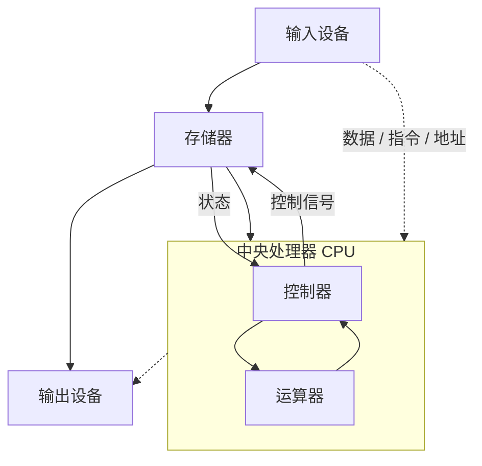

## 计算机的发展历程

#### 计算机系统的组成

- **硬件**：计算机的实体部分，例如主机、外设。
- **软件**：由具有各类特殊功能的程序组成。

> 计算机性能的好坏取决于**软硬件功能的总和**——硬件提供算力基础，软件决定算力如何被组织和调度。

#### 硬件的发展

计算机硬件的发展史，本质上是**逻辑元件**的迭代史：元件越小、越快、越省电，整机的速度、软件形态和应用领域就跟着往前跳一级。

| 代次 | 时间 | 逻辑元件 | 代表机型 | 软件形态 | 主要应用 |
| :--- | :--- | :--- | :--- | :--- | :--- |
| **第一代** | 1946~1957 | 电子管 | ENIAC（1946）、UNIVAC、EDSAC（1949）、EDVAC（1951） | 机器语言 | 科学计算 |
| **第二代** | 1958~1964 | 晶体管 | TRADIC、IBM 7000 | 汇编语言与高级语言（FORTRAN） | 数据处理、实时过程控制 |
| **第三代** | 1964~1971 | 中小规模集成电路 | IBM 360、DEC PDP-8 | 高级语言与操作系统 | 企业管理、辅助设计 |
| **第四代** | 1972 至今 | 大规模、超大规模集成电路 | Intel 4004、8080、Z80 | 系统软件与应用软件 | 全面应用 |

> **注意**：**EDSAC**（1949，剑桥大学）是**第一台存储程序计算机**。它比 ENIAC（1946）晚三年，但理念更先进

第四代的关键变化是**微处理器**与**微型计算机**的出现，以及两条常被引用的规律：

- **机器字长**不断增长。机器字长是计算机一次整数运算所能处理的二进制位数。
- **摩尔定律**（Moore's Law）：集成电路上可容纳的晶体管数目约每 18 个月翻一番，性能也随之翻番。它描述的不是物理定律，而是产业发展速度的**经验规律**。

今天的发展趋势呈现**"两极"分化**：一极是微型计算机向更微型化、网络化、低功耗方向发展；另一极是巨型机向超高速、大规模并行、智能化方向发展，例如我国的**神威·太湖之光**。

> **提示**：微处理器的指令集、微体系结构与制造工艺是信息产业的基础设施，这也是"自主可控"在计算机体系结构层面被反复强调的原因

#### 软件的发展

- 编程语言演进：机器语言 → 汇编语言 → 高级语言。
- 操作系统演进：DOS（命令行操作系统） → 图形化界面操作系统。

#### 软件的分类

- **应用软件**：为了解决某个应用领域的问题而编制的程序，亦称"按任务需要编制成的各种程序"。例如抖音（娱乐）、QQ/微信（通讯）、美图秀秀/PhotoShop（图像处理）、B 站等。
- **系统软件**：负责管理硬件资源，并向上层应用程序提供基础服务。例如操作系统、数据库管理系统（DBMS）、标准程序库、网络软件、语言处理程序、服务程序。


## 计算机硬件的基本组成

### 早期冯·诺依曼机

早期计算机最致命的缺陷不是慢，而是**程序与计算相分离**：程序指令存放在外部电路里，要人工接通数百条电缆才能做几分钟运算。冯·诺依曼的贡献在于把"程序"也变成数据存进存储器，于是计算机能在无人干预下自动逐条取指执行。

#### 提出过程

- 冯·诺依曼在参与 **ENIAC** 研制过程中发现其主要弊端：**程序与计算相分离**——程序指令被存放在外部电路中，必须人工接通数百条电缆才可进行几分钟的运算。
- **1945 年**，冯·诺依曼与莫尔小组等成员以《关于 EDVAC 的报告草案》为题，起草了长达 **101 页**的总结报告，发表了全新的"**存储程序通用电子计算机方案**"。
- **1949 年**，第一台存储程序计算机 **EDSAC** 由剑桥大学研制完成；**1951 年**，**EDVAC** 研制完成。
- 从 ENIAC（手动接线控制计算）到 EDVAC（冯·诺依曼结构），这条路线确立了此后所有通用计算机的基本形态：**几乎现代所有的计算机都采用了冯·诺依曼结构。**

#### 部件构成

计算机应由**运算器、控制器、存储器、输入设备、输出设备**五个基本部件组成，各部件功能如下：

| 部件 | 功能 |
| :--- | :--- |
| **存储器** | 不仅能存放数据，而且也能存放指令，形式上两者没有区别，但计算机应能区分数据还是指令 |
| **控制器** | 应能自动取出指令来执行，并指挥各部件协同工作 |
| **运算器** | 应能进行加 / 减 / 乘 / 除四种基本算术运算，并且也能进行一些逻辑运算和附加运算 |
| **输入设备 / 输出设备** | 操作人员可以通过它们和主机进行通信；两者统称为 **I/O 设备**（Input/Output Device） |


> **提示**：在计算机系统中，软件和硬件在**逻辑上是等价的**。例如乘法运算，可以专门设计一个硬件电路来实现，也可以用软件方式执行多次加法来实现——只是前者性能高、成本高，后者性能低、成本低。这条等价性是后面引出 **ISA** 的前提。

#### 核心思想

1. **五大部件构成**：运算器、控制器、存储器、输入设备、输出设备。
2. **二进制表示**：内部以二进制表示指令和数据；每条指令由**操作码**（指出操作类型）和**地址码**（指出操作数的地址）两部分组成，由一串指令组成程序。
3. **存储程序**（Stored Program）：任何要计算机完成的工作都要先被编写成程序，然后将程序和原始数据送入主存并启动执行。**一旦程序被启动，计算机应能在不需操作人员干预下，自动完成逐条取出指令和执行指令的任务。**

> **存储程序的确切定义**：把指令以二进制代码形式事先输入计算机的主存储器，然后按其在存储器中的首地址执行程序的第一条指令，以后就按该程序的规定顺序执行其他指令，直至程序执行结束。

> **提示**：同一套思想有两种包装——按"**思想**"分层（五大部件 / 二进制 / 存储程序）便于理解，按"**特点**"列清单（下面的六大特点）便于记忆与应试。内容完全一致。

#### 特点

1. 计算机由五大部件组成。
2. 指令和数据以同等地位存于存储器，可按地址寻访。
3. 指令和数据用二进制表示。
4. 指令由**操作码**（Opcode）和**地址码**（Address）组成。
5. **存储程序**——程序预先存入存储器，按顺序自动执行。
6. **以运算器为中心**——I/O 设备与存储器之间的数据传送必须通过运算器来完成。

> **易错点**：特点 6 是**冯·诺依曼机与现代计算机的关键区别**。现代计算机改为**以存储器为中心**，I/O 设备可直接与存储器交换数据，绕开了"所有数据都必须穿过运算器"这个瓶颈。所以"冯·诺依曼结构"与"冯·诺依曼机"不是一回事：前者是思想（存储程序、五大部件、二进制），后者是早期那种以运算器为中心的具体实现。

#### 哈佛结构

冯·诺依曼结构把**指令和数据混放在同一个存储器**、共用一套总线。与之相对的是**哈佛结构**（Harvard Architecture）：指令与数据**分开存储**在物理上独立的两个存储器里，各有独立的地址空间与访问通路。名字来自 1944 年哈佛大学参与研制的 Mark I——它把指令记录在纸带上、数据放在机电计数器里，本来就是两套介质。

| 对比维度 | 冯·诺依曼结构 | 哈佛结构 |
| :--- | :--- | :--- |
| **指令与数据存储** | 混合存放在**同一存储器**，共用地址空间 | **分开存放**在两个独立存储器，各有独立地址空间 |
| **总线** | 指令与数据**共用一套总线** | 指令总线与数据总线**分开** |
| **取指与取数** | 不能同时进行，需分时**争用**总线 | 可以**同时进行** |
| **硬件成本** | **较低**（一套存储器与总线） | **较高**（两套存储器与总线，芯片面积与引脚数都增加） |
| **执行效率** | 受"取指—取数"争用限制 | **更优**（取指与取数可并行） |
| **灵活性** | 程序可被当作数据统一处理 | 二者严格分离，程序一般不能作为数据访问 |
| **典型应用** | 通用计算机（PC、服务器） | 单片机与嵌入式（8051、AVR）、DSP，以及现代 CPU 的 L1 Cache 层面 |

- **成本更高**：需要两套独立的存储器与两套总线（地址线、数据线各自一份），芯片面积、引脚数和布线复杂度都随之上升；
- **效率更优**：冯·诺依曼结构中指令与数据共用一条通路，**取指令和取数据必须分时进行**——这就是著名的**冯·诺依曼瓶颈**（von Neumann bottleneck）。哈佛结构把两条通路分开后，取指与取数可以在同一时钟周期内并行完成，瓶颈被绕开。

> **结论（最值得记住的一点）**：**现代通用计算机在主存层面仍然是冯·诺依曼结构，但在 CPU 内部的一级 Cache 层面改用了哈佛结构。**
>
> - **主存层面**：指令与数据同居主存、共用内存总线，程序仍可被当作数据处理——冯·诺依曼结构在统一性与灵活性上的优势得以保留；
> - **Cache 层面**：L1 Cache 被拆成**指令 Cache（I-Cache）与数据 Cache（D-Cache）**，各自独立通路，使 CPU 能够一边预取指令、一边读写数据。

> **延伸**：冯·诺依曼结构"指令与数据形式统一、程序可被当作数据处理"这一特点，也是后面理解**缓冲区溢出**（向数据区写入过长内容从而改写返回地址）的前提

### 现代计算机的硬件结构

现代计算机改为**以存储器为中心**，克服了冯·诺依曼机中运算器成为数据传输瓶颈的问题。在现代集成电路工业中，一般把运算器与控制器合并成为**中央处理器**（CPU，Central Processing Unit）。


硬件组成结构可以整理成一棵树：

- **主机**
    - **CPU**
        - 运算器
        - 控制器
    - **存储器**
        - **主存**（内存，例如内存条）
        - **辅存**（外存，例如硬盘）
- **I/O 设备**
    - 输入设备
    - 输出设备


#### 主存储器的基本组成


- **存储体**：数据按地址存储在存储体内，每个地址对应一个**存储单元**。
    - **存储单元**：每个存储单元存放一串二进制代码。
    - **存储字**（Word）：存储单元中二进制代码的组合。
    - **存储字长**：存储单元中二进制代码的位数。
    - **存储元**：即存储二进制的电子元件，每个存储元可存 1 bit。
- **MAR（Memory Address Register，存储地址寄存器）**：位数反映**存储单元个数**。例如 MAR 为 32 位，则可寻址 $2^{32}$ 个存储单元。
- **MDR（Memory Data Register，存储数据寄存器）**：位数 = **存储字长**。
- **单位换算**：1 字节（Byte，记作 1B）= 8 bit（记作 8b）——注意 **B ≠ b**。

> **注意**：现在的计算机通常把 MAR、MDR 也集成在 CPU 中，而非独立于 CPU 之外。

#### 运算器的基本组成


- **ACC（Accumulator，累加器）**：用于存放操作数或运算结果。
- **MQ（Multiplier-Quotient Register，乘商寄存器）**：在乘除运算时，用于存放操作数或运算结果。
- **X（通用操作数寄存器）**：用于存放操作数。
- **ALU（Arithmetic and Logic Unit，算术逻辑单元）**：通过内部复杂的电路实现算术运算、逻辑运算。

> **注意**：ACC、MQ、X 三者职能不同——ACC 是通用累加器，MQ 专用于乘除法，X 作为通用操作数暂存器。理解它们在乘法和加法指令中的不同角色，是读懂下一节"工作过程"的关键。

#### 控制器的基本组成


- **CU（Control Unit，控制单元）**：用于分析指令，给出控制信号。
- **IR（Instruction Register，指令寄存器）**：存放当前正在执行的指令。
- **PC（Program Counter，程序计数器）**：存放下一条指令的地址，具有自动加 1 功能。

三者形成"**取指—分析—执行**"的控制链条：PC 指向下一条指令 → CU 分析 IR 中的指令 → CU 发出控制信号驱动各部件执行。

#### 部件的连接方式

五个部件之间并非孤立工作，它们在控制器的统一指挥下交换三类信息：

| 信息类型 | 走哪一组线 |
| :--- | :--- |
| **数据** | 数据线 |
| **地址** | 地址线 |
| **控制信号与状态** | 控制线 |

连接方式本身也在演进：

- **早期**：部件之间用**分散方式**相连；
- **现在**：部件之间大多用**总线方式**相连（第 8 章展开）；
- **趋势**：点对点（分散方式）高速连接。

程序和数据从输入设备进入存储器，运算结果从存储器送往输出设备，控制器则向各部件发出命令并回收状态：



### 计算机的工作过程

"存储程序"落地成硬件动作，就是**取指令—分析指令—执行指令**的反复循环。

#### 参与指令执行的部件与寄存器

| 缩写 | 名称 | 作用 |
| :--- | :--- | :--- |
| **PC** | 程序计数器（Program Counter） | 存放**将要执行**指令的地址，具有自动 +1 功能 |
| **IR** | 指令寄存器（Instruction Register） | 存放当前正在执行的指令 |
| **MAR** | 存储器地址寄存器 | 存放将要访问的存储单元地址 |
| **MDR** | 存储器数据寄存器 | 存放从存储器读出或将要写入存储器的数据 |
| **GPRs** | 通用寄存器组 | 暂存操作数与运算结果 |
| **ALU** | 算术逻辑部件 | 完成算术与逻辑运算 |
| **标志寄存器** | 状态寄存器 | 保存运算结果的状态标志（进位、溢出、零、符号等） |
| **控制器** | 控制部件 | 取指令、译码、发出控制信号，协调各部件工作 |

> **提示**：主存储器（存储体 + MAR + MDR）、运算器（ACC / MQ / X / ALU）、控制器（CU / IR / PC）的**硬件构成与容量计算**已经在上一节讲完；这一节只关心"一条指令被取出并执行"时，这些部件各自扮演什么角色。

#### 四步循环

**（1）程序启动前**

指令和数据都存放在存储器中，**形式上没有差别**，都是 0/1 序列；**PC 存放将要执行指令的地址**。

**（2）程序运行时**

控制器周而复始地执行以下步骤：

1. **取指令**：控制器将 PC 的值写入 MAR，从存储器读出该地址的内容，经 MDR 传送到指令寄存器 IR。
2. **分析指令**：控制器对 IR 中的指令进行译码，同时更新 PC（PC + "1"），使其指向下一条指令。
3. **取操作数**：控制器将操作数地址写入 MAR，取出相应数据传送到通用寄存器。
4. **执行指令**：控制器根据操作码控制 ALU 对数据进行处理，结果传送到通用寄存器或存储器。

> **关键结论**：上述四步中，**取指令与分析指令对所有指令完全一致**，只有"取操作数"和"执行"因指令类型而异。这正是冯·诺依曼机"存储程序、顺序执行"在硬件上的直接体现——也是后面讲**指令流水线**（第 5 章）时"各阶段可以重叠"这一优化的物理基础。

#### 案例分析：`y = a * b + c`

以 C 语言语句 `y = a * b + c` 为例，看计算机如何执行一段完整程序。设 $a = 2$、$b = 3$、$c = 1$，编译装入主存后的指令和数据如下：

| 主存地址 | 操作码 | 地址码 | 注释 |
| :-: | :--- | :--- | :--- |
| 0 | 000001 | 0000000101 | 取数 a 至 ACC |
| 1 | 000100 | 0000000110 | 乘 b 得 ab，存于 ACC |
| 2 | 000011 | 0000000111 | 加 c，得 ab+c 存于 ACC |
| 3 | 000010 | 0000001000 | 将 ab+c 存于主存单元 |
| 4 | 000110 | 0000000000 | 停机 |
| 5 | — | — | 原始数据 a = 2 |
| 6 | — | — | 原始数据 b = 3 |
| 7 | — | — | 原始数据 c = 1 |
| 8 | — | — | 原始数据 y = 0 |

**初始状态**：`(PC) = 0`，指向第一条指令的存储地址。**记号 `()` 表示取相应寄存器中的数据**，`M(MAR)` 表示取 MAR 所指存储单元的内容。


**第 1 条指令：取数指令**

| 步骤 | 操作 | 说明 |
| :-: | :--- | :--- |
| ① | (PC) → MAR | 导致 (MAR) = 0 |
| ② | (PC) + 1 → PC | PC 自动加 1，(PC) = 1 |
| ③ | M(MAR) → MDR | 导致 (MDR) = 000001 0000000101 |
| ④ | (MDR) → IR | 导致 (IR) = 000001 0000000101 |
| ⑤ | OP(IR) → CU | CU 分析后得知是"取数"指令 |
| ⑥ | Ad(IR) → MAR | 指令的地址码送到 MAR，导致 (MAR) = 5 |
| ⑦ | M(MAR) → MDR | 导致 (MDR) = 0000000000000010 = 2 |
| ⑧ | (MDR) → ACC | 导致 (ACC) = 0000000000000010 = 2 |

> **第 1 条指令执行过程总结**：步骤 ①~④ 是**取指令**，步骤 ⑤ 是**分析指令**，步骤 ⑥~⑧ 是**执行取数指令**。

**第 2 条指令：乘法指令**

| 步骤 | 操作 | 说明 |
| :-: | :--- | :--- |
| ① | (PC) → MAR | 导致 (MAR) = 1 |
| ② | (PC) + 1 → PC | PC 自动加 1，(PC) = 2 |
| ③ | M(MAR) → MDR | 导致 (MDR) = 000100 0000000110 |
| ④ | (MDR) → IR | 导致 (IR) = 000100 0000000110 |
| ⑤ | OP(IR) → CU | CU 分析得知是"乘法"指令 |
| ⑥ | Ad(IR) → MAR | 导致 (MAR) = 6 |
| ⑦ | M(MAR) → MDR | 导致 (MDR) = 0000000000000011 = 3 |
| ⑧ | (MDR) → MQ | 导致 (MQ) = 0000000000000011 = 3 |
| ⑨ | (ACC) → X | 导致 (X) = 2 |
| ⑩ | (MQ) × (X) → ACC | 由 ALU 实现乘法运算，导致 (ACC) = 6 |

> **第 2 条指令执行过程总结**：步骤 ⑤ 是**分析指令**，步骤 ⑥~⑩ 是**执行乘法指令**；如果乘积太大，则需要 MQ 辅助存储（乘数放 MQ、被乘数放 X，结果与高位在 ACC，低位在 MQ）。

**第 3 条指令：加法指令**

| 步骤 | 操作 | 说明 |
| :-: | :--- | :--- |
| ① | (PC) → MAR | 导致 (MAR) = 2 |
| ② | (PC) + 1 → PC | PC 自动加 1，(PC) = 3 |
| ③ | M(MAR) → MDR | 导致 (MDR) = 000011 0000000111 |
| ④ | (MDR) → IR | 导致 (IR) = 000011 0000000111 |
| ⑤ | OP(IR) → CU | CU 分析得知是"加法"指令 |
| ⑥ | Ad(IR) → MAR | 导致 (MAR) = 7 |
| ⑦ | M(MAR) → MDR | 导致 (MDR) = 0000000000000001 = 1 |
| ⑧ | (MDR) → X | 导致 (X) = 0000000000000001 = 1 |
| ⑨ | (ACC) + (X) → ACC | 由 ALU 实现加法运算，导致 (ACC) = 7 |

**第 4 条指令：存数指令**

| 步骤 | 操作 | 说明 |
| :-: | :--- | :--- |
| ① | (PC) → MAR | 导致 (MAR) = 3 |
| ② | (PC) + 1 → PC | PC 自动加 1，(PC) = 4 |
| ③ | M(MAR) → MDR | 导致 (MDR) = 000010 0000001000 |
| ④ | (MDR) → IR | 导致 (IR) = 000010 0000001000 |
| ⑤ | OP(IR) → CU | CU 分析得知是"存数"指令 |
| ⑥ | Ad(IR) → MAR | 导致 (MAR) = 8 |
| ⑦ | (ACC) → MDR | 导致 (MDR) = 7 |
| ⑧ | (MDR) → M(MAR) | 将 MDR 中的数据写入地址为 8 的存储单元，导致 y = 7 |

> **第 4 条指令执行过程总结**：步骤 ①~④ 是**取指令**，步骤 ⑤ 是**分析指令**，步骤 ⑥~⑧ 是**执行存数指令**。

**第 5 条指令：停机指令**

| 步骤 | 操作 | 说明 |
| :-: | :--- | :--- |
| ① | (PC) → MAR | 导致 (MAR) = 4 |
| ② | (PC) + 1 → PC | PC 自动加 1，(PC) = 5 |
| ③ | M(MAR) → MDR | 导致 (MDR) = 000110 0000000000 |
| ④ | (MDR) → IR | 导致 (IR) = 000110 0000000000 |
| ⑤ | OP(IR) → CU | CU 分析得知是"停机"指令（利用中断机制通知操作系统终止该进程） |


观察五条指令的执行过程，可以发现一个**统一模板**：

1. **取指令**（①~④）：`(PC) → MAR → MDR → IR`，同时 PC + 1；
2. **分析指令**（⑤）：`OP(IR) → CU`；
3. **执行指令**（⑥ 起）：根据指令类型（取数 / 乘法 / 加法 / 存数 / 停机）调用不同部件。

其中步骤 ①~④ 在所有指令中完全一致——这正是冯·诺依曼机"存储程序、顺序执行"的集中体现。

#### 计算机系统的工作原理

核心流程：程序和数据经输入设备进入主存 → CPU 从主存取指令执行 → 结果经输出设备输出。整个过程围绕"取指令—分析指令—执行指令"不断循环。

## 程序的开发与运行

上一节讲的是硬件如何"执行"指令，但指令从哪来？这一段源码在变成机器能执行的 0/1 序列之前，究竟走过哪些路？

### 三种程序设计语言

#### 机器语言

最早的程序开发方式是**用机器语言编写程序，并记录在纸带或卡片上**，以是否穿孔表示 0 和 1：

```
0 ： 0101 0110
1 ： 0010 0100
2 ： ……
3 ： ……
4 ： 0110 0111      ← 假设 0010 表示 jxx（转移指令）
5 ： ……
6 ： ……
```

输入靠按钮、开关，输出靠指示灯——**所有信息都是 0/1 序列**。这种方式有两个致命问题：

- **转移指令不灵活**：若在第 4 条指令前插入一条指令，其后所有指令的地址都会改变，转移指令中的**目标地址必须重新计算**，然后整条纸带重新打孔；
- **书写、阅读困难**：人几乎不可能直接记住大段 0/1 序列的含义。

#### 汇编语言

**汇编语言**是面向机器的程序设计语言，也称为**符号语言**：

- 用**助记符**表示操作码；
- 用**标号**表示位置；
- 用助记符表示寄存器。

同一段逻辑用汇编语言写出来是：

```asm
    sub  B
    jnz  L0
    ……
    ……
L0: add  C
    ……
B:  ……
C:  ……
```

关键改进在于**转移指令引用的是标号而不是绝对地址**：在第 4 条指令前加指令时，**不用改变** `sub`、`jnz`、`add` 指令中的地址码——标号到地址的换算交给工具去做。

| 优点 | 缺点 |
| :--- | :--- |
| 不会因为增减指令而需要修改其他指令 | 机器无法直接识别，需将汇编语言转换为机器语言 |
| 不需记忆指令码，编写方便 | 编程效率不高 |
| 可读性比机器语言强 | 依赖具体机器结构 |

从汇编语言到机器语言由**汇编程序（Assembler）**完成。**机器语言与汇编语言一一对应，都是面向机器结构的语言，统称为机器级语言。**

#### 高级语言

**高级语言**更接近于人类自然语言和数学语言，面向算法描述，比机器级语言描述能力强得多：

- **编写效率更高**；
- **与具体机器结构无关，可移植性更强**；
- 处理逻辑分为三种结构：**顺序结构、选择结构、循环结构**；
- 有"**面向过程**"和"**面向对象**"之分：
    - 面向过程：以事件为中心，把解决问题的步骤用函数实现，按顺序调用函数；
    - 面向对象：以对象为中心，描述某个对象在整个解决问题步骤中的属性和行为。

#### 三种语言的对比

| 对比维度 | 机器语言 | 汇编语言 | 高级语言 |
| :--- | :--- | :--- | :--- |
| **表示形式** | 0/1 序列 | 助记符、标号 | 接近自然语言与数学语言 |
| **与硬件的关系** | 完全绑定 | 完全绑定 | 与具体机器结构无关 |
| **是否需要翻译** | 不需要 | 需要（汇编程序） | 需要（编译程序或解释程序） |
| **可读性与编写效率** | 最差 | 一般 | 最好 |
| **可移植性** | 无 | 无 | 强 |
| **面向对象** | 机器结构 | 机器结构 | 算法描述 |

> **提示**：机器语言与汇编语言合称**机器级语言**，这个"级"字在后续 ISA 层、机器级表示的讨论中会反复出现——它标记的是"与具体机器结构绑定的那一层"。

### 翻译程序

将高级语言转化为机器可执行的机器语言，有两种基本方式：

- **编译程序（Compiler）**：将高级语言编写的源程序**全部语句一次性翻译**成机器语言程序，而后再执行机器语言程序（只需翻译一次）。例如 C/C++。
- **解释程序（Interpreter）**：将源程序的一条语句翻译成对应于机器语言的语句，并立即执行，紧接着再翻译下一句（每次执行都要翻译）。例如 JavaScript、Python、Shell。

> 编译程序的执行效率高于解释程序，因为编译只需一次，而解释每次运行都要重新翻译。

| 对比维度 | 编译程序（Compiler） | 解释程序（Interpreter） |
| :--- | :--- | :--- |
| **工作方式** | 将高级语言源程序**整体**转换为机器级目标程序，执行时只要启动目标程序即可 | 将高级语言语句**逐条**翻译成机器指令并立即执行，不生成目标文件 |
| **翻译次数** | 只翻译一次 | 每次运行都要重新翻译 |
| **优势** | **运行效率高** | **跨平台性能好** |
| **典型语言** | C、C++ | Python、JavaScript、Shell |

**编译程序、汇编程序、解释程序统称为翻译程序。**


### 从源程序到可执行文件

高级语言要落回机器，中间不是"一步翻译"，而是一条**四级流水线**。理解每一级的输入输出，是理解"编译错误、链接错误为什么现象不同"的前提。

以一个最简单的 C 程序为例：

```c
#include <stdio.h>
int main()
{
    printf("hello, world\n");
}
```

保存在 `hello.c` 中。对机器来说，它首先只是一串 **ASCII 文本**——每个字符按 ASCII 编码占一个字节：

```
#  i  n  c  l  u  d  e  <sp>  <  s  t  d  i  o  .  h  >  \n  \n  i  n  t  <sp>  m  a  i  n  (  )  \n  {  …
35 105 110 99 108 117 100 101 32 60 115 116 100 105 111 46 104 62 10 10 105 110 116 32 109 97 105 110 40 41 10 123 …
```

例如 `#` 的 ASCII 码是 35，`i` 是 105，空格是 32。**计算机不能直接执行 `hello.c`**——它只是一份"给人看的字符文件"。

#### GCC + Linux 平台的四个处理阶段

| 阶段 | 处理程序 | 输入 | 输出 | 产物性质 |
| :--- | :--- | :--- | :--- | :--- |
| **预处理** | `cpp` | `hello.c` 源程序 | `hello.i` 源程序 | 文本 |
| **编译** | `cc1` | `hello.i` 源程序 | `hello.s` 汇编语言程序 | 文本 |
| **汇编** | `as` | `hello.s` 汇编语言程序 | `hello.o` 可重定位目标程序 | **二进制** |
| **链接** | `ld` | `hello.o` + `printf.o` | `hello` 可执行目标程序 | **二进制** |


> **注意**：**"文本 → 二进制"的转折点发生在汇编阶段**（`as`）。这也是为什么"编译错误"（语法、类型）能在 `cc1` 阶段报出并指出源码行号，而"链接错误"（未定义符号、重定义）只能报符号名——后者发生在已经丢失源码信息的 `ld` 阶段。同名全局变量互相覆盖的问题正是在这一层出的，属于第 4 章。

> **提示**：`gcc` 的 `-E`、`-S`、`-c`、`-o` 分别停在预处理、编译、汇编、链接各阶段的产物上，配合 `objdump` 与 `gdb` 可以亲手复现上面这张流程图。

#### 可执行文件的启动与执行

有了可执行文件，还差最后一步：**它怎么跑起来**。在命令行敲下 `./hello` 之后：

```
$ ./hello
hello, world
$
```

中间发生的事情可以分成三段：

| 阶段 | 发生的事 |
| :--- | :--- |
| **shell 命令行处理** | shell 接收并解析 `./hello` 这一命令行，把它交给操作系统去加载并运行 |
| **可执行文件加载** | 把 `hello` 中的代码和数据从磁盘装入主存，建立起程序运行所需的地址空间 |
| **hello 程序执行** | 程序逐条执行指令，`printf` 最终把 `"hello, world\n"` 送到标准输出，屏幕上出现 `hello, world` |

> **关键结论**：**所有过程都是在 CPU 执行指令所产生的控制信号的作用下进行的。** 无论是 shell 解析命令行、操作系统装载程序，还是 `printf` 输出字符——站在硬件角度看，它们都只是"指令序列在控制信号驱动下逐条执行"。这正是"软件与硬件在逻辑功能上等价"的直观体现。

## 计算机系统的层次结构与抽象层转换

前两节回答了"计算机怎么工作""程序怎么变成机器码"，这一节回答更抽象的一问：**从人到电子器件，中间隔了多少层？每层的分工是什么？**

### 计算机系统的层次结构

#### 系统层次

计算机系统是分层的：每一层向下调用下层的服务，向上提供更抽象的接口。

| 层次 | 名称 | 归属 |
| :-: | :--- | :--- |
| 9 | 应用（问题） | 软件（抽象） |
| 8 | 算法 | 软件（抽象） |
| 7 | 编程（语言） | 软件（抽象） |
| 6 | 操作系统（虚拟机） | 软件（抽象） |
| **5** | **指令集体系结构（ISA）** | **软硬件分界面** |
| 4 | 微体系结构（微架构） | 硬件（实现） |
| 3 | 功能部件 | 硬件（实现） |
| 2 | 逻辑电路 | 硬件（实现） |
| 1 | 器件 | 硬件（实现） |

自下而上，抽象程度递增；自上而下，实现细节递增。**ISA 正好卡在软硬件的交界面上**——这也是为什么它被称为"软件和硬件之间的界面"。

#### 不同角色工作的层次

同一台计算机，不同角色的"视野"完全不同：

| 角色 | 主要关注的层 |
| :--- | :--- |
| **最终用户** | 应用（问题）层 |
| **程序员** | 编程（语言）层、操作系统层 |
| **架构师** | 指令集体系结构（ISA）层、微体系结构层 |
| **电子工程师** | 功能部件、逻辑电路、器件层 |

#### 程序执行结果的决定因素

> **程序执行结果，不仅取决于算法、程序编写，而且取决于语言处理系统、操作系统、ISA、微体系结构。**

这条结论的分量在于：同一个 C 表达式，换一个平台或一个编译器就可能算出不同结果（数据表示、整数溢出、浮点舍入，属 ISA 与语言处理系统）；同一个数组访问，换一个循环次序就可能差出一个数量级（Cache 与访问局部性，属微体系结构）；两个目标文件里定义了同名全局变量，链接后可能互相覆盖（符号解析与存储分配，属链接器）；而无符号数当循环上界导致的访存异常，则同时牵扯 ISA 的运算规则与操作系统的虚拟地址空间。**没有哪一层能解释全部现象——这就是"系统思维"必须跨层的原因。**

#### 与计算机系统相关的课程概念

这是三个容易混淆但分工不同的概念：

- **计算机系统基础（Introduction to Computer Systems）**：站在程序员而非设计者的角度，把程序从源代码到在硬件上执行的完整链条（编译 → 链接 → ISA → 微体系结构 → 操作系统）串起来。回答"程序**为什么这样跑**"。
- **计算机组成原理（Computer Organization）**：实现计算机体系结构所体现的属性，对程序员**透明**（不可见），讨论具体指令的实现。回答"计算机**如何实现**"。
- **计算机体系结构（Computer Architecture）**：机器语言程序员所见到的计算机系统的属性——概念性的结构与功能特性。例如指令系统、数据类型、寻址技术、I/O 机理。回答"计算机**提供了什么**"。

### 指令集体系结构（ISA）

#### ISA的基本概念

**软硬件的逻辑功能等价性**是引出 ISA 的入口：同一个功能，既可以用硬件实现（性能高、成本高），也可以用软件实现（性能低、成本低）。既然二者可以互换，就必须有一条明确的界线说清"哪些由硬件保证、哪些交给软件"——这条界线就是 ISA。

> **ISA 是软件和硬件之间的界面，是软件和硬件之间接口的一个完整定义。**

- 设计计算机系统的 ISA，就是要定义一台计算机可以支持哪些指令，以及每条指令的作用是什么、每条指令的用法是什么。
- ISA 是软件和硬件的"**契约**"：软件只看到 ISA 定义的机器，不关心底层硬件如何实现；硬件工程师则负责高效地实现 ISA。

ISA 是一种**规约**（Specification）。它不规定"用什么电路实现"，只规定"这台机器对外承诺能做什么"——这一定位使得**同一个 ISA 可以有多种不同的微体系结构实现**（例如同一套 x86 指令集，可以由不同代次的微架构去实现）。

ISA 规约了以下七类内容：

| 序号 | 规约内容 |
| :-: | :--- |
| ① | **可执行的指令的集合**，包括指令格式、操作种类以及每种操作对应的操作数的相应规定 |
| ② | 指令可以接受的**操作数的类型** |
| ③ | 操作数所能存放的**寄存器组的结构**，包括每个寄存器的名称、编号、长度和用途 |
| ④ | 操作数所能存放的**存储空间的大小和编址方式** |
| ⑤ | 操作数在存储空间存放时按照**大端还是小端**方式存放 |
| ⑥ | 指令获取操作数的方式，即**寻址方式** |
| ⑦ | 指令执行过程的**控制方式**，包括程序计数器、条件码定义等 |

#### ISA 的必要性

- **没有它，软件无法使用计算机硬件**——软件没有任何可依赖的稳定接口；
- **没有它，一台计算机不能称为"通用计算机"**——"通用"的前提是有明确的指令集合可供任意程序使用。

#### ISA 是软硬件的分界面

- **ISA 层下面是硬件部分**：CPU、主存和输入/输出设备等主要功能部件，这些功能部件通过**数字逻辑电路**设计实现；
- **ISA 层上面是软件部分**：低层的系统软件和高层的应用软件，汇编程序、编译程序和操作系统等系统软件**直接在 ISA 上实现**。

所以可以说：**硬件的所有功能都由 ISA 集中体现，软件通过 ISA 在计算机上执行——ISA 是整个计算机系统的核心部分。**

### 计算机系统的不同用户与"透明"

"层次结构"不只是技术图景，也是**人的分工图景**。同一台计算机，最终用户、系统管理员、应用程序员、系统程序员看到的机器完全不同——这正是"**透明**"这个概念的来处。

#### 用户的类型

| 用户类型 | 做什么 | 所看到的机器与抽象层 |
| :--- | :--- | :--- |
| **最终用户**（end user） | 使用应用软件完成特定任务（玩游戏、网购、炒股、收发邮件） | 工作在**应用程序层**。通过键盘、鼠标等外设与计算机交互，通过操作系统提供的用户界面启动并执行应用程序；能感知到的只是简单的人机交互界面和已安装的应用程序 |
| **系统管理员**（system administrator） | 利用操作系统、数据库管理系统等提供的功能对系统进行配置、管理和维护，以建立高效合理的系统环境 | 工作在**操作系统层**。所看到的是配置了操作系统的虚拟机器，称**操作系统虚拟机**；能感知到系统中的部分硬件层面、系统管理层面以及相关实用程序和人机交互界面 |
| **应用程序员**（application programmer） | 使用高级编程语言编制应用软件 | 工作在**语言处理系统层**。除硬件、操作系统提供的应用编程接口、人机交互界面和实用程序外，还包括程序语言处理系统（编辑程序、翻译程序、链接程序、装入程序、IDE、可调用的函数库）；所看到的虚拟机器称**高级语言虚拟机**，故也称高级语言程序员 |
| **系统程序员**（system programmer） | 设计和开发系统软件（操作系统、编译器、数据库管理系统等） | 工作在 **ISA 层**。所看到的是配置了指令系统的机器，称**机器语言机器**，故也称机器语言程序员；必须熟悉指令系统、机器结构和相关机器功能特性，有时要直接用汇编语言等低级语言编写代码 |

同一个人可能同时扮演多种角色。以一个计算机专业学生为例：

- 玩游戏、网购时——**最终用户**；
- 整理磁盘碎片、升级系统、备份数据时——**系统管理员**；
- 完成老师布置的应用程序开发作业时——**应用程序员**；
- 完成操作系统或编译程序等软件的开发作业时——**系统程序员**。

#### 透明的定义

在计算机技术中，若一个存在的事物或概念从某个角度看似乎不存在，则称其**透明**。

具体到本课：**系统程序员所看到的底层机器级的概念性结构和功能特性，对高级语言程序员（通常就是应用程序员）来说是透明的**——因为应用程序员直接用高级语言编程，不需要了解汇编语言的编程问题，也不用了解机器语言中规定的指令格式、寻址方式、数据类型和格式等指令系统方面的问题。

> **易错点**：这里的"透明"与日常语感**正好相反**——不是"看得见、看得清"，而是"**看不见、不必关心**"。这个词在后面讲虚拟存储器（对应用程序员透明的地址转换）、Cache（对程序员透明的数据搬运）、微程序控制（对 ISA 层透明）时会反复出现，务必一次记准。

## 计算机系统性能评价

"这台机器比那台快"是一句几乎人人都在说、却很少有人说得准的话。这一节先厘清"性能"到底有几种含义以及各自的评价指标，再说明基准测试为什么会失真，最后给出计算机系统设计中最重要的定量原则——**Amdahl 定律**。

#### 性能的基本含义

"机器 X 的速度（性能）是 Y 的 $n$ 倍"这句话的确切含义是：

$$
\frac{\text{ExTime}(Y)}{\text{ExTime}(X)} = \frac{\text{Performance}(X)}{\text{Performance}(Y)} = n
$$

也就是说，**相对性能用执行时间的倒数来表示**。计算机有两种不同的性能：

| 类别 | 别名 | 含义 | 典型关心场合 |
| :--- | :--- | :--- | :--- |
| **响应时间**（response time） | 执行时间（execution time）、等待时间、时延（latency） | **一个任务所用的时间** | 事务处理系统（存/取款速度要快） |
| **吞吐率**（throughput） | 带宽（bandwidth） | **单位时间完成的任务量** | 多媒体应用（音/视频播放要流畅） |
| 两者都要求高 | — | — | 文件服务器、Web 服务器等 |

**基本的性能评价标准是 CPU 的执行时间。**

> **注意**：吞吐率与响应时间是**两个不同维度**的指标。提高吞吐率（例如并行处理更多任务）有时会拉长单个任务的响应时间，二者并不总是同向变化。

#### CPU 的性能指标

- **CPU 主频（时钟频率）**：CPU 内数字脉冲信号振荡的频率。
    - CPU 时钟周期（单位：μs、ns）
    - CPU 主频（单位：Hz、KHz、GHz）$= 1 / \text{CPU 时钟周期}$
- **CPI**（Cycles Per Instruction）：执行一条指令所需的时钟周期数。
    - 不同指令功能不同，所需的时钟周期数也不同；
    - 对于**某一条特定的指令**，CPI 是一个特定的值；
    - 对于**某一个程序或某一台机器**来说，CPI 表示所有指令执行所需的**平均**时钟周期数。

$$
\text{CPI} = \frac{\text{程序的 CPU 时钟周期数}}{\text{程序的指令条数}}
$$

$$
\text{CPU 执行时间} = \text{CPU 时钟周期数} \times \text{时钟周期}
= \frac{\text{指令条数} \times \text{CPI}}{\text{主频}}
$$

CPI 用来衡量以下三个方面的综合结果：

| 方面 | 具体来源 |
| :--- | :--- |
| **ISA** | Instruction Set Architecture |
| **该体系结构的实现** | Organization & Technology |
| **程序** | Compiler、Algorithm |

> **提示**：注意第三项——**同一个程序换个编译器，CPI 就会变**。这是"性能不只是硬件的事"的又一个证据，也呼应上一节的结论。

- **IPS**（Instructions Per Second）：每秒执行多少条指令。
    - $\text{IPS} = \text{主频} / \text{平均 CPI}$
    - 例如：2 MIPS 表示每秒执行 $2 \times 10^6$ 条指令。
- **FLOPS**（Floating-point Operations Per Second）：每秒执行多少次浮点运算。
    - 例如：9 GFLOPS 表示每秒执行 $9 \times 10^9$ 次浮点运算。

> **易错点**：**主频高不一定运行更快**，还取决于 CPI。CPU-A 主频 3 GHz、平均 CPI = 2；CPU-B 主频 2.5 GHz、平均 CPI = 1。则 A 每秒执行 $\text{3G} / 2 = 1.5\text{G}$ 条指令，B 每秒执行 $\text{2.5G} / 1 = 2.5\text{G}$ 条指令——B 反而更快。

#### MIPS 与 MFLOPS

**MIPS** = Million Instructions Per Second（定点指令执行速度）：

- 因为每条指令执行时间不同，**MIPS 总是一个平均值**；
- 不同机器的指令集不同；程序由不同的指令混合而成；指令使用的频度动态变化；
- Peak MIPS（峰值 MIPS）不实用；
- **所以 MIPS 数不能说明性能的好坏。**

**MFLOPS** = Million Floating-point Operations Per Second（浮点操作速度）：

- **浮点操作不一定是程序中花时间的部分**——一个浮点性能极高的机器，可能在整数或访存密集的程序上表现平平。

> **注意**：这两个"每秒多少次"的指标都极易被误用为跨机器比较的依据。MIPS 受指令集差异干扰，MFLOPS 只统计浮点操作。**跨机器比较应使用同一基准程序的实际执行时间。**

#### 存储器的性能指标

- **MAR 位数**反映存储单元个数；**MDR 位数** = 存储字长；
- **存储总容量** = 存储单元个数 × 存储字长（bit）= 存储单元个数 × 存储字长 / 8（Byte）；
    - 例如：32 位 MAR，8 位 MDR → 总容量 = $2^{32} \times 8\ \text{bit} = 4\ \text{GB}$。
- **单位换算**（仅用于描述存储容量、文件大小）：

| 单位 | 含义 | 数值 |
| :--- | :--- | :--- |
| K（Kilo） | $2^{10}$ | 1 024 |
| M（Mega） | $2^{20}$ | 1 048 576 |
| G（Giga） | $2^{30}$ | 约 $1.07 \times 10^9$ |
| T（Tera） | $2^{40}$ | 约 $1.10 \times 10^{12}$ |

> **易错点**：此处 K/M/G/T 以 $2^{10}$ 为进位（二进制换算），与日常使用的 $10^3$ 进位不同。例如 1 KB = 1024 B，而非 1000 B。另外 **1 字节（Byte，1B）= 8 bit（8b）**，B 与 b 不是一回事。

#### 系统整体的性能指标

- **数据通路带宽**：数据总线一次所能并行传送信息的位数（各硬件部件通过数据总线传输数据）。
- **吞吐量**（Throughput）：系统在单位时间内处理请求的数量。它取决于信息能多快地输入内存、CPU 能多快地取指令、数据能多快地取出或存入。因此，系统吞吐量主要取决于**主存的存取速度**。
- **响应时间**（Response Time）：从用户向计算机发送一个请求，到系统对该请求做出响应并获得所需结果的等待时间。

> **注意**：吞吐量关注"单位时间能处理多少"，响应时间关注"单个请求要等多久"。高吞吐量不一定意味着低响应时间。

#### 基准程序（Benchmark）

- 用**基准程序**（Benchmark）来评测计算机的性能；
- 基准测试程序是**专门用来进行性能评价的一组程序**；
- 基准程序通过**运行实际负载**来反映计算机的性能；
- 最好的基准程序是**用户实际使用的程序或典型的简单程序**。

但它有明显的缺陷——**当基准程序的性能与某段短代码密切相关时，会被利用以得到不当的评测结果**：硬件系统设计人员或编译器开发者会针对这些代码片段进行**特殊优化**，使执行这段代码的速度非常快。

| 例子 | 内容 |
| :--- | :--- |
| **例 1** | Intel Pentium 处理器运行 SPECint 时用了公司内部使用的特殊编译器，使其性能极高 |
| **例 2** | 矩阵乘法程序 SPECmatrix300 有 **99%** 的时间运行在**一行语句**上；有些厂商用特殊编译器优化该语句，使性能达 VAX 11/780 的 **729.8 倍** |

> **提示**：这就是"跑分"与"实际体验"经常对不上的结构性原因——**只要评测程序有热点，就有针对热点优化的空间**。选择基准程序时应尽量选贴近自己真实负载的那一个。另外，基准程序执行得快**并不说明**机器性能就好，因为基准程序中的语句存在频度差异。

#### Amdahl 定律

Amdahl 定律是**计算机系统设计方面重要的定量原则之一**。

> **基本思想**：对系统中某部分（硬件或软件）进行更新所带来的**系统性能改进程度**，取决于**该部分被使用的频率或其执行时间占总执行时间的比例**。

换句话说：**优化能不能带来整体提速，先看这块占多少比重。**

$$
\text{改进后的执行时间} = \frac{\text{改进部分执行时间}}{\text{改进部分的改进倍数}} + \text{未改进部分执行时间}
$$

$$
\text{整体改进倍数} = \frac{1}{\dfrac{\text{改进部分时间比例}}{\text{改进部分的改进倍数}} + \text{未改进部分时间比例}}
$$

> **注意**：分母里的第二项是"**未**改进部分时间比例"——它不会因为改进而变小，这就是 Amdahl 定律的"天花板"来源。

:::example 例 1 · 10 倍加速下的整体提升
若整数乘法器改进后可加快 10 倍，整数乘法指令在程序中占 40%，则整体性能可改进多少倍？若占比达 60% 和 90%，则整体性能分别能改进多少倍？

**思路**：直接用整体改进倍数公式。设改进部分时间比例 $f = 0.4$，改进倍数 $n = 10$，则整体改进倍数 $= 1 \div (f/n + (1-f))$。

**解**：

- 占比 40%：$1 \div (0.4/10 + 0.6) = 1 \div 0.64 \approx \mathbf{1.56}$
- 占比 60%：$1 \div (0.6/10 + 0.4) = 1 \div 0.46 \approx \mathbf{2.17}$
- 占比 90%：$1 \div (0.9/10 + 0.1) = 1 \div 0.19 \approx \mathbf{5.26}$

**评注**：把乘法器加速 10 倍是相当激进的硬件改进，但当乘法只占 40% 时，整机只快 1.56 倍——**提升幅度被"未改进的 60%"吃掉了大部分**。占比越高，同样的硬件改进收益越大：90% 时能拿到 5.26 倍。
:::

:::example 例 2 · 加速到极限
若把上述改进倍数推向无穷大（即该部分被加速到几乎不花时间），整体改进倍数分别是多少？

**思路**：令 $n \to \infty$，则 $f/n \to 0$，公式退化为 $1 \div (1-f)$——此时整体改进倍数只由未改进部分决定。

**解**：

- 占比 40%：$1 \div (0 + 0.6) = \mathbf{1.67}$
- 占比 60%：$1 \div (0 + 0.4) = \mathbf{2.5}$
- 占比 90%：$1 \div (0 + 0.1) = \mathbf{10}$

**评注**：即使把占比 40% 的部分优化到"零耗时"，整机也只能快 1.67 倍。**这个上界不取决于你多努力，只取决于那 60% 还在不在。** 工程含义很直接：优化前先测占比，把力气花在占比大的部分上。
:::

> **结论**：计算机系统的整体性能受**慢速部件**制约，想要改进计算机的整体性能，**不能仅加速部分部件**。

## 小结

1. 计算机系统 = 硬件 + 软件；硬件的发展是逻辑元件迭代史（电子管 → 晶体管 → 集成电路 → 大规模集成电路），EDSAC 是第一台存储程序计算机，第四代之后呈现"两极分化"。
2. 冯·诺依曼结构的核心是**存储程序**：程序与数据同存主存储器、二进制表示、指令由操作码和地址码组成，启动后自动逐条执行。
3. 五大部件是运算器、控制器、存储器、输入设备、输出设备；冯·诺依曼机的六大特点里，**"以运算器为中心"**是它与现代计算机的关键区别，现代计算机改为**以存储器为中心**，并把运算器与控制器合并成 CPU。
4. 主存储器由存储体、MAR、MDR 组成：**MAR 位数决定存储单元个数，MDR 位数等于存储字长**；运算器由 ACC、MQ、X、ALU 组成；控制器由 CU、IR、PC 组成。
5. **现代计算机是"改进的哈佛结构"**：主存层面仍是冯·诺依曼，L1 Cache 层面拆成 I-Cache 与 D-Cache 采用哈佛式分离，从而绕开**冯·诺依曼瓶颈**。
6. 指令执行是"取指令 → 分析指令（PC + 1）→ 取操作数 → 执行指令"的循环；**取指段与具体指令无关**，这是指令流水线能重叠各阶段的物理基础。
7. `y = a * b + c` 的五条指令演示了统一模板：取数、乘法（MQ 辅助）、加法、存数、停机，每条都是"取指 → 分析 → 执行"三段。
8. 程序从源码到运行要经过**预处理 → 编译 → 汇编 → 链接**四个阶段，**"文本 → 二进制"的转折点在汇编阶段**；这也是编译错误能报行号、链接错误只能报符号名的原因。
9. 计算机系统自下而上有九层抽象（器件 → 逻辑电路 → 功能部件 → 微体系结构 → **ISA** → 操作系统 → 编程语言 → 算法 → 应用），**ISA 是软硬件的分界面**。
10. **ISA 是一份规约**（七类内容），不规定电路实现，因此同一 ISA 可以有多种微体系结构实现；**体系结构回答"提供什么"，组成原理回答"如何实现"**。
11. 计算机中的**"透明"是"看不见、不必关心"**，与日常语感相反；系统程序员看到的机器级特性对高级语言程序员透明。
12. 性能分**响应时间**与**吞吐率**两个维度；$\text{CPU 执行时间} = \text{指令条数} \times \text{CPI} / \text{主频}$，**主频高不代表更快**，MIPS / MFLOPS 不能跨机器比较。
13. **Amdahl 定律**：整体改进倍数 $= 1 \div (f/n + 1 - f)$，即使 $n \to \infty$ 上界也只有 $1 \div (1-f)$——优化前先测占比。
