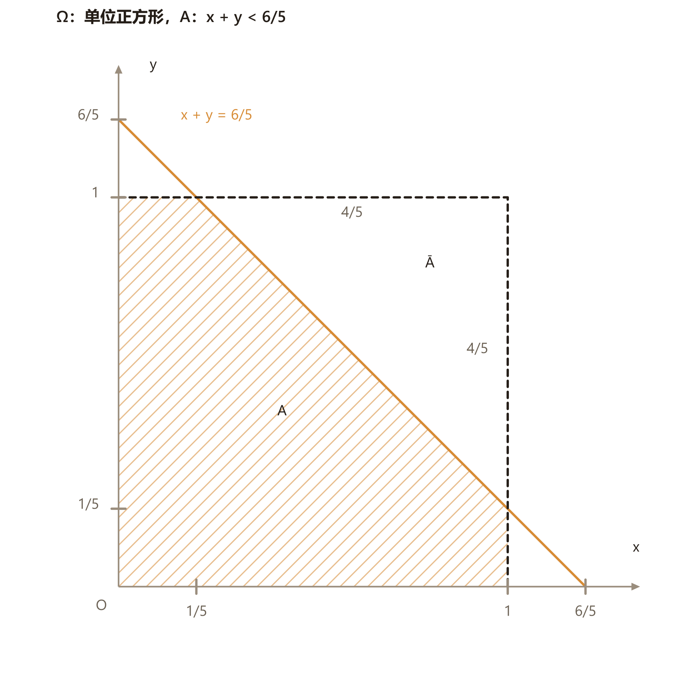

# 概统第 1 章 · 审阅清单

> 这篇是**草稿**（`draft: true`）：只在 `pnpm.cmd dev`（http://localhost:4321）里出现，官网产物里一个字都没有。
> 看完满意，把 `draft: true` 改成 `false` —— 那一步才是「上线」。这份清单是给你审阅用的，看完可以删。

---

## 一、现在这篇是什么状态

| 项目 | 现在 |
| :--- | :--- |
| **文件** | `src/content/notes/ptms-1-random-events-and-probability.md`，637 行，`draft: true` |
| **本地地址** | http://localhost:4321/notes/ptms-1-random-events-and-probability/ |
| **结构** | 6 个 `##`（1.1–1.5 五节 + 小结）、3 个 `###`、24 个 `####` 知识点 |
| **例题** | 16 个绿框（例 N）+ 5 个橙框（性质证明） |
| **公式** | 45 处块级公式，全部居中独占一行；KaTeX 渲染 **0 报错** |
| **表格** | 7 张（互斥/对立、事件运算、运算律、计数原理、古典/几何对照、公理、六条性质） |
| **图片** | 4 张：3 张手绘图 + 1 张**脚本新画**的几何概型图 |
| **小结** | 11 条，结论式、关键术语加粗、只用行内公式（对齐高数那 11 篇的写法） |

原文的正文**没有被改写**：逐行回查 488 行，只有下面「三、」里明列的 2 行是改写
（`DM-3` → `离散数学-3`、`PTMS-1` → 全名）；汉字数 6607 → 6619，净增的 12 个字全来自这两处。

### 从知识库搬过来时做的格式转换

| 项目 | 处理 |
| :--- | :--- |
| **frontmatter** | 换成站点字段：`category: 数学` / `subfield: 概率论与数理统计` / `difficulty: 基础` / `date: "2026-11-21"`（= 首次上网那天）/ `draft: true`。没填 `updated` |
| **标题层级** | `#`→`##`、`##`→`###`、`###`→`####`；标题里的编号（`1.1`、`1.2.1`、`1.`、`B.1`）全部去掉，站点目录自动编号 |
| **例题** | 21 个 `> [!NOTE]` → `:::example 例 N · 短标题`（16 个）/ `:::tip`（5 个性质证明） |
| **公式** | 原文 45 处块级公式全部挤在一行，改 `$$` 独占三行；**公式内容一字未改** |
| **图片** | 手绘图复制改名进 `public/notes-assets/`；正文改成 `` |
| **段内换行** | 「(1)(2)(3)」「A./B. 选项」这类原文靠换行分行的地方，站点会并成一行 —— 已在 10 处断成独立段落 |
| **其它** | 去掉 3 条 `---` 分隔线；`**思路：**` → `**思路**：`；`[[DM-3 计数]]` → 「离散数学-3 计数」 |
| **附录 A/B/C** | 你已删除（站点目录会把它们编成 `1.6 附录 A`，确实别扭）。知识库原文里还在 |

### 图片改名对照

| 原文件名 | 站内文件名 | 图注（我写的，可换） |
| :--- | :--- | :--- |
| `G-PTMS-1.1 A包含于B.jpg` | `ptms1-01-subset-of-b.jpg` | A 包含于 B：A 的样本点都在 B 中 |
| `G-PTMS-1.2 互斥事件与对立事件.jpg` | `ptms1-02-mutex-vs-complement.jpg` | 互斥事件与对立事件 |
| `G-PTMS-1.3 事件的运算.jpg` | `ptms1-03-set-operations.jpg` | 事件的运算：并、交、差 |
| `G-PTMS-1.4 几何概型例2.jpg` | **`ptms1-04-geometric-example.svg`（脚本新画）** | 几何概型例 2：单位正方形里 x + y < 6/5 的区域 A 与右上角的补集 |

---

## 二、这一轮补的三件事

### 1. 小结（新增，`## 小结`）

11 条，全是结论式的一句话，关键术语加粗，**只用行内公式、没有块级公式**（与高数那 11 篇的写法一致）：

1 试验与样本空间 · 2 随机事件（基本/不可能/必然） · 3 包含/相等/互斥/对立 · 4 并/交/差 ·
5 分配律与对偶律、差事件先去括号 · 6 古典概型与计数口径 · 7 三条解题套路 ·
8 几何概型与度量之比 · 9 频率、统计定义、公理化三条 · 10 六条性质与容斥 · 11「概率为 0 ≠ 不可能」

内容全部取自本篇正文（含例题评注里反复强调的易错点），**没有引入正文没讲过的东西**。
措辞你看看要不要按自己的口气改——这段是新写的，我在等你这句话。

### 2. 几何概型那张图改成脚本画的



用的是和高数那几百张图同一套工具（`scripts/build-plots.mjs`）。这张图要交代的全是**精确位置**，
正是脚本的强项：

- 单位正方形 Ω 的上边、右边画成虚线，左下两条边正好压在坐标轴上；
- 直线 `x + y = 6/5` 只画两个截距之间那一段，两端正好落在坐标轴上；
- 阴影区域 A 的上边界取 `min(1, 6/5 − x)`（用 `|a − b|` 写出 min），
  面积按积分核对是 **17/25**，和正文一致；
- 右上角补集 Ā 的两条直角边各标了 `4/5`；轴上的刻度是 `1/5`、`1`、`6/5`（不是 0.2 / 1.2）。

自动检查也跟上了：`node scripts/test-plots.mjs --only ptms1` 会验「直线确实过 (1/5, 1) 与 (1, 1/5)」
「正方形上边确实在 y = 1」等 5 个点，实测最大偏差 **0.02 px**。

> 原手绘图我没删，还在 `public/notes-assets/ptms1-04-geometric-example.jpg`（58 KB，SVG 是 8.2 KB）。
> 想换回手绘版：把正文那一行的 `.svg` 改成 `.jpg` 就行；确定不要了，把那个 jpg 删掉。
> **这张图值不值得换，请你按「换了之后是不是更好看」判**——高数那批的结论是：
> 函数的图像值得换，几何示意图的标注很难摆得像手绘一样自然。这张属于后者，
> 所以我把两版都留着了。

### 3. PTMS 后续 8 章已挂进课程规划

`src/data/curriculum.ts` 里「概率论与数理统计」现在是完整九章：

| 章 | 笔记 id | 状态 |
| :--- | :--- | :--- |
| 1 随机事件与概率 | `ptms-1-random-events-and-probability` | **已写，草稿** |
| 2 条件概率与事件的独立性 | `ptms-2-conditional-probability-and-independence` | 待发布 |
| 3 随机变量及其分布 | `ptms-3-random-variables-and-distributions` | 待发布 |
| 4 多维随机变量及其分布 | `ptms-4-multivariate-random-variables` | 待发布 |
| 5 随机变量的数字特征 | `ptms-5-numerical-characteristics` | 待发布 |
| 6 数理统计 | `ptms-6-mathematical-statistics` | 待发布 |
| 7 点估计 | `ptms-7-point-estimation` | 待发布 |
| 8 区间估计 | `ptms-8-interval-estimation` | 待发布 |
| 9 假设检验 | `ptms-9-hypothesis-testing` | 待发布 |

`draftTitles` 里也把这九条兜底标题写全了，所以学习路线页现在会把这条线**一次画完**
（1 章是草稿、2–9 章是灰色「待发布」）。以后写第 N 章，只要文件名是上表里的 id、
frontmatter 的 `title` 是「概率论与数理统计-N 章名」，路线页和页尾列表就自动接上，**数据不用再动**。

章与章之间的先修（`prereq`）我**没写**：按章号排已经表达了先后，等各章真写出来再补更准。

---

## 三、还需要你拍板的 2 处

### 1. 例题编号：每小节从「例 1」起，还是整章连续编？

现在**沿用原文**：1.2 有例 1–3、1.3 有例 1–6、1.4 有例 1–2、1.5 有例 1–5，
所以页面上会出现四个「例 1」。高数那 11 篇也是这个处理。要改成整章连续 1–16，
我可以统一重排并同步所有「例 N」交叉引用 —— 但那是动正文，得你点头。

### 2. 两处原文自己就对不上的引用（**我没动**）

1. **1.3 例 5（有放回 vs 不放回）的评注**：「与例7 是同一件事」—— 但 1.3 只有例 1~6，
   全章也没有例 7。按语义看大概是**例 6（抽奖券，先后次序不影响结果）**。
2. **1.4 的「注意」**：「这正兑现了 §1.1 的提醒『概率为 0 的事件不一定是不可能事件』」——
   这句提醒其实在 **1.5**（例 1 与它后面那条「注意」），1.1 通篇没提概率。
   （站内目录编号正好也是 1.1–1.5，所以 §1.1 这种写法本身不用改。）

---

## 四、这一篇之外动过的地方

| 文件 | 改了什么 | 为什么 |
| :--- | :--- | :--- |
| `src/data/curriculum.ts` | 概率论与数理统计：`planned: true` → 九章规划；`draftTitles` 补到九条 | 路线页才能把这条线画全，第 1 章也不会被标成「未编入路线」 |
| `scripts/build-plots.mjs` | `FIGURES` 末尾新增 `ptms1-04-geometric-example` | 上面那张图 |
| `scripts/test-plots.mjs` | `PROBES` 新增该图 5 个检查点 | 让「直线过 (1/5, 1)」这件事由脚本验，不靠肉眼 |
| `public/notes-assets/` | 新增 4 张图（3 张手绘 jpg + 1 张 svg） | 正文引用 |
| `概统-几何概型例2-预览.png` | 上面那张图的位图预览 | 只为在这份清单里能直接看到它；**审完可以连同本清单一起删** |

当前 `git status` 的预期结果：`curriculum.ts`、`build-plots.mjs`、`test-plots.mjs` 三个 **M**，
另外新增 1 篇笔记、`public/notes-assets/` 下 5 个图文件（4 张手绘 jpg + 1 张新 svg）、
这份清单和它引用的那张预览 png。

---

## 五、怎么看

```bash
pnpm.cmd dev          # 已经在跑就不用再开
```

打开 http://localhost:4321/notes/ptms-1-random-events-and-probability/ ，重点看：

- **左侧目录**：`1.1 → 1.5` 加一节「小结」，`1.2.1/1.2.2/1.2.3` 三层，知识点是「·」开头的条目；
- **21 个框**：绿框 16 个（例题）、橙框 5 个（性质证明）；
- **几何概型那张图**：鼠标悬停右上角有「放大」，点开能看全尺寸；
- **小结**：文末 11 条，看看口气要不要改；
- **学习路线** http://localhost:4321/notes/route/ ：数学分野里「概率论与数理统计」应该是 `1/9` 章
  （dev 里草稿也算可见；正式构建时是 0/9），点进去能看到九章的清单。

### 转正（把草稿改成正式稿）

把 `draft: true` 改成 `draft: false`。就这一步。然后：

```bash
pnpm.cmd release      # 构建 + 产物自检，看到「✅ 全部检查通过」就没事
```

### 以后改这张图

```bash
node scripts/build-plots.mjs --only ptms1      # 只重画这一张
node scripts/test-plots.mjs  --only ptms1      # 只验这一张（5 个检查点）
```

> 别直接 `pnpm.cmd plot`：那会把**所有**图全量重画一遍（66 张），没必要。

---

## 六、自检结果（都跑过了）

| 检查 | 结果 |
| :--- | :--- |
| **dev 真实页面** | `/notes/ptms-1-random-events-and-probability/` → **200**，`katex-error` **0 个**，无报错遮罩；21 个框、7 张表、4 张图、45 处居中公式全部在位 |
| **渲染管线** | 用站点同一套 remark/rehype 插件渲染：45 处块级公式全部识别为居中块级，507 处公式 0 报错 |
| **小结** | 11 条，全部为行内公式（无块级公式），列表正常生成 |
| **新图** | `test-plots --only ptms1` 5 个检查点最大偏差 0.02 px；填充面积按积分核对为 17/25 |
| **内容保真** | 逐行回查 488 行，只有明列的 2 行改写；汉字数 6607 → 6619 |
| **残留记号** | 无 `![[` / 无 `[[` / 无 `> [!` / 无一级标题 / 无 `---` 分隔线 / 无「附录」字样 |
| **块级公式定界符** | `pnpm.cmd check:math` 全文通过（只剩模板文件里两条历史提示，与本文无关） |
| **加粗渲染** | 本篇 0 处异常 |
| **课程数据** | `--experimental-strip-types` 直接 import `curriculum.ts` 验过：九章在、章号 1–9、`planned` 已去掉 |

> 顺带发现（**不是这篇的问题**）：`cso-2-data-representation.md` 里有一处加粗没闭合
> （「负数\*\*有两种等价算法」），站点上会原样露出两个星号。要我一并修掉吗？
